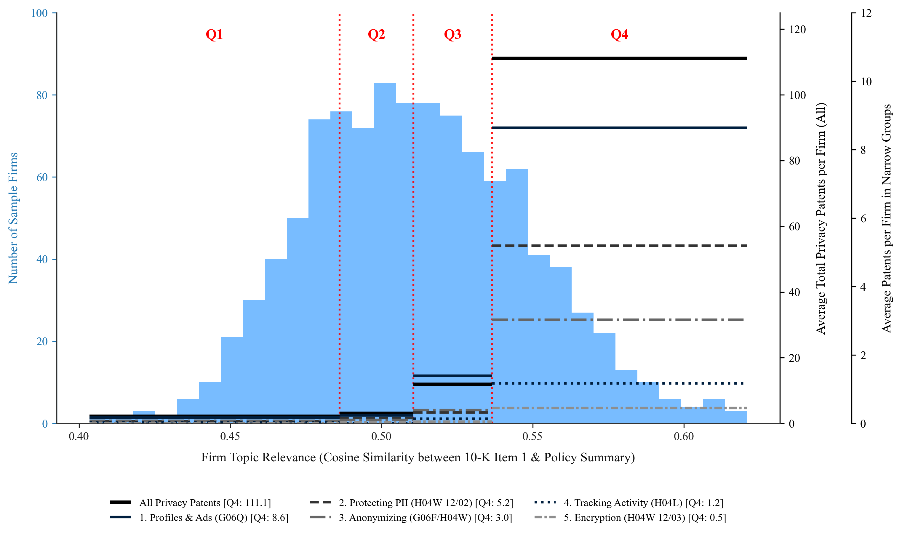
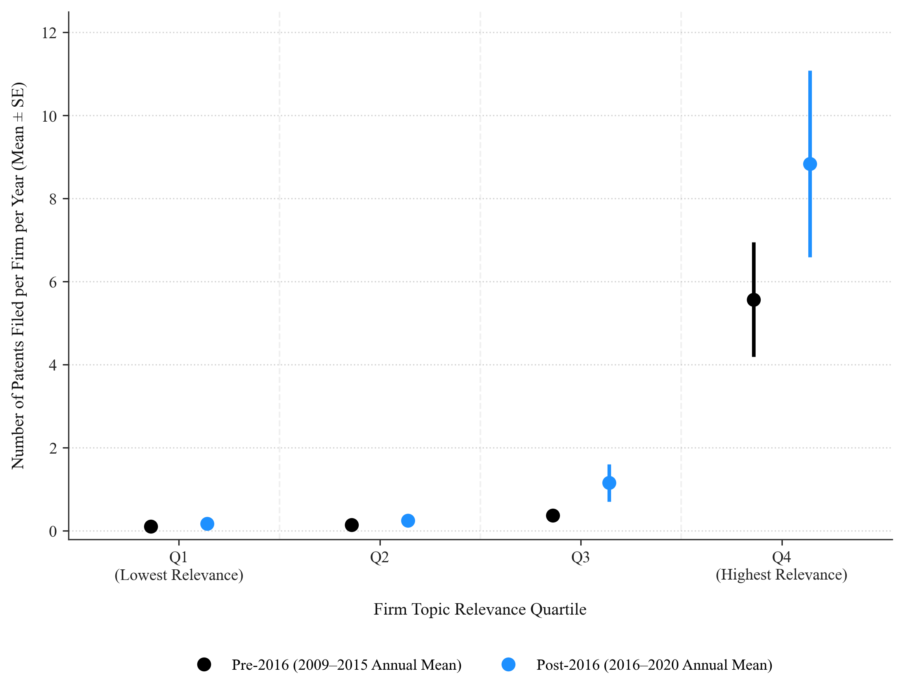
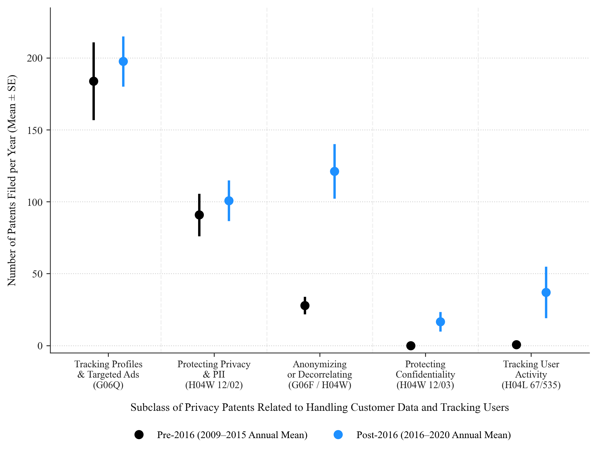
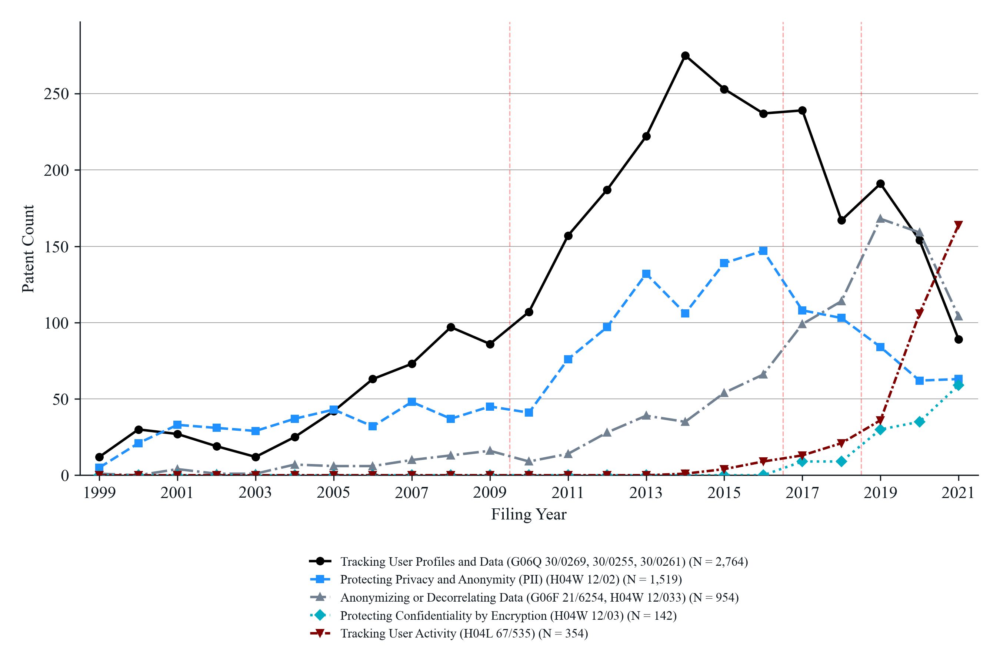
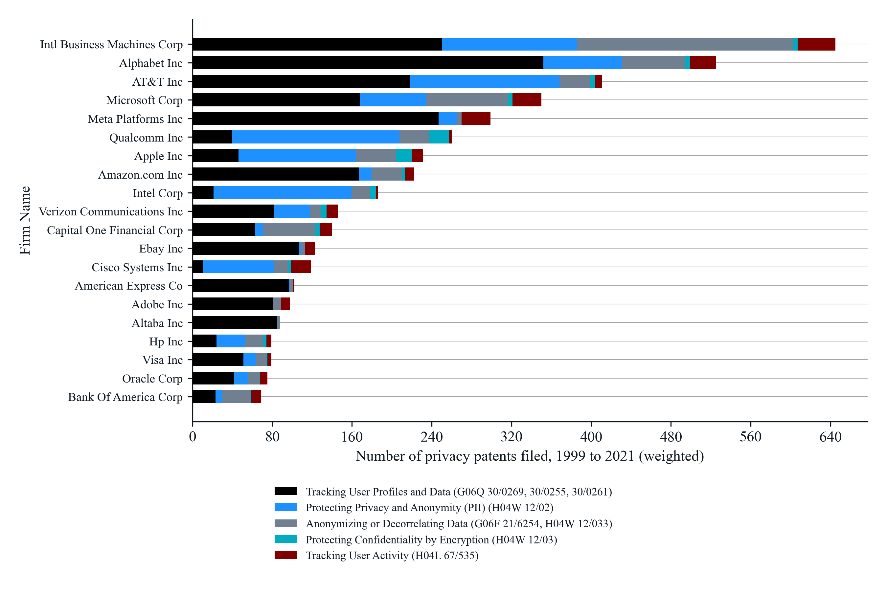
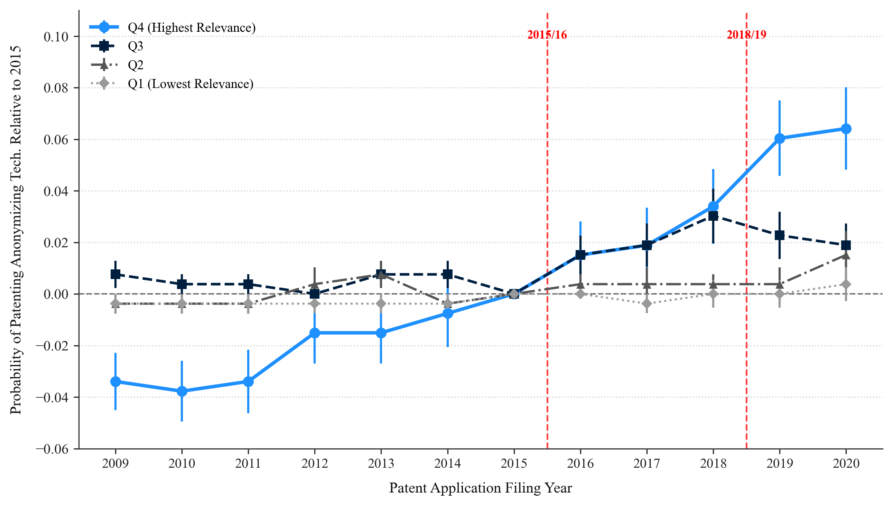
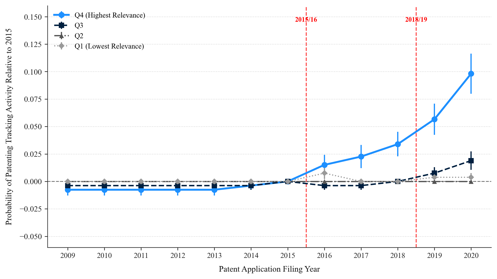

# Opening the Black Box of Large Language Models in Text-based Measurement: Staged Pipelines with Verifiable Checkpoints

**Authors:** Milan Miric, Albert Roh, Nan Jia  
*University of Southern California, Marshall School of Business*  

**Proposal for Special Issue:** AI-Enabled Frontiers in Organizational Science (*Organization Science*)  
**Repository:** [https://github.com/HC-Geopolitics-Innovation/LLM-Text-Analysis-and-Synthesis](https://github.com/HC-Geopolitics-Innovation/LLM-Text-Analysis-and-Synthesis)  

**This document:** the full-methodology version of the proposal.

---

## 1. The Data Opportunity and Black-box Risk in LLM-based Measurement: A Staged Pipeline Approach

Researchers increasingly use large language models (LLMs) to construct variables from text (Gilardi et al. 2023, Rathje et al. 2024, Asirvatham et al. 2026). The appeal is clear: long noisy documents, which traditional techniques such as topic models or embeddings can only handle after extensive pre-processing (Grimmer and Stewart 2013, Hannigan et al. 2019, Dell 2025), such as 10-K filings and policy reports, can now be processed by LLMs at scale and at lower cost (Kim et al. 2023, Jha et al. 2024, de Kok 2025, Dell and Rambachan 2026). This opens research contexts that were previously impractical to study at very large scale. However, when LLMs are used as an end to end solution: by providing a model with entire documents and asking it to return a numerical quantity, the LLM becomes a black box in that the final output is the only observable checkpoint. Researchers cannot see which parts of a document a measure rests on, what was omitted, or how judgments are made at intermediate stages. In addition, the outcome is sensitive to unobserved choices, making it difficult to reproduce.

This opacity creates three risks. (1) Validation. Validating only the final output shows how often a measure is accurate in specific cases, but provides no systematic indication why it may have not been accurate. These aggregate measures can mask systematic errors: Carlson and Burbano (2026) show how these measures need to be validated by creating a heterogeneous set of approaches and then validating the outcomes on those approaches. (2) Reproducibility. Rerunning an end-to-end process may not return the same measure when proprietary models are updated or retired; and because the process produces no intermediate outputs, other researchers cannot leverage the intermediate outputs generated by that process, and instead must re-create the entire effort. (3) Heterogeneity within documents. An end-to-end measure collapses each document into a single output, concealing variation inside it. Researchers do not have control over which portion of a text document is driving the final outputs of the large language models, or whether for some parts of the model, the model is creating summaries and not processing these document equally. Because these measures enter subsequent analyses as variables, the risk is not merely noisy measurement but biased analysis: when errors are systematic, a finding may reflect how a measure was produced rather than the phenomenon it is meant to capture. One might expect these risks to fade as models gain longer context windows and stronger reasoning. However, many of these concerns will remain. A more capable end-to-end model will only expose the final output, but the concerns will emerge from opacity and a lack of control over design choices, rather than from a limited capability.

Recent work has acknowledged and begun to devise methodologies to overcome these risks. Carlson and Burbano (2026) propose a way of mitigating these concerns by systematic sensitivity analysis, including generating families of prompt variations, running them across models, and reporting the range of resulting downstream estimates. This approach reveals how much conclusions depend on implementation choices, but also focuses on a single albeit common task of textual classification. Processing long text documents and extracting specific insights nests a text classification choice within a black box of other data parsing, processing and synthesis functions. Using large language models for these other more complex textual analysis tasks, creates more opportunities for the models to make choices. This is part of a broader literature which has emerged showing the idiosyncrasies of how these models can make individual choices, but when combined as part of a carefully crafted workflow can mimic at scale or improve what human workers would have achieved (Csaszar et al. 2024, Doshi et al. 2025, Dell’Acqua et al. 2026). These studies have demonstrated important AI use in specific tasks, many of which could be easily integrated into an AI pipeline. However, the LLM processing of large information rich text documents which could enable researchers to answer new and important questions, requires finding a way to integrate and apply these methodologies as part of a pipeline which could in turn avoid introducing systematic noise and bias through black box algorithms. We propose a complementary approach.

Instead of using an end-to-end approach (e.g. using an LLM to parse, summarize and process an entire document) and varying the input (prompt text), we propose opening up the black-box algorithm and decomposing LLM-based measurement generation into a pipeline of discrete stages, each producing an inspectable intermediate output. This design addresses each risk. For validation, each stage can be checked against its own benchmark, allowing researchers to detect systematic error and locate where it arises. For reproducibility, a change in model, or a new construct definition, is confined to one stage, so researchers can reuse the outputs of earlier stages and revalidate only what changed; the same structure lets sensitivity analysis vary one stage at a time and attribute any change in results to it. For heterogeneity, intermediate outputs are retained for individual passages rather than whole documents, so aggregate measures can be traced back to their components and re-aggregated by contributor, section, or other conditions of interest.

Decomposing the process also allows each stage to use the tool best suited to it.

LLMs excel at two types of tasks: (1)

Synthesizing text, that is, reading long, noisy passages and condensing them into short, information-dense outputs such as summaries or statements of position; and (2)

Generating code, that is, producing machine-readable instructions that can be systematically executed and tested. We use LLMs for synthesis and rely on established methods, such as embeddings and similarity measures, where they

have proven routines, validation standards, and verifiable properties, applying them to condensed or sentence-level text rather than to whole documents. The pipeline thus combines the core strengths of LLMs with the known properties of established tools rather than replacing one with the other. Code generation also makes the pipeline easier to extend to other use cases: because the pipeline’s code is available in a public repository, other researchers can use coding agents to adapt it to their own data and questions (Section 8).

We demonstrate the application of this approach in a setting relevant for organization researchers: how congressional debate over regulating a technology relates to changes in the innovation trajectories of firms exposed to it. Studying this question requires understanding and quantifying the nature of the policy debate which exists and how it might be leveraged by researchers. This also requires measuring the extent to which the issues being discussed in the debate represent threats or opportunities for firms.

We focus on the policy debate over user data privacy that emerged in the mid 2010’s related to technology companies collecting customer data, the Cambridge Analytica scandal related to the use of Facebook data by third party companies, and document the relationship between the debate of policy makers which coincided with shifts in the innovation policy of firms. Studying this question requires identifying which firms were likely impacted by this debate, so they can be compared with firms that credibly were not. That information is embedded in two kinds of long, noisy documents: congressional hearing transcripts, which average roughly 40,000 words and alternate between testimony and questioning from many participants, and firms’ 10-K filings. The setting puts all three risks at stake: Because the exposure measure assigns firms to treatment and control groups, systematic error in it would bias the estimated effect; because other researchers may want to extend the measure to studying other policies, it must be reproducible in parts; and because a committee’s stance may reflect its members broadly or only a few vocal participants, heterogeneity within hearings matters for interpretation.

## 2. Our Framework: A Staged Pipeline for LLM-based Measurement

We develop a framework that illustrates how LLMs can be used within a data pipeline without ceding full control to them. After data preparation, the pipeline proceeds through three stages (text summarization, stance extraction, and relevance to firms’ business areas), each composed of discrete steps that produce intermediate outputs. Each output can be validated, reused, and disaggregated, addressing the three risks above. Researchers can adapt these stages to extract different insights or apply them to data of their choice.

### 2.1. Overview of Data Pipeline and Processing Stages

- **Stage 1:** Data Preparation: Assembling and structuring the corpora before any LLM is applied. We parse congressional hearing transcripts from the U.S. Government Publishing Office into speaker-attributed turns, extract business descriptions (Item 1) from S&P 500 firms’ 10-K filings, and retrieve independent C-SPAN hearing abstracts as a validation benchmark. Defects such as undigitized transcripts are flagged rather than dropped, so every exclusion can be inspected.
- **Stage 2:** Text Summarization: Taking large, complex textual documents that contain considerable noise alongside embedded data, partitioning them into chunks, and using LLMs to generate, synthesize, and aggregate textual summaries. We demonstrate this approach on congressional hearing transcripts (Albert to confirm – see Section 6 for data sources and processing), summarizing long and convoluted documents into concise summaries that can subsequently be used for text classification, topic modeling, or semantic distance estimation in more reliable ways.
- **Stage 3:** Stance Extraction: Using LLMs to identify the positions of different actors (e.g., members of Congress, firms, government agencies) on specific topics, allowing researchers to distill the nuances of arguments and positions that each individual takes on an issue. We apply this to congressional hearings to identify the stances of members of Congress on key issues, classified as support, concern, or neutral, in a format that can be utilized in subsequent research.
- **Stage 4:** Debate Relevance to Firm Business Areas: Using the distilled stances of individuals within the debate, we create a synthesis of the policy debate. This synthesis, or an embedding of the underlying statements, can then be compared to the business descriptions of firms to identify which firms are exposed to the debate. In our empirical context, this means framing the key issues that policymakers are debating and attempting to regulate. We then compare this to the business descriptions (Item 1) in firms’ 10-K filings. This allows us to identify and study firms that are exposed to the debate versus those that are not.
### 2.2. Adapting the Pipeline for Other Research Questions

Because each stage is modular and its code is available in our repository, researchers can reuse the pipeline in part or in full. For example, they can apply the same stages to hearings of other committees or to other policy topics, or replace the stance-extraction stage to measure a different construct while keeping data preparation and summarization fixed.

Furthermore, LLMs’ ability to generate code lowers the cost of such adaptation: these models also excel at writing code that is automatically tested, verified, and validated. By providing our pipeline’s code and methodologies in a GitHub repository where the codebase is available, researchers can use their own coding agents to either improve upon our methodology or apply this methodology to their own setting and data.

We believe this provides a framework that can guide how large language models can be used to adapt and deploy research pipelines in the future.

## 3. Current Status of Project

We have currently developed a research pipeline, focused on the specific question outlined above: the relationship between congressional debate about user data privacy and the innovation trajectory of technology companies, made available on the associated GitHub repository for this project. This pipeline demonstrates the transformation from raw transcripts of congressional hearings to a series of research outputs: textual summaries, summaries of perceived priorities (support/concerns identified by policymakers), and an index for policy relevance for publicly listed firms. This is a prototype of what can be done (using one set of approaches and design choices in the LLM pipeline). However, as we aim to show, and much like we are advocating, that this pipeline could be verified, adopted or adapted to other projects and applications.

### 3.1. Expected Deliverables

- **Reproducible LLM Data Pipeline for Text Summarization, Stance Extraction, and Topic Relevance**
- **Public Datasets for Subsequent Research: From the data of 36K Congressional Hearings from 1995–2025 (currently 2,352 hearings for the House and Senate Science Committees): full chunked text, intermediate summaries, list of topics discussed, summarized stances, an index of committee stances on topics discussed in hearings, and an index of relevance of those topics for publicly listed firms based on Item 1 business descriptions (1995–2025).**
- **Illustrative Empirical Results: Demonstration of the empirical results of the privacy regulation applied to investigate the impact of privacy regulation on the trajectory of corporate innovation.**
- **Instructions and Framework for Deployment for Follow-on Research**
### 3.2. Datasets (Outputs from Focal Research Project)

- **Text Summaries for Congressional Testimony from 1995 to 2025:**  - Intermediate outputs for verification and replication: Cleaned and chunked testimony, summarized testimony chunks, finalized text summaries.
- **Index of Committee Stances in Congressional Debate:**  - Intermediate outputs for verification and replication: Topics within congressional debate, filtered chunks focused with a stance on a focal topic, summarized positions on a focal topic, and an aggregated index of committee stances on topics discussed.
- **Index of Relevance of Congressional Debate for Publicly Listed Firms:**  - Intermediate outputs for verification and replication: Summarized congressional stances and company business descriptions based on 10-K filings, relevance index for individual company filings and congressional topic stances, and an aggregated index for topical relevance.
### 3.3. Example of Empirical Application

- **Demonstration of the Policy Relevance Index: Demonstrating the use of the constructed policy relevance index regarding the impact of congressional debate on the innovative trajectories of publicly listed firms. Using the context of the Cambridge Analytica scandal, we demonstrate how these tools can be used to identify firms that were in treated or control groups, allowing for an event study design to examine changes in innovation trajectories following these events.**
### 3.4. Key Risks and Limitations in Implementation

We have tested the viability of our empirical strategy and have developed a working prototype of its deployment. We have confidence that this methodology will provide useful outputs. We have a goal of demonstrating this with as large a dataset as possible (the population of congressional testimony, public firm 10-Ks, and major policy topics discussed). We also recognize the potential for different ways of constructing and aggregating data. Because each of these approaches is time-consuming, we are committed to implementing all of them, but may become constrained in the number of individual specifications we can add.

## 4. How This Advances Organizational and Social Science

Long-form documents such as congressional hearings, regulatory filings, and corporate disclosures record how organizations and governments deliberate, yet they have been difficult to use: established text methods work best on short, information-dense text, and end-to-end LLM use relaxes this constraint only by introducing opacity. Our approach relaxes this constraint while alleviating the opacity of end-to-end use. If successful, it advances organizational research in three ways.

First, it provides a pipeline that turns long, noisy documents into measures whose construction can be inspected stage by stage. LLM-based measures thus become auditable research objects rather than outputs taken on trust, and the pipeline offers a template for reporting them, including intermediate outputs, stage-level validation, and stage-specific sensitivity analysis.

Second, it provides a public research dataset: summaries of more than 2,300 congressional hearings, a panel of legislators’ stances by topic, and firm-level measures of exposure to policy debate. Because intermediate outputs are released alongside the final measures, other researchers can build on any stage, for example by re-aggregating stances by member or relating firm exposure to new outcomes.

Third, the framework enables a new form of replication. Because the pipeline is shared as a modular repository, researchers can direct coding agents to rebuild or adapt it at low cost. And because each stage produces outputs that can be compared with ours, a replication need not succeed or fail as a whole: discrepancies can be located at the stage where they arise. Replication thus shifts from an all-or-nothing comparison of final results to a stage-by-stage check.

Together, these contributions allow researchers both to do existing work better and to do new work. Existing work improves because the risks identified above become testable: when each stage is validated, systematic error can be detected and located before it biases a finding, and when a replication can localize discrepancies, disagreements over results can be traced to specific choices rather than left unresolved. New work becomes possible because researchers no longer face a choice between avoiding long-form documents and relying on measures that cannot be checked. Hearings, regulatory proceedings, and corporate disclosures, which record how organizations and governments deliberate, can support credible measures at scale; and because outputs are retained within documents, researchers can ask not only what a collective position is but who shapes it. The aim is not more research from the same materials, but better research from materials previously out of reach.

---

## 5. Overview of Steps in Large Language Model Enabled Research Pipeline

Here we illustrate the detailed pipeline, split across three related tasks (or problems) solved by LLMs.

---

### 5.1. Long-Document Text Summarization

Many textual documents contain important information but also contain noisy and complex textual data. Text summarization takes such a document and uses a large language model to write a concise, information-rich account of it that can be utilized in subsequent research tasks. In our pipeline, that account is the hearing summary from which Section 5.2 extracts the topics of debate, so what the summary keeps and what it drops determines what every later step can see.

Off-the-shelf models can summarize an uploaded document in a single call. However, summarizing a large corpus into consistent and representative summaries requires an engineered pipeline, for two reasons. First, long documents still exceed the context limits of economical, open-weight, or local models, which are precisely the models that a researcher can run over thousands of documents at a fixed cost; the researcher must therefore either partition and sequence the text through the model deliberately or accept opaque, automated chunking. Second, long documents move across topics and speakers, so each input must be as coherent as possible for its summary to be faithful; even when a whole document fits in the context window, cleaning and structured partitioning improve the fidelity and clarity of the result. Carefully designing and partitioning this process ensures that data extraction remains reliable, transparent, and reproducible regardless of underlying model advances.

#### 5.1.1. Overview of Processing Pipeline

A pipeline to manage this process involves three decisions, which Figure S1 lays out in processing order:

- **Understand Document Structure and Define Semantic Partitioning:** Researchers must first decide what the final summary has to preserve, because the research question determines whether it should capture broad themes, particular arguments, or statements attributed to individual actors. Long textual documents often have a particular structure, and the chunking strategy should follow it. Context-aware chunking uses meaningful units already present in the source, such as a document section or a speaker's uninterrupted contribution, and is the first choice. When such units cannot be identified, recursive structure-aware splitting falls back on paragraphs and then on sentences. When neither is available, a fixed-size sliding window over characters provides a simpler fallback, but it can divide an argument or separate it from its speaker. The units are then grouped into model inputs that fit a chosen context window, leaving room for the instructions and the generated text.
- **Summarize and Combine the Inputs:** Each chunk of text is provided to an LLM with instructions outlining the desired format of the summary and the key information that should be extracted. There are two standard ways to combine the results. In the "map-reduce" approach, each chunk is summarized independently in a map stage, and the segment summaries are combined into one document summary in a reduce stage; when the segment summaries are too long to enter one call, intermediate collapse steps shorten groups of them first. Separate prompts distinguish reading source text from combining existing summaries. This approach runs in parallel at scale, but it can lose context that spans two chunks. In the "refine" approach, the model updates a running summary as successive chunks arrive, which maintains continuity but requires sequential processing and can carry an early error into every later update. Which approach suits a corpus depends on the documents and on the intended output.
- **Model Selection, Validation, and Deployment:** This is inherently an iterative process. Outcomes depend on the choice of model, the prompt, and the aggregation rules, so researchers prototype alternative models and settings on a few documents before scaling. The intermediate outputs make these choices inspectable: the partitions show what each call saw, the segment summaries show what survived the first pass, and the lengths, call counts, and retention of speaker names show the cost and the character of each model's output. Where an external reference exists, such as a human-written abstract, the summaries can be validated against it. Once the choices are fixed, the pipeline is deployed across the entire corpus, and every intermediate artifact is archived: the cleaned source segments, the chunk summaries, the aggregated outputs, and a log of every model call. This record lets a researcher inspect one component or rerun one transformation with a different model without repeating the whole run.

**Figure S1. The Text Summarization Pipeline, From Transcript to Hearing Summary.**

<p align="center"></p>

*Notes*: The chart follows one hearing through the three stages of the pipeline. In stage (1), the raw transcript is parsed into speaker turns and consecutive turns are packed into chunks of at most 6,144 tokens. In stage (2), the model summarizes each chunk in one call (map). In stage (3), groups of segment summaries are condensed when they would exceed one call (collapse), and one final call writes the hearing summary (reduce). Tape-shaped blocks are documents as text; shaded rounded blocks are text written by the model; blue blocks tagged "LLM" are the only steps in which the model is called, with Qwen3.5-4B in production; the remaining blocks are computations that a reader can rerun. The counts in the chart are those of the completed run on 2,352 hearings. This figure appears only in this long version.

*Source*: `R - Results/figures/T - Three Step Text Analysis Pipeline/T1 - Text Summarization/fig_text_summarization_flowchart.tex`; counts from the production run described in Section 5.1.2.

#### 5.1.2. Application: Summarizing Long Text Congressional Hearings

We apply this pipeline to a corpus of U.S. congressional hearing transcripts. Hearings record policy deliberations among legislators and invited witnesses, including scientists, corporate executives, and industry stakeholders, and they have served as a source across research settings (xxx; xxx; xxx). However, the transcripts are long and saturated with procedural preamble and formulaic courtesies that dilute the substantive debate. Our sample is the 2,352 hearings of the House Committee on Science, Space, and Technology and the Senate Committee on Commerce, Science, and Transportation with usable digitized transcripts on GovInfo, held between 1996 and 2025 and drawn from the 36,378 hearings that GovInfo lists for 1995 to 2025. The median transcript contains 36,505 words. A transcript opens with introductory material and participant lists, followed by opening statements, witness testimony, exchanges between legislators and witnesses, and material inserted into the record.

The research question that the pipeline serves, how congressional debate on regulating a technology relates to firms' innovation in that technology, needs from each hearing the particular practices and proposals discussed and who took a position on them. Section 5.2 builds the topic codebook and the legislators' stances from these summaries and turns, and Section 5.3 condenses the stances on consumer data privacy into the policy summary that is compared with firms' business descriptions, which the toy example in Section 7 links to firms' privacy patents. A title or an opening statement names the announced subject, but it cannot supply the positions taken in later exchanges, and procedural recognitions and repeated courtesies occupy space without adding substance. We therefore process the retained hearing record in sequence and ask the model to distinguish substantive discussion from procedural segments.

To show each step concretely, we use *Facebook, Social Media Privacy, and the Use and Abuse of Data* (`CHRG-115shrg37801`) as a running example. This joint hearing of the Senate Judiciary and Commerce committees on April 10, 2018 examined Facebook's handling of user data after the Cambridge Analytica revelations, with testimony from Mark Zuckerberg. Its stored text contains 243,434 words, 385 pages in the printed record, including written material appended to the hearing. The linked [running example](<../T - Three Step Text Analysis Pipeline/T1 - Text Summarization/T1.4 - Running Example [Facebook-Cambridge Analytica Scandal Hearing]/README.md>) provides the source, the parsed records, the exact model inputs, and the recorded outputs; it includes an intermediate collapse stage and a matched C-SPAN abstract, so that both the aggregation and the validation can be followed on one hearing. The same hearing continues as the running example of Appendices A.2 and A.3.

**1. Parse the transcript into speaker records.** We downloaded each transcript and its MODS metadata through GovInfo's API and extracted the fixed-width text from the transcript's HTML wrapper. Because the research question needs legislators' contributions distinguished from witness testimony, together with the exchanges that give them context, the *speaker turn* is the unit we preserve. The downloaded text does not label turns, so we recover them from a recurring formatting pattern: paragraphs begin with at least four spaces, and a turn opens with a title and a surname, such as `Chairman Grassley.` or `Mr. Zuckerberg.` in this hearing. Python reconstructs paragraphs from the indentation, starts a new record at each recognized opening, and matches detected surnames to the participant list in the metadata, attaching Bioguide identifiers to legislators; witnesses keep their transcript label. We remove paragraphs with dot leaders, which mark contents and index entries, drop records flagged as written questions for the record (`qfr`), strip page markers, and standardize whitespace. The [parsed examples](<../T - Three Step Text Analysis Pipeline/T1 - Text Summarization/T1.4 - Running Example [Facebook-Cambridge Analytica Scandal Hearing]/T1.4.1 - Example - The Facebook Hearing Step by Step.ipynb>) show these fields and the rules, which require no LLM calls.

For the Facebook hearing, the [source text](<../T - Three Step Text Analysis Pipeline/T1 - Text Summarization/T1.4 - Running Example [Facebook-Cambridge Analytica Scandal Hearing]/01 - Inputs/source.txt>) yields 8,192 paragraphs. Removing 40 dot-leader paragraphs and grouping the remainder produces [903 speaker records](<../T - Three Step Text Analysis Pipeline/T1 - Text Summarization/T1.4 - Running Example [Facebook-Cambridge Analytica Scandal Hearing]/01 - Inputs/parsed_turns.json>), each with the attributed speaker, the member identifier where available, the section label, and the text in transcript order. The output also reveals a limitation: the parser flags no record as `qfr`, although the appendix contains written responses, which therefore remain attached to Grassley's final record and enter summarization.

**2. Group consecutive speaking turns into model inputs.** Preserving turns prevents a contribution from being cut arbitrarily. However, summarizing each turn on its own would detach an answer from the question that explains it, and because the map stage summarizes each input independently, later aggregation cannot restore context that the segment summaries omitted. We therefore pack neighboring turns, in order and intact wherever possible, into inputs of at most 6,144 tokens, measured with the summarization model's tokenizer. This window leaves room for the instructions and the generated text, fits the context limits of the four models we compared (`Qwen/Qwen3.5-4B`, `meta-llama/Llama-3.2-3B-Instruct`, `google/gemma-4-E4B-it`, and `meta-llama/Llama-3.1-8B-Instruct`), and reduces the number of calls relative to one call per turn. When the next turn would exceed the window, a new chunk starts; a turn that exceeds the window on its own is divided at paragraph boundaries and, failing that, at token boundaries, and the [chunking function](<../T - Three Step Text Analysis Pipeline/T1 - Text Summarization/T1.2 - Process Entire Sample Congressional Hearings/T1.2.1 - Production - Summarize the Sample in Shards.ipynb>) records the resulting lengths and every split.

The running example produces [55 chunks](<../T - Three Step Text Analysis Pipeline/T1 - Text Summarization/T1.4 - Running Example [Facebook-Cambridge Analytica Scandal Hearing]/01 - Inputs/Chunks/chunks.md>). The [second chunk](<../T - Three Step Text Analysis Pipeline/T1 - Text Summarization/T1.4 - Running Example [Facebook-Cambridge Analytica Scandal Hearing]/01 - Inputs/Chunks/chunks_01-10.md#chunk-02>) holds nine records and 5,898 tokens, including Zuckerberg's opening statement and his exchange with Grassley on whether Facebook had required audits to confirm the deletion of improperly transferred data, so that the model sees the question and the reply together. Boundaries are set by length, so a question and its answer can still fall in different chunks, and chunks 8 to 14 divide one long record of submitted letters and statements labeled Grassley. The saved inputs make these exceptions visible; preserving the speaking turn is the rule, and splitting is used only to fit the window.

**3. Summarize each chunk.** Before production, the [model-comparison notebook](<../T - Three Step Text Analysis Pipeline/T1 - Text Summarization/T1.1 - Process Prototyping and Evaluation/T1.1.2 - Compare - Four Models on Five Hearings.ipynb>) ran the four candidate models on the same five hearings, chosen near the 10th, 30th, 50th, 70th, and 90th percentiles of transcript length, and recorded processing time, call counts, summary lengths, and the retention of speaker names. The comparison profiles feasibility and the character of each model's output; it does not establish accuracy, which we judged by reading a small set of summaries. We selected `Qwen/Qwen3.5-4B` in bfloat16 precision for production. Each chunk then enters one model call. The [map prompt](<../T - Three Step Text Analysis Pipeline/T1 - Text Summarization/T1.4 - Running Example [Facebook-Cambridge Analytica Scandal Hearing]/01 - Inputs/prompts.md#map-prompt>) requests about 150 words on the subjects discussed, the positions attributed to named speakers, and the numbers and legislation copied from the input, which are the fields later steps need to distinguish policies and speakers; for a purely procedural or ceremonial segment it requests one sentence, so that such segments shrink without the model inventing substance. These are instructions to the model, not guarantees that every requested detail survives. In the example, 55 calls produce [55 segment summaries](<../T - Three Step Text Analysis Pipeline/T1 - Text Summarization/T1.4 - Running Example [Facebook-Cambridge Analytica Scandal Hearing]/02 - Outputs/outputs.md#map-01>).

**4. Condense the segment summaries when necessary.** The segment summaries must be brought together so that one call can write an account of the whole hearing. For long hearings, however, even these shorter summaries can exceed the 6,144-token window when combined. Python checks their combined length in transcript order; when it is too long, it groups consecutive summaries by token count and asks the model to condense each group with the [collapse prompt](<../T - Three Step Text Analysis Pipeline/T1 - Text Summarization/T1.4 - Running Example [Facebook-Cambridge Analytica Scandal Hearing]/01 - Inputs/prompts.md#collapse-prompt>), which identifies the input as existing summaries, requests about 200 words retaining named speakers, their positions, numbers, and legislation, and instructs the model not to draw a conclusion about the hearing as a whole, since each group covers only part of it. The check repeats on the condensed accounts for up to eight rounds, and hearings whose segment summaries already fit skip the step. In the Facebook example, the 55 summaries are grouped as 1 to 23, 24 to 45, and 46 to 55 into [three condensed accounts](<../T - Three Step Text Analysis Pipeline/T1 - Text Summarization/T1.4 - Running Example [Facebook-Cambridge Analytica Scandal Hearing]/02 - Outputs/outputs.md#collapse-01>), which fit together, so one round suffices. Each condensation can omit details; we therefore retain both the segment summaries and the intermediate accounts, so that readers can see what survived.

**5. Produce the hearing-level summary.** In the reduce stage, the model receives the segment summaries, or their condensed versions, in transcript order in a single call. The [reduce prompt](<../T - Three Step Text Analysis Pipeline/T1 - Text Summarization/T1.4 - Running Example [Facebook-Cambridge Analytica Scandal Hearing]/01 - Inputs/prompts.md#reduce-prompt>) requests an account of 200 to 250 words covering the hearing's purpose, main subjects, speakers' positions, disagreements, and key numbers and legislation, and it instructs the model to omit details that the supplied summaries do not establish. The word range is a prompt target; generation is capped at 512 tokens of the summarization model's tokenizer, which keeps the output short for downstream text analysis and within the input limits of BERT-based models such as BERTopic, and the pipeline removes an incomplete final sentence when the cap is reached. For the Facebook hearing, the [final summary](<../T - Three Step Text Analysis Pipeline/T1 - Text Summarization/T1.4 - Running Example [Facebook-Cambridge Analytica Scandal Hearing]/02 - Outputs/outputs.md#final-summary>), reproduced below, contains 264 words and 359 tokens. The complete sequence is 55 transcript chunks, 55 segment summaries, three condensed accounts, and one hearing summary, in 59 model calls; the example export reconstructs the inputs and verifies all 59 user-prompt hashes against the production log.

> **The recorded final summary of the Facebook hearing** (reduce stage, 264 words, 359 tokens).
>
> On April 10, 2018, a joint Senate hearing addressed Facebook's data privacy, centering on the Cambridge Analytica scandal where approximately 87 million users' data was scraped. Mark Zuckerberg testified, apologizing for the failure to notify victims and acknowledging that while changes were made in 2014, he failed to prevent harm from fake news and foreign interference. He confirmed the Internet Research Agency spent $100,000 on ads seen by 11 million people and that around 200 apps were suspended pending audit. Zuckerberg stated Facebook serves over 2 billion users with $40 billion in 2017 revenue, emphasizing community protection over profits. He denied selling data to advertisers but acknowledged allowing targeted placement.
>
> The hearing also covered content moderation and political neutrality. Zuckerberg detailed data collection practices and explained that content visibility adheres to Community Standards focused on Safety, Voice, and Equity, explicitly excluding political party affiliation from hate speech definitions. Regarding bias, Facebook reported that an investigation into the "Trending Topics" feature found no systematic bias, with approval rates for conservative and liberal topics being "virtually identical." On election integrity, Zuckerberg noted tracking 40+ elections, removing 70 Facebook and 65 Instagram accounts controlled by the Russia-based Internet Research Agency, and finding no evidence of Russian involvement in the "Release the Nunes Memo" campaign as of February 7, 2018.
>
> Senators questioned the need for federal standards, including the Honest Ads Act and GDPR-style controls, while Zuckerberg supported a 72-hour breach notification rule but refused to disclose his hotel name or messenger contacts. The hearing concluded with a recess, leaving the committee to consider stronger legislation versus self-regulation.

**6. Apply the procedure to the corpus.** Once reviewed examples meet the study's needs for content and quality, the procedure is scaled to the full corpus. The [production notebook](<../T - Three Step Text Analysis Pipeline/T1 - Text Summarization/T1.2 - Process Entire Sample Congressional Hearings/T1.2.1 - Production - Summarize the Sample in Shards.ipynb>) divides the sample into ten disjoint batches and saves the result after every hearing, and the [assembly notebook](<../T - Three Step Text Analysis Pipeline/T1 - Text Summarization/T1.2 - Process Entire Sample Congressional Hearings/T1.2.2 - Production - Assemble the Summaries.ipynb>) combines the batches and checks coverage, duplicates, failures, and summary lengths. The run produced 2,352 hearing summaries from 26,722 chunks and 29,264 model calls. The median hearing required 11 chunks; 2,259 hearings went directly from map to reduce, and 93 required one collapse round. The final summaries have a median length of 396 tokens, and the recorded processing time sums to 112.7 hours across the ten batches.

**7. Validate the summaries against independent human-written abstracts.** A fluent summary can omit central points or add claims that the transcript does not support, so we assess whether the summaries capture the hearings' substantive content. Overlap measures such as ROUGE compare words and sequences with a human reference and do not by themselves establish whether meaning is preserved; we therefore use independent human-written accounts as references and assess correspondence in meaning, allowing for differences in wording. C-SPAN's editorial abstracts provide such a reference for the hearings it broadcast. However, they are much shorter than our summaries and cover only the subject and selected points, so a detail absent from the abstract may still be supported by the transcript, and a similarity score on its own cannot show whether the resemblance reflects the particular hearing or the vocabulary common to many policy discussions. We therefore ask whether a generated summary resembles the abstract of its own hearing more closely than the abstracts of other hearings, including hearings of the same committee.

We matched hearings to C-SPAN programs by date and chamber, title similarity, and witness names, without using the generated summaries; of the 2,352 hearings, 351 had a matched abstract. We embedded the 351 summaries and a reference pool of 3,812 matched C-SPAN abstracts with `BAAI/bge-large-en-v1.5`, with no truncation in either set, and computed the cosine similarity of every summary–abstract pair, dividing the pairs into three mutually exclusive groups. In the running example, the generated summary reproduced above and the [C-SPAN abstract](<../T - Three Step Text Analysis Pipeline/T1 - Text Summarization/T1.4 - Running Example [Facebook-Cambridge Analytica Scandal Hearing]/02 - Outputs/outputs.md#c-span-reference>) below both identify Zuckerberg, Facebook's handling of user data, and Cambridge Analytica; the summary adds subjects and details that the short abstract cannot independently confirm.

> **The matched C-SPAN abstract** (program 500690, "Facebook CEO Mark Zuckerberg Hearing on Data Privacy and Protection"; 101 words).
>
> Facebook CEO Mark Zuckerberg testified before two Senate committees on the social media platform's use and protection of user data. The hearing was one of several held in response to revelations that the political consulting firm Cambridge Analytica improperly harvested data of up to 87 million Facebook users. Mr. Zuckerberg in his opening statement said his company was working on tools to prevent fake news, foreign interference, and hate speech. During his testimony, he apologized for Facebook's failures and admitted that not enough had been done to protect users' privacy, but he said his company has handled user data security responsibly.

| Comparison | What the comparison helps assess | Pairs | Median similarity |
|---|---|---:|---:|
| Same hearing | Correspondence between the generated summary and an independent human account of the same event. | 351 | 0.798 |
| Different hearing, at least one shared committee identifier | A comparison for recurring committee subject matter: a generic account of a committee's concerns could resemble many of its hearings. | 94,304 | 0.576 |
| Hearings with no shared committee identifier | A broader comparison across congressional subjects, showing how much similarity remains outside shared committee membership. | 1,243,357 | 0.533 |

Figure 1 shows the three distributions. The same-hearing median of 0.798 exceeds the median for other hearings of the same committee, 0.576, and the median across committees, 0.533, which supports the interpretation that the summaries retain information specific to the hearing beyond recurring committee subject matter. Group medians can conceal weak matches for individual hearings, so we also ask whether each summary ranks its own abstract first among all 3,812 candidates; it does for 215 of the 351 hearings (61.3 percent). Together, these checks provide evidence of hearing-specific content in the evaluated summaries. They do not establish the absence of hallucinations, the accuracy of every attribution or number, or complete coverage of the hearing; those require direct review against the source transcript, which the paired texts and intermediate outputs make possible.

**Figure 1. Cosine Similarity Between Human-Written C-SPAN Abstracts and Generated Hearing Summaries.**

<p align="center"></p>

*Notes*: Each observation is one summary–abstract pair, and the vertical axis is the cosine similarity of their `bge-large-en-v1.5` embeddings. The three groups are the generated summary against the abstract of its own hearing (351 pairs), against the abstracts of other hearings that share a committee identifier (94,304 pairs), and against the abstracts of hearings that share none (1,243,357 pairs). Boxes contain the middle 50 percent of scores and the line within each box marks the median: 0.798, 0.576, and 0.533, with interquartile ranges of 0.752 to 0.837, 0.529 to 0.621, and 0.498 to 0.567. Whiskers extend to the most extreme scores within 1.5 times the interquartile range; more distant observations are hidden. The comparison uses the 351 hearings with a matched abstract and a pool of 3,812 abstracts.

*Source*: C-SPAN Archives API editorial abstracts; GovInfo hearing transcripts; authors' calculations, notebooks `T - Three Step Text Analysis Pipeline/T1 - Text Summarization/T1.3 - Validation of Summaries/T1.3.1 - Validation - Match C-SPAN Programs to Hearings.ipynb` and `T1.3.2 - Validation - Compare Summaries with C-SPAN Abstracts.ipynb`.

#### 5.1.3. Research Outputs

The summarization pipeline yields a transparent record of code and prompts, as well as intermediate outputs at each stage of the process that can be utilized further:

- **Partitioned Textual Documents:** The parsed speaker records of each hearing, with the speaker label, the member identifier where available, the section label, and the text in transcript order, together with the rules and the tokenizer needed to reconstruct the 26,722 model-input chunks exactly. A reader can retrieve the language underlying any summary and inspect attribution, exclusions, and chunk boundaries. The corpus chunks are reconstructed from the parsed records rather than stored; the running example stores them as readable files for one hearing.
- **Summarized Partitions:** The 26,722 segment summaries and the condensed accounts of the 93 hearings that needed a collapse round, identified by stage and position, together with a log of all 29,264 model calls that records the stage, the position, the user-prompt hash, the token counts, the timing, and the output text, in one file per hearing. The log locates whether a detail disappeared when the source text was first summarized or during later condensation, and it lets any saved call be verified against its reconstructed input or rerun with different settings.
- **Committee Hearing Summaries:** One table with a row for each of the 2,352 hearings, holding the final summary and its metadata: the GovInfo package identifier, title, Congress, chamber, year and date, committee identifiers and names, the counts of members, witnesses, words, and turns, the model and prompt version, the batch, the numbers of chunks, calls, and collapse rounds, the processing time, and the summary length in tokens. The amount of processing is visible alongside the resulting text. This table is the input to the topic extraction of Section 5.2.

**Where to look in the repository.**

- `T - Three Step Text Analysis Pipeline/T1 - Text Summarization/Text Summarization Workflow Overview.ipynb`: the stage-by-stage overview, with the exact prompt templates and generation settings.
- `T1.1 - Process Prototyping and Evaluation`, `T1.2 - Process Entire Sample Congressional Hearings`, and `T1.3 - Validation of Summaries`: the notebooks of the three stages (the draft and the model comparison; the sharded production run and its assembly; the C-SPAN matching and the similarity test). The executed runs behind the counts in this section are the notebooks `T1.1.2`, `T1.2.1`, `T1.2.2`, and `T1.3.2`, which keep their cell outputs.
- The chunker and the map, collapse, and reduce calls are written out inside `T1.2.1 - Production - Summarize the Sample in Shards.ipynb`, the notebook that runs them; there is no separate helper module.
- `T1.4 - Running Example [Facebook-Cambridge Analytica Scandal Hearing]`: the Facebook hearing from source text to summary, with inputs, outputs, the production log, and the step-by-step notebook `T1.4.1`.
- `R - Results/figures/T - Three Step Text Analysis Pipeline/T1 - Text Summarization`: Figure S1 as LaTeX, PDF, and PNG, and Figure 1 under `T1.3 - Validation of Summaries/T1.3.2 - Validation - Compare Summaries with C-SPAN Abstracts`.
- Data on the cluster, under `/scratch1/acroh/projects/LLM-Text-Analysis-and-Synthesis/T - Three Step Text Analysis Pipeline/T1 - Text Summarization/T1.2 - Process Entire Sample Congressional Hearings`: `Interim/sst_Qwen3.5-4B/shards/summaries_00.parquet` to `summaries_09.parquet` (the ten batches, with the summary text); `Interim/sst_Qwen3.5-4B/status/<packageId>.jsonl` (the per-hearing call logs, 2,352 files); and `Processed/hearing_summaries.parquet` (the 2,352-row table).
- Prompts: the [map](<../T - Three Step Text Analysis Pipeline/T1 - Text Summarization/T1.4 - Running Example [Facebook-Cambridge Analytica Scandal Hearing]/01 - Inputs/prompts.md#map-prompt>), [collapse](<../T - Three Step Text Analysis Pipeline/T1 - Text Summarization/T1.4 - Running Example [Facebook-Cambridge Analytica Scandal Hearing]/01 - Inputs/prompts.md#collapse-prompt>), and [reduce](<../T - Three Step Text Analysis Pipeline/T1 - Text Summarization/T1.4 - Running Example [Facebook-Cambridge Analytica Scandal Hearing]/01 - Inputs/prompts.md#reduce-prompt>) prompts, with the system prompts and settings, in the running example's `01 - Inputs/prompts.md`.

---

### 5.2. Extracting Topics, Positions, and Arguments from Long-Form Documents

Large language models can also extract subtle but important nuances from textual documents, specifically related to topics of interest. In this step, we provide a method for extracting topics, positions, and arguments from long-form documents. The method runs in two tracks. Track 1 turns each document's summary from Section 5.1 into a small set of named subjects and builds the codebook of topics that all later work uses. Track 2 returns to the raw text and attaches to those topics the specific statements that individual actors made about them, with their direction and the sentences that carry them. Throughout, a *subject* is a phrase extracted from a document's summary, an *issue* is what a statement in the raw text is about, and a *topic* is a codebook category into which both are placed. The statements on consumer data privacy that Track 2 produces are the input to the policy summary of Section 5.3.

The standardized summaries could be supplied directly to established topic models such as LDA. However, extraction with an LLM differs in four ways that matter for a research question about regulation. First, the extraction is instructed: the model is told what counts as a subject for the research question and what does not, such as an agency named in passing, and it returns the central subjects of each document in order of centrality, whereas a topic model weighs an incidental mention the same as the central subject. Second, the finest level of detail is the named subject itself, so fine distinctions within one policy domain survive, where a topic model confined to one domain yields finer topics dominated by shared vocabulary. Third, meaning enters at two points rather than only when the researcher reads the output: the model returns a readable phrase, and the phrases are grouped by embedding their meaning, so that "Facebook data privacy" and "GDPR-style controls" can enter one category although they share no word. Fourth, a label alone cannot show how a topic is discussed; Track 2 returns to the raw text and attaches the specific statements made about a topic, so that with the topic held fixed the statements capture how its treatment varies over time and across speakers.

#### 5.2.1. Overview of Processing Pipeline

A pipeline to manage this process involves five steps, which Figure S2 lays out in two tracks:

- **Extract Topics from Textual Summaries:** From the long-form textual summaries, researchers can identify the major topics discussed within each document. Because the summaries are condensed and uniform, one model call per document is enough. The rule for what counts as a subject is written *prior to* extraction and applied through the prompt: it states what a subject is, such as a specific policy, program, regulation, or practice, and what does not qualify, such as an actor named by itself or an item mentioned only as an example. The model returns a short ranked list of phrases that can be checked against the summary. Different documents name related subjects in different wording, so the phrases are embedded and clustered on meaning into candidate groups at several levels of detail. An LLM then drafts a label, a definition, and example phrases for each candidate group, and researchers review every group and record a decision to keep, merge, or drop it. The result is frozen as the codebook, and each document is classified by the topic that holds most of its subjects.
- **Filter Textual Summaries by Topic Relevance:** The raw text contains the subtle and nuanced arguments that a summary compresses, attributes to no one, or drops. However, most of it is noise for a question about positions: generic statements, procedure, courtesy, factual description, and remarks by peripheral actors. The raw text is therefore prepared as passages that preserve attribution, such as a speaker's turn, with their sentences numbered, and the model's first judgment in each passage is a selection: which sentences, if any, express a position that qualifies under the rule. All other sentences return nothing, and the prompt closes with "when in doubt, do not extract," because an invented position enters the counts while a missed one only lowers them. The selection does not see the document's Track 1 subjects, so that a broad subject cannot make every sentence count as relevant.
- **Extract Arguments and Stances from Relevant Textual Summaries:** Within the selected sentences, the model names the *issue* as a short neutral phrase that carries no direction, and labels the *stance* toward it from a closed set, here support or concern. Each record cites the one to three consecutive sentence numbers that carry it, so that any record can be traced to its source and reviewed. Each judgment is an inference, but a narrow one: the model selects sentences in front of it, names an issue those sentences contain, and chooses a label from a closed set. Rule-based code then screens every record against the passage it came from, rejects malformed output and records whose cited sentences do not exist or are not consecutive, flags issue phrases that carry a direction, and merges records that repeat one stance within a passage.
- **Aggregate and Summarize:** The statements took no part in the clustering, so they are placed under the fixed topics by the similarity of their issue to each topic's member phrases, with a threshold below which they remain unassigned; whether a document's statements fall in the topics Track 1 assigned to the document is a cross-check on both tracks. Topics can then be grouped by hand into broader groups suited to the research question. Aggregation requires three choices: the counting unit (a statement measures the volume of discussion; a speaker measures how many hold a view), the comparison period (here the two-year Congress), and the balance measure that summarizes direction within a topic and period, reported together with the underlying counts. We use the share of supporting statements among all statements with a direction, with uncertainty clustered by document.
- **Prototyping and Validation:** The goal of this exercise is to extract information that is otherwise difficult to capture and contextualize at scale. Prompts and parsers are fixed only after development on small seeded samples read turn by turn beside the extracted records. Format checks establish that records are well formed, not that they are correct, so samples of records are read against their cited sentences. Comprehensive ground truth does not pre-exist; where an independent classification of the documents exists, the topics are benchmarked against it, with frequency and random baselines so that agreement due to the subject distribution can be separated from agreement due to the document's own content.

**Figure S2. The Topic Extraction and Stance Pipeline, in Two Tracks.**

<p align="center"></p>

*Notes*: The left lane is Track 1: the model extracts up to five subjects from each hearing summary, the phrases are embedded and clustered into 150 candidate groups, the model drafts a label and a definition for each, every group is reviewed by hand (keep 111, merge 9, drop 30), and the frozen codebook of 111 topics is then grouped by hand into 26 topic groups. The right lane is Track 2: legislators' speech turns are kept and their sentences numbered, the model extracts each legislator's statements with their issue, direction, and cited sentences, and each statement is placed under the nearest codebook topic when the cosine of its issue to the topic's phrases is at least 0.68. The bottom lane counts support and concern statements by topic or group and by Congress and reports the support share with 95 percent bars clustered by hearing. Tape-shaped blocks are raw text; bordered blocks are extracted phrases and statements; shaded rounded blocks are text written by the model; blue blocks tagged "LLM" are model calls (Qwen3.5-4B); blocks tagged "Manual" are decisions made by hand and recorded; the remaining blocks are computations. Counts are those of the completed run. This figure appears only in this long version.

*Source*: `R - Results/figures/T - Three Step Text Analysis Pipeline/T2 - Topic Extraction and Stance Analysis/fig_topic_extraction_flowchart.tex`; counts from the production run described in Section 5.2.2.

#### 5.2.2. Application: Extracting Stances and Arguments around Focal Topics

We apply this methodology to extract stances and arguments from U.S. congressional hearings. The research question needs two kinds of information from each hearing: the regulatory subjects it focused on, which later connect hearings to firms, and the stances legislators took on particular issues within those subjects, which measure regulatory concern and its direction. Track 1 extracts hearing-level subjects from the 2,352 summaries of Section 5.1 and builds the codebook; Track 2 returns to the transcripts and places legislators' statements into that codebook; a final step groups the topics by hand and counts the statements by group and Congress. We continue with the Facebook hearing of April 10, 2018 as the running example. The linked [topic extraction example](<../T - Three Step Text Analysis Pipeline/T2 - Topic Extraction and Stance Analysis/T2.5 - Running Example [Facebook-Cambridge Analytica Scandal Hearing]/README.md>) contains the numbered inputs, the exact prompts, the recorded responses, the category assignments, and the verification code.

**Track 1. Hearing-level subjects**

**1. Select the source text.** Track 1 takes each hearing's final summary from Section 5.1 as its input, because the summaries present each hearing's main subjects in a short and uniform form and one call per hearing is enough to identify them.

**2. Design the extraction and develop the prompt.** The LLM is given one hearing's summary together with the [Track 1 prompt](<../T - Three Step Text Analysis Pipeline/T2 - Topic Extraction and Stance Analysis/T2.1 - Track 1 - Topic Extraction based on Hearing Summaries/T2.1.1 - Production - Extract Topics from Every Summary.ipynb>) and decides which subjects the summary gives substantial attention to, naming each as a short neutral phrase. Without a rule, the first development rounds returned names such as an agency or a bill number, which say who or which bill was discussed but not what the hearing was about and cannot be compared across hearings. The prompt therefore sets a screening rule: a subject is a specific policy or program, a regulation or technology, or a practice or budget item; an agency, company, or country named by itself does not count, and neither does a bare bill number or an entity mentioned only as an example or comparison. The [Track 1 parser](<../T - Three Step Text Analysis Pipeline/T2 - Topic Extraction and Stance Analysis/T2.1 - Track 1 - Topic Extraction based on Hearing Summaries/T2.1.1 - Production - Extract Topics from Every Summary.ipynb>) checks that the output is a list of strings, drops case-insensitive duplicates and any phrase beyond the fifth, flags directional wording, and counts each dropped item. Two judgments are left to the model, whether a phrase is central and whether it names the right subject, and both are low-risk because the input is already a standardized summary. The prompt was fixed after two development rounds on 28 seeded summaries; the recorded version is `summary-topics-0.2-dev`.

**3. Extract hearing-level subjects.** We use `Qwen/Qwen3.5-4B` under the same settings as Section 5.1 and send each summary to the model once with the Track 1 prompt ([production notebook](<../T - Three Step Text Analysis Pipeline/T2 - Topic Extraction and Stance Analysis/T2.1 - Track 1 - Topic Extraction based on Hearing Summaries/T2.1.1 - Production - Extract Topics from Every Summary.ipynb>)). For the Facebook hearing, the [saved response](<../T - Three Step Text Analysis Pipeline/T2 - Topic Extraction and Stance Analysis/T2.5 - Running Example [Facebook-Cambridge Analytica Scandal Hearing]/02 - Outputs/topics.json>) is the following.

```json
["Facebook data privacy", "content moderation", "election integrity", "Honest Ads Act", "GDPR-style controls"]
```

The prompt asks for up to five phrases ordered from most to least central, and the parser keeps them with their ranks. Across all 2,352 hearings, the extraction yields 11,592 mentions and 9,095 distinct subjects after standardizing capitalization and whitespace; hearings received 4.93 phrases on average with a standard deviation of 0.28.

**4. Cluster the subjects into candidate groups.** Hearings on the same matter rarely yield the same wording, so comparing hearings requires that subjects with similar meanings be grouped before any category is defined. The [clustering notebook](<../T - Three Step Text Analysis Pipeline/T2 - Topic Extraction and Stance Analysis/T2.1 - Track 1 - Topic Extraction based on Hearing Summaries/T2.1.2 - Cluster - Embed and Cluster the Topic Phrases.ipynb>) first strips years, bill numbers, and trailing words such as "Act" from each phrase, so that "California Consumer Privacy Act" and "California Consumer Privacy" become one string, embeds the 8,736 resulting strings with `BAAI/bge-large-en-v1.5`, and groups near-duplicates into 7,712 families. It then partitions the families at nine candidate counts from 15 to 150, repeating each partition 30 times on subsamples to see whether the groupings persist when the fitting sample changes. We examine three properties of each partition: stability (how consistently members are assigned together across repetitions), silhouette (how well clusters are separated from their neighbors), and cohesion (how closely member meanings align within a cluster). None is used as a gate. All three properties are flat across the counts and do not single out a number. We set the topic level at 150 candidate groups so that the candidates sit at a granularity comparable with the CAP subtopics that serve as the yardstick in step 6, and the review in step 5 then reduces them; the 15-cluster partition is kept only for the record, because the analysis groups the topics by hand in step 11. The diagnostics are saved with the clustering notebook. These are chosen levels of detail and not optimal counts.

**5. Review the codebook and classify each hearing.** We review the 150 candidate groups before any assignment, because a plausible label alone cannot establish a coherent group. The [drafting notebook](<../T - Three Step Text Analysis Pipeline/T2 - Topic Extraction and Stance Analysis/T2.1 - Track 1 - Topic Extraction based on Hearing Summaries/T2.1.3 - Draft - Label and Define Each Cluster.ipynb>) shows the model each group's member subjects and the leading subjects of its two nearest groups; the model drafts a label, a one-sentence definition, a note on how the group differs from its neighbors, and five example phrases copied from the members (the prompt is in that notebook), and a parser removes any invented example. We then review every draft. The review keeps 111 groups, merges nine into kept groups, and drops 30. Dropped groups are held together by a shared word rather than by meaning, such as "program" or "initiative", or mix unrelated subjects; this is a limit of clustering on the wording of a bare name alone. Merged groups join a kept group on the same matter, as the Clean Air and Clean Water Act subjects join EPA regulation. The [codebook of 111 topics](<../T - Three Step Text Analysis Pipeline/T2 - Topic Extraction and Stance Analysis/T2.5 - Running Example [Facebook-Cambridge Analytica Scandal Hearing]/02 - Outputs/codebook.json>) is frozen with a version hash, so that every later assignment refers to the same topics. Each kept topic also sits under the broad cluster holding most of its subjects, which leaves 14 broad themes; the frozen file keeps them for the record, but the analysis and the validation of step 6 use the 26 groups made by hand in step 11. The frozen entry for the topic at the center of the running example reads as follows.

| Field | Entry for topic 68 |
|---|---|
| Label | consumer data privacy legislation |
| Definition | This topic encompasses federal and state laws, proposed bills, and regulatory frameworks specifically addressing the collection, use, and protection of consumer personal information. |
| Exclusion note | Unlike Neighbor 1, this cluster focuses on privacy rights rather than cybersecurity tools or ransomware incidents. Unlike Neighbor 2, it addresses general data privacy rather than identity theft prevention or biometric identification systems. |
| Example phrases | consumer privacy; California Consumer Privacy Act; federal data privacy framework; Commercial Privacy Bill of Rights; Consumer Online Privacy Act |
| Diagnostics | 83 member phrases; stability 0.78; cohesion 0.69 |

The label, definition, exclusion note, and example phrases are the model's draft as kept at review; the diagnostics come from the clustering of step 4.

We assign the hearing-level subjects by membership. Each subject keeps its group and follows any merge or drop, and 83.2 percent of the 11,592 mentions receive a codebook topic. The Facebook hearing's subjects are assigned as follows.

| Rank | Subject | Topic ID | Topic label |
|---:|---|---:|---|
| 1 | Facebook data privacy | 68 | consumer data privacy legislation |
| 2 | content moderation | 93 | Online advertising and consumer choice policies |
| 3 | election integrity | 100 | Voting systems standards and integrity |
| 4 | Honest Ads Act | 93 | Online advertising and consumer choice policies |
| 5 | GDPR-style controls | 68 | consumer data privacy legislation |

A hearing's primary topic is the topic with the most assigned subjects ([primary-topic rule](<../T - Three Step Text Analysis Pipeline/T2 - Topic Extraction and Stance Analysis/T2.1 - Track 1 - Topic Extraction based on Hearing Summaries/T2.1.4 - Freeze - Review the Clusters and Freeze the Codebook.ipynb>)). Here topics 68 and 93 tie at two subjects each, and the implemented rule resolves a tie by the lower topic identifier rather than by the model's ranking of the subjects; the two coincide in this hearing, but ties occur in 976 of the 2,342 hearings that receive a primary topic, and a rank-based rule would change 655 of them. The text describes the identifier rule as implemented; a rank-based rule is the natural alternative and has not been adopted.

**6. Validate against an independent classification.** The Comparative Agendas Project (CAP) codes congressional hearings into human-assigned *major topics* and *subtopics*. Our codebook uses its own categories, so we examine correspondence between the two systems rather than requiring identical labels. The [matching notebook](<../T - Three Step Text Analysis Pipeline/T2 - Topic Extraction and Stance Analysis/T2.3 - Validation of Topics/T2.3.1 - Validation - Match Hearings to CAP Records.ipynb>) links hearings to CAP rows by Congress and committee and then by date and title, without reading CAP's topic codes. CAP ends with the 117th Congress, so 143 later hearings cannot be matched; of the 2,209 hearings in the CAP window, 1,796 are matched, and the [evaluation notebook](<../T - Three Step Text Analysis Pipeline/T2 - Topic Extraction and Stance Analysis/T2.3 - Validation of Topics/T2.3.2 - Validation - Compare the Codebook with CAP Codes.ipynb>) keeps the 1,763 matches with the strongest evidence and requires usable codes in both systems, which leaves 1,697 hearings. The Facebook hearing has no CAP match. Three assessments use this sample, and Figure S3 shows the first.

(a) We cross-tabulate each hearing's topic group, the group of its primary topic from steps 5 and 11, against the CAP major topic its human coders gave it (Figure S3). In 18 of the 26 groups more than half of the hearings share one CAP major topic: 169 of the 187 NASA hearings carry CAP's Technology code, 52 of the 62 aviation hearings its Transportation code, and 36 of the 49 climate hearings its Environment code. Over all hearings, 61.2 percent carry the major topic most common in their group, against 33.2 percent for a rule that always guesses the most common code; the normalized mutual information between the two codings is 0.353. (b) At the finer level, each of the 111 topics is mapped to the CAP subtopic it most often receives: 47.9 percent of hearings carry their topic's modal subtopic, against 9.4 percent for always guessing the most common one, and the normalized mutual information is 0.557. (c) Part of the remaining disagreement is a difference of grain rather than error. CAP's Technology major covers space, telecommunications, computing, and weather alike, so the broadband, weather-satellite, and cybersecurity groups each sit under one CAP code while separating hearings that the human coding merges; conversely, the budgets group and the privacy group spread across several CAP codes, because a budget hearing or a privacy hearing can concern any policy area. Two cautions apply. CAP agreement informed two design choices in step 4, the 150-topic count and the rule not to gate clusters on stability, so the comparison benchmarks the final labels but is not a clean holdout; and none of these checks concerns Track 2.

**Figure S3. Crosswalk of the Codebook's Topic Groups against CAP's Human-Coded Major Topics.**

<p align="center"></p>

*Notes*: The sample is the 1,697 hearings with a CAP match and usable codes in both systems. Rows are the 26 topic groups, ordered by their most common CAP major topic and then by size; columns are the CAP major topics that occur. Each cell is the share of the group's hearings that CAP's human coders placed under that major topic, and shares of 10 percent or more are printed. CAP's major topics are coarse, so a group concentrated in one column can be finer than CAP rather than wrong, and a group spread over several columns, such as federal budgets or privacy, concerns subjects that cut across CAP's policy areas. This figure appears only in this long version.

*Source*: Comparative Agendas Project, U.S. Congressional Hearings dataset 21.7 and codebook (Jones et al. 2025); authors' calculations, notebook `T - Three Step Text Analysis Pipeline/T2 - Topic Extraction and Stance Analysis/T2.3 - Validation of Topics/T2.3.2 - Validation - Compare the Codebook with CAP Codes.ipynb`.

**Track 2. Legislators' stances within topics**

Regulatory concern is expressed in what legislators say about a topic, which a summary may compress, attribute to no one, or drop. Track 2 therefore returns to the transcripts and adds to each hearing-level topic the stances legislators expressed about it. It reuses the model, the sentence numbering, and the screening discipline of Track 1, but during extraction it does not reference Track 1, for the reason given in step 8; the placement in step 10 then serves as the cross-check between the tracks.

**7. Prepare the speaker turns.** Track 2 takes each legislator's own speaker turn as its input; witness turns are excluded because the measure is of legislators' stances, which can reach firms through regulation. The turns come from the parsing of Section 5.1. The [attribution rules](<../D - Data Collection and Processing/D1 - GovInfo Congressional Hearings/D1.4 - GovInfo - Build Hearing Corpus.ipynb>) read the honorific and surname opening a paragraph, attach a Bioguide identifier when the surname appears on the committee roster, and carry the presiding chair, written as "The Chairman" without a surname, under the placeholder identifier `0000000`. The [preparation notebook](<../T - Three Step Text Analysis Pipeline/T2 - Topic Extraction and Stance Analysis/T2.2 - Track 2 - Legislator Stance Extraction/T2.2.1 - Prepare - Legislator Turns as Numbered Sentences.ipynb>) selects turns labeled as spoken and attributed to a committee member or to the chair: 221,311 of the 399,029 spoken turns (55 percent), from 2,343 of the 2,352 hearings. We split each turn into sentences with `pysbd==0.3.4` and apply four cleaning rules implemented in the [stance helper](<../T - Three Step Text Analysis Pipeline/T2 - Topic Extraction and Stance Analysis/T2.2 - Track 2 - Legislator Stance Extraction/T2.2.1 - Prepare - Legislator Turns as Numbered Sentences.ipynb>): truncate the turn at the first adjournment or inserted-document marker, drop the leading speaker-label echo ("Senator Dorgan."), drop bracketed stage directions, and drop mostly capitalized inline headers. Of 2,490,103 raw sentences, truncation removes 1,249,776 (50.2 percent), label echoes 219,650, headers 28,666, and stage directions 6,350, leaving 985,661 sentences in 220,160 nonempty turns. From the Facebook hearing's 903 speaker records, this step selects 507 legislator turns containing 1,696 cleaned sentences; truncation removed 13,380 sentences, almost all from Grassley's final record with its appended written responses. Sentence numbering starts at one within each cleaned turn, so that the model can point to existing evidence without generating a quotation, and turns longer than 40 sentences are sent in consecutive windows that keep the turn-wide numbering.

**8. Design the extraction and develop the prompt.** The LLM is given one speaker turn with its numbered sentences and the speaker's name, together with the [Track 2 prompt](<../T - Three Step Text Analysis Pipeline/T2 - Topic Extraction and Stance Analysis/T2.2 - Track 2 - Legislator Stance Extraction/T2.2.2 - Draft - Develop the Stance Prompt on Thirty Turns.ipynb>), and nothing else: not the witness's answer, not the neighboring turns, not the hearing's subject or the codebook. If Track 2 selected sentences by Track 1's subject, most sentences in the hearing would count as relevant and the extraction would lose its discrimination. Within the turn the model makes three judgments in order. The first is the *selection* of sentences that express a stance toward a policy issue; questions asked without a stance, procedure, courtesies, introductions, and factual statements return nothing, and the prompt closes with "when in doubt, do not extract." The second is the *issue*, named as a short neutral noun phrase that never carries the direction, so that support for an issue and concern about the same issue can enter one category later. The third is the *direction*: `support` if the legislator endorses or urges adoption, funding, or expansion of the issue, and `concern` if the legislator expresses worry or objection toward it or urges its restriction, delay, or scrutiny; a harm is recorded as concern and never as support. Each record holds one to three consecutive sentence numbers, the issue, and the direction.

The [Track 2 parser](<../T - Three Step Text Analysis Pipeline/T2 - Topic Extraction and Stance Analysis/T2.2 - Track 2 - Legislator Stance Extraction/T2.2.2 - Draft - Develop the Stance Prompt on Thirty Turns.ipynb>) rejects output that is not well-formed JSON or uses another stance label, and any record whose cited sentence numbers do not exist in the turn, exceed three, or are not consecutive; every rejection is recorded with its reason. In the full run this rule discarded 4,680 records against 32,385 kept, so a stance the model grounded in four sentences is thrown away rather than trimmed. The parser also checks the issue against a fixed dictionary of sixteen directional word stems, such as "ban" or "expand", and flags matching records without removing them; 838 of the kept records (2.59 percent) carry the flag, 326 of them from the word "protection" in neutral names such as consumer protection, and the review of the remaining flags is still to be done. It then merges records that share an issue and a direction when their cited sentences overlap or lie within two sentences of each other, so that a stance stated three times in one turn counts once. The [stance promptbook](<../T - Three Step Text Analysis Pipeline/T2 - Topic Extraction and Stance Analysis/T2.2 - Track 2 - Legislator Stance Extraction/T2.2.2 - Draft - Develop the Stance Prompt on Thirty Turns.ipynb>) iterated the prompt on 30 seeded turns of varied length from both chambers, including short procedural turns whose correct output is an empty list, and every round was read turn by turn beside the extracted records; three rounds removed the observed failure classes, which included appended written material, truncated opening statements, and a harm recorded as the supported issue. The recorded version is `stance-extraction-0.3-dev`, and the wording did not change after the full run began.

**9. Extract legislators' stances.** We send each cleaned speaker turn to the model with the Track 2 prompt ([production notebook](<../T - Three Step Text Analysis Pipeline/T2 - Topic Extraction and Stance Analysis/T2.2 - Track 2 - Legislator Stance Extraction/T2.2.3 - Production - Extract Stances from Every Turn in Shards.ipynb>)). Four statements from the Facebook hearing, all later placed under consumer data privacy legislation, show what the extraction recovers from the raw text that neither the hearing summary nor a topic label carries: which legislator asked for what, and in which direction. For Chairman Grassley's sentence 32, the [recorded record](<../T - Three Step Text Analysis Pipeline/T2 - Topic Extraction and Stance Analysis/T2.5 - Running Example [Facebook-Cambridge Analytica Scandal Hearing]/02 - Outputs/stance_records.md#turn-5-record-4>) is the following.

```json
{"sentences": [32], "topic": "privacy standards", "stance": "support"}
```

The table sets the cited sentences beside the records the model returned for them.

| Legislator and cited sentences | Issue named by the model | Stance |
|---|---|---|
| Grassley, [opening statement](<../T - Three Step Text Analysis Pipeline/T2 - Topic Extraction and Stance Analysis/T2.5 - Running Example [Facebook-Cambridge Analytica Scandal Hearing]/01 - Inputs/numbered_turns.md#turn-5>), sentence 28: "Now, at a minimum, consumers must have the transparency necessary to make an informed decision about whether to share their data and how it can be used." | consumer transparency regarding data sharing | support |
| Grassley, opening statement, sentence 32: "Moreover, Congress must determine if and how we need to strengthen privacy standards to ensure transparency and understanding for the billions of consumers who utilize these products." | privacy standards | support |
| Young, [turn 888](<../T - Three Step Text Analysis Pipeline/T2 - Topic Extraction and Stance Analysis/T2.5 - Running Example [Facebook-Cambridge Analytica Scandal Hearing]/01 - Inputs/numbered_turns.md#turn-888>), sentence 3: "Might we create stronger privacy rights for consumers either through creating a stronger general property right regime online, say a new law that states unequivocally something that you have said before, that users own their online data or through stronger affirmative opt-in requirements on platforms like yours." | stronger privacy rights for consumers | support |
| Nelson, [turn 7](<../T - Three Step Text Analysis Pipeline/T2 - Topic Extraction and Stance Analysis/T2.5 - Running Example [Facebook-Cambridge Analytica Scandal Hearing]/01 - Inputs/numbered_turns.md#turn-7>), sentences 4 to 6: "If you and other social media companies do not get your act in order, none of us are going to have any privacy anymore. That is what we are facing. We are talking about personally identifiable information that, if not kept by the social media companies from theft, we will not have our personal privacy anymore, a value that we have in America." | privacy | concern |

Each record names the issue without its direction, labels the direction, and cites the sentences that carry it, so that the reading can be checked in the source. Read together, the four records give the shape of the debate that Section 5.3 later condenses into the policy summary: legislators asking for transparency and informed consent, for stronger privacy standards, and for property or opt-in rights over personal data, and warning of the loss of privacy if the companies do not act. For the Facebook hearing, eight candidate records fail the consecutive-reference check and one merge combines duplicates, which leaves 49 stance records from 27 turns; the example's [verification script](<../T - Three Step Text Analysis Pipeline/T2 - Topic Extraction and Stance Analysis/T2.5 - Running Example [Facebook-Cambridge Analytica Scandal Hearing]/T2.5.1 - Example - Topics and Stances in the Facebook Hearing Step by Step.ipynb>) reproduces the parsing and merging and matches every prompt to the saved logs. Across all hearings, the [assembly notebook](<../T - Three Step Text Analysis Pipeline/T2 - Topic Extraction and Stance Analysis/T2.2 - Track 2 - Legislator Stance Extraction/T2.2.4 - Production - Assemble the Stance Records.ipynb>) combines the results and checks that every nonempty turn appears exactly once. The extraction yields 32,385 records, 16,149 support and 16,236 concern, with 24,798 distinct issues; only 6 percent of turns return a record, and 1.87 percent of turns have a structural error. A [production check](<../T - Three Step Text Analysis Pipeline/T2 - Topic Extraction and Stance Analysis/T2.2 - Track 2 - Legislator Stance Extraction/T2.2.5 - Check - Read Records against Their Sentences.ipynb>) read a sample of 45 records beside their cited sentences, and about 85 to 90 percent read correctly on all three fields; the defects were a harm recorded as the supported issue, vague issues such as "agencies", and issues grounded in adjacent uncited sentences. No error rate beyond this sample exists for the three judgments, and a benchmark against human coding remains to be run.

**10. Place the stance records into the codebook.** The issues took no part in the clustering and sit at a finer level of detail than hearing subjects; an earlier run that pooled the two before clustering found only 4.6 percent of distinct phrases shared between them. The [assignment notebook](<../T - Three Step Text Analysis Pipeline/T2 - Topic Extraction and Stance Analysis/T2.2 - Track 2 - Legislator Stance Extraction/T2.2.6 - Assign - Place Each Statement under a Codebook Topic.ipynb>) therefore represents each topic by the average embedding of its Track 1 member subjects, weighted by how often each subject was extracted, embeds each of the 24,798 distinct issues with the same encoder, and places the issue in the topic whose embedding is closest, provided the cosine similarity is at least 0.68. An issue below that floor stays in "other" rather than being forced into a topic; the floor was carried over from the trial run, where a sample of placements just above it had been read and judged acceptable, and it controls whether an issue is placed rather than whether the topic fits, so placements near the floor can still be wrong and remain reviewable through their wording and cited sentences. Each record keeps its stance label, cited sentences, and original wording, and gains a topic and a similarity value. Across the sample, 92.6 percent of records are placed, with a median similarity of 0.78 among them, which leaves 29,979 placed records and 2,406 in other. Of the Facebook hearing's 49 records, 41 are placed and eight stay in other. Of the 41, 13 fall under consumer data privacy legislation (topic 68) and 11 under online advertising and consumer choice policies (topic 93), the two topics holding that hearing's top-ranked subjects, although the two tracks reached those topics from different inputs and different prompts. The 13 records placed under topic 68 are listed below; the four statements shown in step 9 are placed at similarities between 0.81 and 0.88.

| Speaker | Turn | Cited sentences | Issue named by the model | Stance | Similarity to topic 68 |
|---|---:|---|---|---|---:|
| Grassley | 5 | 26 | data privacy and security policy | support | 0.80 |
| Grassley | 5 | 27 | data privacy | support | 0.85 |
| Grassley | 5 | 28, 29 | consumer transparency regarding data sharing | support | 0.84 |
| Grassley | 5 | 30 | tech industry response to data privacy concerns | support | 0.79 |
| Grassley | 5 | 32 | privacy standards | support | 0.88 |
| Nelson | 7 | 4, 5, 6 | privacy | concern | 0.81 |
| Nelson | 7 | 25, 26 | Facebook privacy measures | concern | 0.80 |
| Grassley | 17 | 4, 5 | Facebook data policy | concern | 0.74 |
| Hatch | 60 | 2 | consumer privacy | concern | 0.93 |
| Harris | 659 | 3 | Facebook's trust and transparency | concern | 0.72 |
| Kennedy | 685 | 1, 2 | Facebook regulation | concern | 0.73 |
| Young | 884 | 14 | comprehensive privacy policy | support | 0.79 |
| Young | 888 | 3 | stronger privacy rights for consumers | support | 0.88 |

The 13 records come from six legislators and seven turns, 7 support and 6 concern; every cited sentence can be read in the [numbered turns](<../T - Three Step Text Analysis Pipeline/T2 - Topic Extraction and Stance Analysis/T2.5 - Running Example [Facebook-Cambridge Analytica Scandal Hearing]/01 - Inputs/numbered_turns.md>) of the running example.

**11. Group the topics by hand and aggregate the statements by Congress.** The 111 topics are finer than the research question needs for comparison across policy areas, so after the codebook was frozen we grouped them by hand into 26 topic groups ([table_topic_groups.csv](<../R - Results/tables/T - Three Step Text Analysis Pipeline/T2 - Topic Extraction and Stance Analysis/T2.1 - Track 1 - Topic Extraction based on Hearing Summaries/T2.1.5 - Groups - Group the 111 Topics by Hand/table_topic_groups.csv>)). Each topic belongs to exactly one group; the "Privacy and digital consumer protection" group holds five topics: consumer privacy and anti-spam legislation (65), digital identity verification and protection (67), consumer data privacy legislation (68), children's online privacy and safety legislation (92), and online advertising and consumer choice policies (93). We then count statements rather than legislators, because the question is what was discussed and in which direction, and we use the two-year Congress as the common period, pooling all hearings held during it. The balance measure is the support share, support statements divided by support plus concern statements, which is 0.5 when the two are equally common; the point estimate treats the statement as the unit, and its 95 percent interval treats the hearing as the independent unit, with a hearing-clustered standard error. The underlying counts are kept alongside the shares, because similar shares can arise from very different volumes of discussion. For the running example, the Facebook hearing contributes 13 of the 55 statements on consumer data privacy legislation in the 115th Congress (2017–2018), 7 support and 6 concern; the other 42 come from 16 further hearings, and the Congress's support share is 34 ÷ 55 = 0.62. One limit of the measure should be kept in view: the direction is judged toward the issue the model named, so within one topic a concern about a harm, such as "Facebook data policy", and a concern about a rule, such as "Facebook regulation", both count as concern, although the first favors regulation and the second opposes it.

Figure 2 illustrates the output of this analysis across four panels. Panel A ranks the 26 topic groups by the number of legislator speech turns with a stance and splits each into concern and support; the privacy group ranks sixth, with 1,086 stance-bearing turns in 551 hearings, and is one of the groups in which concern exceeds support. Panel B breaks the privacy group into its five topics; consumer data privacy legislation is the only one in which support exceeds concern. Panels C and D report the support share by Congress with its hearing-clustered interval, separating consumer data privacy legislation (Panel D) from the group's other four topics pooled (Panel C). In Panel D the share stays between 0.30 and 0.54 from the 106th through the 114th Congress and then rises to 0.62 in the 115th (2017–2018, the Congress of the Cambridge Analytica disclosures), 0.78 in the 116th, 0.67 in the 117th, and 0.79 in the 118th. In Panel C the share stays between 0.28 and 0.42 in every Congress. The pipeline thus documents the political debate and traces a legislative shift that is specific to the topic rather than to the policy area.

**Figure 2. Topics and Overview of Stance (Support / Concern of Policymakers).**

*Application of the LLM-powered topic extraction and stance detection pipeline to U.S. Congressional committee hearings on technology policy.*

| **Panel A: Topic Volume & Balance Groups** | **Panel B: Privacy Topic Stance Volume** |
| :---: | :---: |
|  |  |
| **Panel C: Privacy Support Share Across Congresses** | **Panel D: Consumer Privacy Legislation Shift (2016)** |
|  |  |

*Notes*: Panels A and B count legislator speech turns; Panels C and D count statements. Panel A: 2,206 House Science and Senate Commerce hearings held in 1999–2025 and 12,638 legislator speech turns with a stance on a codebook topic; the 26 groups are the manual grouping of the 111 topics, ordered by the number of distinct stance-bearing turns, with the number of distinct hearings and turns beside each group. Concern marks turns in which legislators express worry, criticism, or objection toward a topic or urge its restriction, delay, or scrutiny; support marks turns in which they endorse or advocate a topic or urge its adoption, funding, or expansion; a turn with both stances enters both bars but counts once in the totals. Panel B: the five topics of the privacy group, 551 hearings and 1,086 turns, counted in the same way; a turn with statements on several topics enters several rows. Panel C pools the group's four topics other than consumer data privacy legislation: 512 hearings, 904 turns, and 1,280 statements. Panel D covers consumer data privacy legislation alone: 119 hearings, 243 turns, and 374 statements. In both, each point is support statements divided by support plus concern statements across all hearings held during one Congress (the 106th is 1999–2000; the 119th is 2025 alone), the bar is the 95 percent interval with the hearing as the independent unit, the solid line at 0.5 marks equal counts, the red dashed lines are the shares pooled within presidential terms, and the grey bands mark the terms. Extraction and placement errors documented in steps 8 to 10 carry into these counts until the underlying records are reviewed.

*Source*: Legislator stance records extracted from GovInfo hearing transcripts (Track 2), placed under the frozen codebook and grouped by hand; authors' calculations, notebooks T2.4.1, T2.4.2, and T2.4.4 in `T - Three Step Text Analysis Pipeline/T2 - Topic Extraction and Stance Analysis/T2.4 - Stance by Topic over Time`.

#### 5.2.3. Research Outputs

The outputs of this pipeline are:

- **Topics of Debate within Congressional Hearings:** A standardized list of topics discussed within the textual documents, assigned to each hearing document. The frozen codebook holds 111 topics with their definitions, exclusion notes, example phrases, and stability and cohesion diagnostics, identified by a version hash, and the manual grouping assigns each topic to one of 26 topic groups. The hearing-level table retains the up to five ranked phrases extracted from each of the 2,352 summaries (11,592 mentions) with their codebook assignments, and a primary topic for 2,342 hearings, so that a researcher can select hearings classified under a subject and inspect the phrases that led to the classification.
- **Filtered Arguments and Examples on Each Topic:** A set of statements filtered from each congressional debate that captures the main arguments related to each specific topic, classified according to whether the legislator expressed support or concern. The 32,385 records each carry the speaker, hearing, and turn identifiers, the cited sentence numbers, the issue phrase, the stance, the wording flag, the assigned topic (29,979 placed and 2,406 in other), and the placement similarity; the 220,160 numbered legislator turns resolve any cited sentence to its text. For the privacy group, an exported table lists the 1,978 stance-bearing legislator turns with their text, topics, and the concern and support passages.
- **Predominant Stances on Each Topic:** An index for each topic indicating the balance of support and concern among legislators' statements, aggregated at the Congress level. The topic-by-Congress table (1,453 rows) counts the statements, the support and concern statements, and the contributing hearings and speakers; the legislator table (15,173 rows) splits the same records by speaker, topic, Congress, and stance; the group-level counts and the support shares by Congress and by presidential term, with their intervals, underlie Figure 2. The statement is the counting unit throughout, and the counts are kept beside every share.

**Where to look in the repository.**

- `T - Three Step Text Analysis Pipeline/T2 - Topic Extraction and Stance Analysis/Topic Extraction Workflow Overview.ipynb`: the stage-by-stage overview with the flowchart and links to every notebook.
- `T2.1 - Track 1 - Topic Extraction based on Hearing Summaries`, `T2.2 - Track 2 - Legislator Stance Extraction`, and `T2.3 - Validation of Topics`: the notebooks of the two tracks and the validation (topics from the summaries, clustering, drafting, review and freeze, and the 26 groups; numbered turns, prompt development, sharded production, assembly, reading check, and placement; CAP matching and the comparison with CAP codes). The executed runs behind the counts in this section are the notebooks `T2.1.1`, `T2.1.3`, `T2.2.2`, `T2.2.3`, `T2.2.6`, and `T2.3.2`, which keep their cell outputs.
- `T2.4 - Stance by Topic over Time`: notebooks T2.4.1 to T2.4.4 (the group counts, the support shares by Congress and term, the exported privacy stance turns, and the per-topic counts behind Figure 2). The 26 manual groups are recorded in notebook `T2.1.5` and exported as `table_topic_groups` under `R - Results/tables`.
- The prompts, the cleaning rules, and the parsers are written out inside the notebooks that use them (`T2.1.1`, `T2.2.1`, `T2.2.2`); there is no separate helper module.
- `T2.5 - Running Example [Facebook-Cambridge Analytica Scandal Hearing]`: the Facebook hearing from summary and numbered turns to topics, stance records, and placements, with the step-by-step notebook `T2.5.1` that verifies every logged call.
- `R - Results/figures/T - Three Step Text Analysis Pipeline/T2 - Topic Extraction and Stance Analysis`: Figure S2 as LaTeX, PDF, and PNG; Figure S3 under `T2.3 - Validation of Topics/T2.3.2 - Validation - Compare the Codebook with CAP Codes`; the figures of T2.4 under `T2.4 - Stance by Topic over Time`. The agreement by topic group that replaces the by-theme figures is a table under `R - Results/tables/T2 - .../T2.3.2 - ...`.
- Data on the cluster, under `/scratch1/acroh/projects/LLM-Text-Analysis-and-Synthesis/T - Three Step Text Analysis Pipeline/T2 - Topic Extraction and Stance Analysis`: `T2.1 - .../Interim/track1/topics.parquet` (the extracted subjects); `T2.2 - .../Processed/member_turns.parquet` and `stance_records.parquet` (the numbered turns and the records before placement); `T2.1 - .../Processed/codebook_v1.parquet`, `track1_assigned.parquet`, `hearing_topics_v1.parquet`, and `topic_groups.parquet` (the frozen codebook, the assignment table, the primary topics, and the groups); and `T2.2 - .../Processed/track2_assigned.parquet` (the placed records).
- Prompts: the [system](<../T - Three Step Text Analysis Pipeline/T2 - Topic Extraction and Stance Analysis/T2.5 - Running Example [Facebook-Cambridge Analytica Scandal Hearing]/01 - Inputs/prompts.md#system-prompt>), [Track 1](<../T - Three Step Text Analysis Pipeline/T2 - Topic Extraction and Stance Analysis/T2.5 - Running Example [Facebook-Cambridge Analytica Scandal Hearing]/01 - Inputs/prompts.md#track-1-hearing-summary>), and [Track 2](<../T - Three Step Text Analysis Pipeline/T2 - Topic Extraction and Stance Analysis/T2.5 - Running Example [Facebook-Cambridge Analytica Scandal Hearing]/01 - Inputs/prompts.md#track-2-senator-hassan-turn-772>) prompts as sent for the running example in the running example's `01 - Inputs/prompts.md`, and as templates in the notebooks `T2.1.1` and `T2.2.2`; the codebook drafting prompt is in the [drafting notebook](<../T - Three Step Text Analysis Pipeline/T2 - Topic Extraction and Stance Analysis/T2.1 - Track 1 - Topic Extraction based on Hearing Summaries/T2.1.3 - Draft - Label and Define Each Cluster.ipynb>).

---

### 5.3. Policy Relevance for Publicly Listed Firms

The earlier analysis provides detailed information extraction from congressional debate about economically important policies that directly shape the external environment of publicly listed firms. While there are anecdotal examples of firms being influenced by these policies, it is difficult to quantify this at scale and determine the extent to which firms are impacted. The statements of Section 5.2 say what legislators want regulated and in which direction; what is missing is a measure, for every firm, of how close its business is to what the debate is about.

To quantitatively measure the relevance of policy debate to publicly listed firms requires computing the relatedness between policy documents and corporate disclosures that reflect the business of the firm. This is fundamentally achieved by computing the textual distance between a document conveying the policy debate and a document describing the firm's business. However, neither side is a single short document: the debate on one topic is spread over hundreds of statements in dozens of hearings, and a firm's business is described in a 10-K Item 1 section that runs to tens of thousands of words and changes from year to year. We therefore use the LLM on both sides first, as a summarizer, to produce two short texts that a researcher can read in a minute and that an embedding model can represent whole: a "policy summary" of what the legislation discussed in the statements asks of companies and tries to regulate, and a "firm-level summary" of each firm's lines of business across its filings. The cosine similarity between the two is the firm's topic relevance. This is the measure used throughout this proposal; alternative constructions of the score, which replace one side or the other with sentence-level comparisons or with other representations of the topic, are kept outside the public repository and are not described here.

#### 5.3.1. Overview of Processing Pipeline

A pipeline to manage this process involves three steps, which Figure S4 lays out as two sides that meet in one computation:

- **Identify & Pre-Process Focal Documents:** On the topic side, the focal documents are the statements that Section 5.2 placed under the focal topic, each carrying the sentences a legislator spoke and the legislator's direction. They are summarized in two stages with the map-reduce pattern of Section 5.1: one call per hearing year writes what the legislation discussed that year asks of companies and tries to regulate, and one further call combines the yearly summaries into the policy summary. On the firm side, the focal documents are the Item 1 (Business) sections of the firm's 10-K filings, one per fiscal year. Each Item 1 is cut into segments and summarized with a prompt that keeps only the firm's lines of business, the products, services, or segments it sells or operates and who its customers are, and excludes internal activities such as labor relations, financing, or regulatory compliance; one further call per firm condenses its yearly summaries into the firm-level summary, noting changes across the years. Both summaries are kept with their inputs and call records, so that any claim in them can be traced to the statements or the filing text it came from.
- **Compute Semantic Distance and Topical Relevance:** Both summaries are embedded with the same sentence encoder, `BAAI/bge-large-en-v1.5`, as unit-length vectors, so that the cosine similarity of the two is their dot product. The score is one number per firm. A higher score means that the firm's business description is closer to what the legislation regulates; it measures semantic relatedness, not the firm's stance toward the legislation and not its compliance. Summaries rather than raw texts enter the comparison for three reasons: a 10-K Item 1 exceeds the encoder's input limit many times over, its boilerplate would dominate a raw comparison, and the summaries make the two texts that are compared readable, so that a reader can judge for any firm why its score is high or low.
- **Aggregate Distance and Relevance Measures:** The firm-level summary already pools a firm's filings, so its cosine with the policy summary is the firm's score over the sample period. The yearly summaries give, in addition, one cosine per filing, which can be read as a firm-year series or averaged. Scores are reported relative to the sample mean or median, by NAICS two-digit sector, and as quartiles across firms, which is how the toy example of Section 7 uses them. The main sample is every fiscal year a firm filed (the all-years sample); a second sample of three fiscal years (2010, 2015, and 2020) is kept for comparison.

**Figure S4. The Topic Relevance Pipeline: Policy Summary, Firm-Level Summary, and Their Cosine Similarity.**

<p align="center"></p>

*Notes*: The left lane is the topic side: the 374 statements with stance under consumer data privacy legislation, from Section 5.2, are summarized by hearing year (26 calls, at most 150 words each) and the yearly summaries are combined in one call into the policy summary (221 words). The right lane is the firm side: the Item 1 of each 10-K of each year (18,779 filings of 1,058 S&P 500 firms, fiscal 1999 to 2025) is summarized with a focus on lines of business (one paragraph of 150 to 200 words per filing), and one call per firm combines its yearly summaries into the firm-level summary (200 to 250 words). The two summaries are embedded with `bge-large-en-v1.5` and their cosine is the firm's topic relevance, one score per firm. Tape-shaped blocks are raw text; bordered blocks are extracted statements; shaded rounded blocks are text written by the model; blue blocks tagged "LLM" are model calls (Qwen3.5-4B); the remaining block is a computation. This figure appears only in this long version.

*Source*: `R - Results/figures/T - Three Step Text Analysis Pipeline/T3 - Topic Relevance and Corporate Disclosure/fig_topic_relevance_flowchart.tex`; counts from the run described in Section 5.3.2.

#### 5.3.2. Application: Connecting Focal Concerns and Opportunities of Policymakers to Business Areas of Publicly Listed Firms

We apply this methodology to understand how congressional policy debate around a particular policy topic relates to the business of firms. We focus on a particularly transformational shift in regulatory debate: the regulation of technology companies in relation to consumer privacy following the Cambridge Analytica scandal, which affected Facebook. The focal topic is therefore consumer data privacy legislation (topic 68 of the codebook), the topic whose support share rose from the 115th Congress onward in Figure 2, and the firms are the S&P 500 constituents whose 10-K filings describe their businesses over the same period.

The firm texts come from the SEC EDGAR 10-K archive, collected in the data stage of the project: the bulk annual-report containers were downloaded through `sec-api.io`, filings were linked to Compustat firm identifiers through the CIK–GVKEY crosswalk, and the Item 1 (Business) section was extracted for every filing of a firm that was ever in the S&P 500 (Section 6 gives the sources and their counts). The resulting table holds 22,299 filings of 1,061 firms. The [sample notebook](<../T - Three Step Text Analysis Pipeline/T3 - Topic Relevance and Corporate Disclosure/T3.1 - Sample - Firms and 10-K Item 1 Filings/T3.1.1 - Sample - Select the Firms and Filings.ipynb>) drops 333 filings whose Item 1 could not be extracted and 3,164 outside fiscal years 1999 to 2025, and resolves 23 firm-years that carry two usable filings by keeping the earlier-filed one, which is the ordinary full-year report. This leaves the all-years sample of 18,779 filings of 1,058 firms, between 625 and 738 filings in every fiscal year, and one filing per firm and year. The three-year sample (fiscal 2010, 2015, and 2020) holds 2,072 filings of 841 firms. Meta Platforms, the firm at the center of the running example, enters with 14 filings, fiscal 2012 to 2025.

**Topic side. From statements to the policy summary**

**1. Collect the statements under the focal topic.** The [statement notebook](<../T - Three Step Text Analysis Pipeline/T3 - Topic Relevance and Corporate Disclosure/T3.2 - Topic Side - Policy Summary of the Legislator Statements/T3.2.1 - Statements - Rebuild the Topic 68 Stance Statements.ipynb>) collects the 374 statements that Section 5.2 placed under consumer data privacy legislation: each is the sentences a legislator spoke, one to eight and usually one, with the hearing, the speaker, the hearing year, and the stance as support or concern. They come from 119 hearings held between 1999 and 2025, and the 13 statements of the Facebook hearing listed in Section 5.2 are among them. No selection is made beyond the placement of Section 5.2, so the policy summary summarizes what legislators said whenever they took a position on the topic, in either direction.

**2. Summarize the statements by hearing year (map).** The [input notebook](<../T - Three Step Text Analysis Pipeline/T3 - Topic Relevance and Corporate Disclosure/T3.2 - Topic Side - Policy Summary of the Legislator Statements/T3.2.2 - Prepare - Prompt and Yearly Statement Blocks.ipynb>) groups the statements by hearing year, which gives 26 groups, from one or two statements in three of the years to 44 in 2018, and the [summary notebook](<../T - Three Step Text Analysis Pipeline/T3 - Topic Relevance and Corporate Disclosure/T3.2 - Topic Side - Policy Summary of the Legislator Statements/T3.2.3 - Production - Summarize by Year and Reduce to the Policy Summary.ipynb>) sends each group to `Qwen/Qwen3.5-4B` in one call. The system prompt casts the model as a policy analyst who reports only what the statements say. The map prompt presents the year's numbered statements, each marked with the legislator's stance, and asks for at most 150 words of continuous prose on "what the legislation discussed in these statements asks of companies and other organizations and what it tries to regulate: which data practices, which kinds of data, and which actors," without listing or counting the statements, naming legislators, or adding knowledge beyond them. Generation uses temperature 0.1, a fixed seed, and no thinking mode, with a cap of 512 tokens that no call reached. The 26 yearly summaries are kept.

**3. Combine the yearly summaries into the policy summary (reduce).** One further call presents the 26 yearly summaries, each marked with its year, and asks for one summary of 200 to 250 words for a reader who has not seen the statements, covering what the legislation asks of companies and the rights it gives consumers, and what it tries to regulate, naming the specific requirements, data practices, and actors rather than saying that the topic is about privacy in general. The result, reproduced below, has 221 words and 274 encoder tokens. The [check notebook](<../T - Three Step Text Analysis Pipeline/T3 - Topic Relevance and Corporate Disclosure/T3.2 - Topic Side - Policy Summary of the Legislator Statements/T3.2.4 - Check - Trace the Policy Summary to the Statements.ipynb>) traces 26 of its specific details back to the statements: 21 have a source statement and five (financial institutions, "clear and conspicuous" policies, health records, directory information, and connected vehicles) do not.

> **The policy summary for consumer data privacy legislation** (reduce stage over 26 yearly summaries of 374 statements; 221 words).
>
> The legislation imposes rigorous obligations on tech giants, broadband providers, healthcare organizations, drone operators, and financial institutions to secure consumer data and prevent its unauthorized sale or misuse. It grants individuals specific rights, including the ability to opt in or out of data collection, demand clear and conspicuous privacy policies, control their digital communications, and establish data "firewalls." Companies are required to implement "privacy by design," provide breach notifications within 72 hours, and ensure that sensitive information such as health records, social security numbers, and geolocation data is protected from discrimination and identity theft.
>
> The regulatory scope targets a wide array of data practices, ranging from the deceptive monitoring of online activities and the unauthorized mapping of consumer movements to the commercialization of private data and the use of algorithms to amplify or suppress content. Specific actors include research centers, third-party aggregators, and federal agencies, with particular emphasis on preventing the export of products and the sharing of personal information without consent. The framework addresses diverse data types, including directory information, voice recordings, and data gathered by connected vehicles, aiming to balance national security interests with civil liberties. Ultimately, the legislation seeks to replace fragmented standards with a uniform national baseline that mandates transparency, enforces accountability, and empowers consumers to make informed choices regarding their personal information in the digital economy.

The four statements shown in Section 5.2 reappear here as obligations and rights: Grassley's demand for transparency and informed consent and for stronger standards, Young's opt-in and ownership rights, and Nelson's warning about the loss of privacy. The summary names the practices and actors that the legislation targets and says nothing about any firm, which is what the comparison with firms' business descriptions requires.

**Firm side. From Item 1 sections to the firm-level summary**

**4. Segment each Item 1.** The [input notebook](<../T - Three Step Text Analysis Pipeline/T3 - Topic Relevance and Corporate Disclosure/T3.3 - Firm Side - Summaries of the 10-K Item 1 Filings/T3.3.1 - Prepare - Segments, Prompts, and Shards.ipynb>) reads the Item 1 text of every sampled filing and measures it with the model's own tokenizer: the median Item 1 has 8,260 tokens and the longest 248,449. Paragraphs are packed whole, in order, into segments of at most 4,000 tokens, as Section 5.1 packs whole speaking turns into chunks; a paragraph longer than a segment is cut into token windows. The 18,779 filings yield 57,754 segments, a median of three and at most 69 per filing. The notebook also writes the prompts and settings of the run, version `item1-mapreduce-1.3`, which followed two prototype versions tested on the three-year sample.

**5. Summarize each filing (map, collapse, reduce).** The [filing notebook](<../T - Three Step Text Analysis Pipeline/T3 - Topic Relevance and Corporate Disclosure/T3.3 - Firm Side - Summaries of the 10-K Item 1 Filings/T3.3.2 - Production - Summarize Each Filing.ipynb>) applies the map-reduce pattern of Section 5.1 with the same budgets: one call per segment (map, about 150 words), condensation of segment summaries in groups when they exceed the 6,144-token aggregation budget (collapse, about 200 words), and one call that writes the filing's summary from all segment summaries (reduce, 150 to 200 words). The prompts of the lines-of-business family ask, at every stage, for "what this segment says the company's business is: the products, services, or segments it sells or operates, and who its customers are," and tell the model not to describe internal activities such as labor relations, fuel purchasing, insurance, financing, or regulatory compliance, to ignore segments that describe no business, and to write about the company only, without referring to the summaries or to what they do not say. The [check notebook](<../T - Three Step Text Analysis Pipeline/T3 - Topic Relevance and Corporate Disclosure/T3.3 - Firm Side - Summaries of the 10-K Item 1 Filings/T3.3.3 - Check - Assemble the Filing Summaries.ipynb>) assembles the 18,779 summaries, one per filing: the median has 193 words (77 to 412), all are within the encoder's 512-token limit, one filing needed a collapse round, 103 were re-asked shorter after exceeding the target, and 247 (1.3 percent) refer to their own inputs rather than to the company, which is counted and not corrected. Meta's summary for fiscal 2018, from a single segment, is reproduced below.

> **Yearly summary, Meta Platforms, fiscal 2018** (144 words).
>
> META PLATFORMS INC. operates a suite of digital products and services designed to connect people and enable content sharing across mobile devices and computers. Its primary offerings include Facebook, a social network featuring an algorithmically ranked News Feed; Instagram, a platform for sharing photos and videos; Messenger, a cross-platform messaging application; WhatsApp, a secure messaging tool for individuals and businesses; and Oculus, a virtual reality ecosystem. The company generates substantially all of its revenue by selling advertising placements to marketers. These advertisers purchase ads to reach audiences based on factors such as age, gender, location, interests, and behaviors. Marketers utilize these platforms directly, through advertising agencies, or via resellers to display advertisements on Facebook, Instagram, Messenger, and third-party applications and websites. The company also invests in consumer hardware and emerging technologies like artificial intelligence and augmented reality to enhance its mission of building community.

**6. Summarize each firm.** The [firm notebook](<../T - Three Step Text Analysis Pipeline/T3 - Topic Relevance and Corporate Disclosure/T3.3 - Firm Side - Summaries of the 10-K Item 1 Filings/T3.3.4 - Production - Summarize Each Firm.ipynb>) presents each firm's yearly summaries, marked with their fiscal years, in one call and asks for one paragraph of 200 to 250 words "describing the company's business across these years, noting changes where the summaries show them," including only what the summaries state. A firm with one filing in the sample gets a rewrite of its single yearly summary; 340 firms have all 27 years. The [check notebook](<../T - Three Step Text Analysis Pipeline/T3 - Topic Relevance and Corporate Disclosure/T3.3 - Firm Side - Summaries of the 10-K Item 1 Filings/T3.3.5 - Check - Assemble the Firm Summaries.ipynb>) assembles the 1,058 firm-level summaries: the median has 248 words (126 to 401), all are within the encoder's limit, two were re-asked shorter, and 15 (1.4 percent) refer to their inputs. Meta's firm-level summary, built from its 14 yearly summaries, is reproduced below.

> **Firm-level summary, Meta Platforms** (14 filings, fiscal 2012 to 2025; 258 words).
>
> Meta Platforms Inc. operates a social networking ecosystem centered on connecting users through features like the News Feed, Timeline, and mobile applications, initially focusing on Facebook, Instagram, and developer tools for third-party integration. The business model relies on attracting diverse user groups to facilitate information sharing and targeted advertising, with revenue generated primarily from selling ad placements to marketers who target audiences based on demographics, interests, and behaviors. Over time, the company expanded its product suite to include Messenger, WhatsApp, and Oculus for virtual reality experiences, evolving into a suite of digital products designed to enable people to connect, share, and discover content across mobile devices and personal computers. By 2018, the firm began investing in emerging technologies like artificial intelligence and augmented reality to enhance its mission of building community, while continuing to generate substantially all revenue through advertising placements displayed across its platforms and third-party applications. In 2021, the company formally organized into two distinct segments: the Family of Apps, which generates revenue via advertising on social platforms, and Reality Labs, which focuses on consumer hardware, software, and content including Meta Quest VR headsets and Facebook Portal devices. This structure persisted through 2025, with the Family of Apps expanding to include Threads and utilizing VR/MR headsets for advertising, while Reality Labs diversified into smart glasses and the Meta Horizon Store. Throughout this period, the company's primary customers remained marketers seeking leads or brand awareness and end consumers utilizing its social and hardware products to connect, share content, and engage in immersive virtual and augmented reality experiences.

**Topic relevance. The cosine of the two summaries**

**7. Embed the summaries and compute the score.** The [policy-vector notebook](<../T - Three Step Text Analysis Pipeline/T3 - Topic Relevance and Corporate Disclosure/T3.2 - Topic Side - Policy Summary of the Legislator Statements/T3.2.5 - Embed - The Policy Summary Vector.ipynb>) encodes the policy summary and the [embedding notebook](<../T - Three Step Text Analysis Pipeline/T3 - Topic Relevance and Corporate Disclosure/T3.3 - Firm Side - Summaries of the 10-K Item 1 Filings/T3.3.6 - Embed - The Filing and Firm Summary Vectors.ipynb>) the 18,779 yearly summaries and the 1,058 firm-level summaries, both with `BAAI/bge-large-en-v1.5` (CLS pooling, unit length, 512-token limit, which no summary exceeds), and the [score notebook](<../T - Three Step Text Analysis Pipeline/T3 - Topic Relevance and Corporate Disclosure/T3.4 - Topic Relevance - Score and Figures/T3.4.1 - Score - Cosine of the Firm Summary and the Policy Summary.ipynb>) takes the cosine of each firm-level summary with the policy summary as the firm's topic relevance, and of each yearly summary as a per-filing series. For Meta, the yearly cosines run from 0.502 (fiscal 2014) to 0.562 (fiscal 2018), and the firm-level score is 0.546, which ranks 186th of the 1,058 firms. Across firms, the score ranges from 0.403 to 0.621 with a median of 0.511, quartiles of 0.486 and 0.537, a mean of 0.512, and a standard deviation of 0.036 (Figure S5). Visa ranks first at 0.621 and PepsiCo 579th at 0.506; the [score notebook](<../T - Three Step Text Analysis Pipeline/T3 - Topic Relevance and Corporate Disclosure/T3.4 - Topic Relevance - Score and Figures/T3.4.1 - Score - Cosine of the Firm Summary and the Policy Summary.ipynb>) stores this score, with the mean of the yearly cosines, in one table per firm and sample.

**Figure S5. Distribution of the Topic Relevance Score Across the 1,058 Sample Firms.**

<p align="center"></p>

*Notes*: Each bar counts the firms of the all-years sample (every fiscal year a firm filed, 1999 to 2025; 1,058 firms) whose score falls in the bin; 30 bins of equal width from 0.403 to 0.621, the range of the sample. The score is the cosine similarity between the embedding of the firm-level summary of the firm's 10-K Item 1 sections and the embedding of the policy summary of legislator statements on consumer data privacy legislation. The median is 0.511 and the quartiles are 0.486 and 0.537. This figure appears only in this long version.

*Source*: Authors' calculations, notebook T3.4.2 in `T - Three Step Text Analysis Pipeline/T3 - Topic Relevance and Corporate Disclosure/T3.4 - Topic Relevance - Score and Figures`.

We summarize the results of this classification in Figure 3. In Panel A, we show the mean score by NAICS two-digit sector relative to the sample mean, with nested 90, 95, and 99 percent intervals of the sector mean. Firms in the information sector (NAICS 51, 113 firms) exhibit the highest relevance, with a mean of 0.547 against the sample mean of 0.512, followed by professional, scientific, and technical services (0.535) and administrative and support services (0.527), which hold the data processing, consulting, and credit reporting firms; manufacturing (420 firms) and finance and insurance (149 firms) sit at the mean, and mining, quarrying, and oil and gas extraction (53 firms) is lowest at 0.465. In Panel B, we display selected high- and low-relevance firms relative to the sample mean, highlighting information-sector companies. Visa, Nielsen, Alphabet, Motorola Mobility, ADT, CrowdStrike, Palo Alto Networks, Cisco, Apple, Amazon, Mastercard, Oracle, Salesforce, and Meta Platforms exhibit the highest alignment, while Brown-Forman, Anheuser-Busch, Molson Coors, Marathon Oil, Morgan Stanley, Norwegian Cruise Line, Pepsi Bottling Group, and Pep Boys exhibit the lowest. The full ranking places payment networks, data and software firms, telecommunications carriers, and device makers at the top (Visa, Palantir, Gen Digital, Nielsen, Dell, Alphabet, Verizon) and oil, gas, mining, shipbuilding, and bottling firms at the bottom. The ordering follows what the policy summary describes, data collection, its sale and sharing, breach notification, and the actors it names, so that a firm's business description is close to it when the business is built on consumer data and far from it when the business is physical. A firm at the center of the debate need not be at the top: Meta's lines-of-business summary describes products and advertising, and the policy summary describes obligations and data practices, so Meta scores in the top fifth rather than first.

**Figure 3. Topic Relevance Scores for Publicly Listed Firms.**

| **Panel A: NAICS Sector Cosine Relative to Sample Mean** | **Panel B: Selected High- and Low-Relevance Firms** |
| :---: | :---: |
|  |  |

*Notes*: Both panels use the all-years sample (every fiscal year a firm filed, 1999 to 2025; 1,058 firms) and the score of this appendix, the cosine similarity between the firm-level summary of a firm's 10-K Item 1 sections and the policy summary of legislator statements on consumer data privacy legislation. Panel A: each bar is the sector mean minus the sample mean, 0.512, so that zero is the sample mean; sectors are the firm's Compustat NAICS code cut to two digits, with codes 31 to 33 merged into manufacturing, 44 to 45 into retail trade, and 48 to 49 into transportation and warehousing, ordered from the highest mean at the top; the three nested lines span the 90, 95, and 99 percent confidence intervals of the sector mean, thickest to thinnest. Panel B: each bar is the firm's score minus the sample mean for 14 selected high-relevance and 8 selected low-relevance firms, chosen by hand as well-known names from a marked list of 33 with the middle cohort dropped; information-sector firms (NAICS 51) are highlighted in red and other sectors are shown in grey. The fifty highest and lowest firms by sector and subsector of an earlier version are no longer drawn; the firm-level scores of every firm are in `R - Results/tables` under T3.4.1.

*Source*: Authors' calculations, notebooks T3.4.3 and T3.4.4 in `T - Three Step Text Analysis Pipeline/T3 - Topic Relevance and Corporate Disclosure/T3.4 - Topic Relevance - Score and Figures`; 10-K Item 1 texts from SEC EDGAR; legislator statements from GovInfo hearing transcripts (Section 5.2).

#### 5.3.3. Research Outputs

The outputs of this pipeline are:

- **Summary of Policy Opportunities and Concerns for Each Congressional Session:** A textual summary of what the legislation discussed in each hearing year asks of companies and tries to regulate, written from that year's legislator statements on the focal topic: the 26 yearly summaries for consumer data privacy legislation, at most 150 words each, with the statements each was written from and the record of every model call.
- **Aggregated Summary of Opportunities and Concerns for Each Major Policy Issue:** A synthesized summary of the obligations, rights, data practices, data types, and actors that the legislation on a policy issue addresses, across all years and legislators: the 221-word policy summary for consumer data privacy legislation, with the check that traces its specific details to supporting statements (21 of 26 sourced). The procedure applies unchanged to any other topic of the codebook; only topic 68 has been run.
- **Scores for Policy Relevance to Publicly Listed Firms:** A distance-based score measuring how close a firm's business description is to what the legislation regulates: the 1,058 firm-level summaries and the 18,779 yearly summaries of the all-years sample, their embeddings, one cosine per filing and one score per firm, and the sector table behind Figure 3, in one table per firm and sample.

**Where to look in the repository.**

- `T - Three Step Text Analysis Pipeline/T3 - Topic Relevance and Corporate Disclosure/Topic Relevance Workflow Overview.ipynb`: the flowchart, the four parts of the main chain and the alternative measures, where the data live, and how to obtain every input.
- The main chain, one folder per part: `T3.1 - Sample - Firms and 10-K Item 1 Filings` (T3.1.1), `T3.2 - Topic Side - Policy Summary of the Legislator Statements` (T3.2.1 to T3.2.5), `T3.3 - Firm Side - Summaries of the 10-K Item 1 Filings` (T3.3.1 to T3.3.6), and `T3.4 - Topic Relevance - Score and Figures` (T3.4.1 the score, T3.4.2 to T3.4.4 the figures). The language-model steps T3.2.3, T3.3.2, and T3.3.4 keep the records of their October 2026 runs and end with a cell that reads them back; `J - Jobs` holds their SLURM wrappers.
- `T3.5 - Running Example [Facebook-Cambridge Analytica Scandal Hearing]`: the hearing's topic followed to the firms, with the hearing's statements, the prompts, the policy summary, the selected firms' summaries, and Figure 3 as one two-panel figure.
- `R - Results/figures/T - Three Step Text Analysis Pipeline/T3 - Topic Relevance and Corporate Disclosure`: Figure S4 as LaTeX, PDF, and PNG at the section level; Figure S5 and the two panels of Figure 3 under `T3.4 - Topic Relevance - Score and Figures`. `R - Results/tables/T - Three Step Text Analysis Pipeline/T3 - Topic Relevance and Corporate Disclosure`: the sample list, the statements, the policy summary check, the firm-level summaries of the all-years sample in full (`table_firm_summaries_all_years.csv`), the firm scores and filing cosines, and the sector tables.
- Data on the cluster, under `/scratch1/acroh/projects/LLM-Text-Analysis-and-Synthesis/T - Three Step Text Analysis Pipeline/T3 - Topic Relevance and Corporate Disclosure`: each subfolder's `Interim` (model inputs, shard outputs, call logs) and `Processed` (the statement table, the policy summary and its vector, the filing and firm summaries and their embeddings, the score tables). The Item 1 texts and the CRSP-Compustat link file come from D3.
- Prompts: the [policy-summary prompts](<../T - Three Step Text Analysis Pipeline/T3 - Topic Relevance and Corporate Disclosure/T3.5 - Running Example [Facebook-Cambridge Analytica Scandal Hearing]/01 - Inputs/prompts.md#policy-summary-prompts>) and the [firm-summary prompts](<../T - Three Step Text Analysis Pipeline/T3 - Topic Relevance and Corporate Disclosure/T3.5 - Running Example [Facebook-Cambridge Analytica Scandal Hearing]/01 - Inputs/prompts.md#firm-summary-prompts>), with the system prompts, in the running example's `01 - Inputs/prompts.md`; the same text is written out inside T3.2.2 and T3.3.1.

---

## 6. Overview of Datasets Used for Data Pipeline

This section provides an integrated overview of the primary input corpora, verification benchmarks, and research output datasets utilized across our AI-enabled pipeline.

### 6.1. Primary Data Inputs

- **Congressional Hearings Dataset (U.S. GPO GovInfo `CHRG` Collection):**
  - **Enumerated Universe:** Complete package manifest of **36,378 hearings** spanning 1995–2025, enumerated prior to data retrieval to ensure every omitted item is a measured subtraction rather than an unobserved omission.
  - **Focal Science Sample:** For this proposal, we focus on hearings before the House Science, Space, and Technology Committee (`hssy00`) and the Senate Commerce, Science, and Transportation Committee (`sscm00`), comprising **2,352 hearings** containing **93.6 million words** across 116,000 speaker turns. [ALBERT: confirm final turn count].
  - **Data Processing & Integrity:** Downloaded MODS XML metadata and full HTML transcripts parsed into speaker-attributed speaking turns, witness lists, member rosters, and hearing dates. Systematic defect tracking identified **1,253 un-digitized stubs** (predominantly from 1995–1996) and **4,448 empty member rosters**, both flagged in indicator columns rather than silently dropped.
- **Publicly Listed Firms Business Descriptions (SEC Form 10-K Filings):**
  - **Enumerated Archive:** Full SEC EDGAR Form 10-K archive accessed via `sec-api.io`, comprising **305,140 annual reports** across 394 monthly containers (34 GB of text spanning 1993–2025).
  - **Firm Linking & Identification:** Mapped to financial fundamentals through a bijective CRSP–Compustat crosswalk linking **25,207 CIK $\leftrightarrow$ GVKEY** identifier pairs.
  - **Item 1 Extraction & Verification:** The Business description section (Item 1) is extracted for all S&P 500 reports. The Extractor API returned 432 filings (1.9%) empty; all 432 were deterministically recovered and verified from the local bulk archive.
  - **Usable Corporate Sample:** Yields **22,299 S&P 500 annual reports** complete with extracted text, provenance metadata, and usability flags, directly feeding Stage 4 policy relevance scoring.

### 6.2. Verification Data

- **Independent Reference Abstracts (C-SPAN Archives API):**
  - **Scope:** **18,697 committee programs** covering 1995–2025, retrieved from `api.c-spanarchives.org`.
  - **Content & Role:** Human-authored editorial abstracts (median 51 words) written by professional C-SPAN editors independently of congressional staff and our pipeline.
  - **Pipeline Function:** Serves as an unpolluted, external ground-truth benchmark for discriminant validity testing, comparing cosine similarity of LLM summaries against human abstracts across identical versus distinct committees. [ALBERT: confirm API endpoint details].

### 6.3. Output Research Datasets

- **Text Summarization Corpus (Stage 2 Outputs):**
  - Cleaned, turn-attributed, and chunked transcript segments across all 2,352 hearings.
  - Intermediate chunk-level summaries produced by turn-aware map-reduce prompts.
  - Finalized, entity-attributed committee hearing summaries (`hearing_summaries.parquet`; 2,352 records) validated against independent C-SPAN abstracts.
- **Policy Stance Panel Dataset (Stage 3 Outputs):**
  - Ratified, canonical 111-topic policy taxonomy codebook (`frozen_codebook_111.parquet`) extracted from congressional testimony and crosswalked to the Comparative Agendas Project (CAP).
  - Filtered text statements isolating discrete member policy positions (support, concern, neutral).
  - Longitudinal congressional member-topic stance panel (`member_stance_panel.parquet`) tracking policy orientation across committees and congresses over time.
- **Corporate Topic Relevance Dataset (Stage 4 Outputs):**
  - Synthesized Form 10-K Item 1 corporate business description embeddings across 22,299 firm-year filings.
  - Synthesized congressional debate summaries and topic centroid vectors (e.g., Topic 68: Consumer Data Privacy Legislation).
  - Firm-year policy exposure and relevance score panel (`firm_topic_relevance_panel.parquet`) linking S&P 500 firms to congressional debate dynamics.

---

## 7. Example of Research Enabled by LLM Data Pipeline

### Evaluating the Impact of Privacy Policy Debate Following the Cambridge Analytica Scandal on the Trajectory of Firm Corporate Research on Privacy Technology

As described above, we demonstrate how the application of our data pipeline to congressional testimony and company 10-K filings allows us to quantify which firms were impacted by this policy and study this question in a way not previously possible. 

Leveraging the rich data pipeline we describe above, we are able to generate an index which provides us with an indication for the stance of a policy debate (e.g., related to corporate / customer privacy; see [Section 5.3.2](#532-application-connecting-focal-concerns-and-opportunities-of-policymakers-to-business-areas-of-publicly-listed-firms)), but also simultaneously the extent to which these policy positions would have impacted firms, and which firms would have been impacted. Crucially, these issues would not have been possible to identify, let alone empirically study, in the absence of an approach such as the one we propose, because while it would have been possible to identify prominent technology companies from the data, it would not have been easy to conclude which are the companies which were directly impacted by these policy changes, beyond the usual suspects (e.g., Meta / Facebook following the Cambridge Analytica scandal).

In Figure 4, Panel A, we plot the distribution of our generated topic relevance scores, indicating each quartile, and then for each corresponding quartile compute the intensity of patenting by firms in that quartile in the domain of user privacy and data security. The firms that we identify as more likely to be influenced by the privacy policy debate are also those generating an overwhelming share of patents in privacy-related domains. We report the breakdown across a variety of specific subclasses related to privacy and technologies involved in collecting and processing customer data.

In Panel B, we report the change in the annual rate of privacy patents filed by firms within each topic relevance quartile before and after 2016 (2009–2015 average vs. 2016–2020 average), coinciding with the structural surge in Congressional debate regarding technology and consumer privacy legislation (see [Section 5.2.2](#522-application-extracting-stances-and-arguments-around-focal-topics)). As shown in Panel B, the increase in corporate privacy innovation is overwhelmingly concentrated among firms in Quartile 4 (the highest topic relevance firms), where annual patent filings rose from an average of 5.57 to 8.84 patents per firm per year (+3.27 patents/year/firm), while lower-relevance firms exhibited negligible increases.

In Panel C, we investigate the specific privacy technology subclasses directly and compare how annual patent filings shifted across the pre- and post-2016 periods. These subclasses capture distinct technological approaches to collecting, tracking, and managing customer data. The patterns in Panel C indicate that the post-2016 surge was particularly driven by an increase in companies anonymizing or de-correlating personal data from user identifiers (`G06F 21/6254`, `H04W 12/033`), which rose from 27.9 to 121.2 patents per year (+335.1%). Simultaneously, there was a dramatic emergence of alternative network-level behavioral tracking technologies (`H04L 67/535`), which jumped from 0.7 to 37.0 patents per year (+5,080%), allowing firms to infer user attributes from online activity rather than direct profile data. Importantly, this reflects a shift toward different technological approaches from those that were predominant prior to 2016.

**Figure 4. Firm Topic Relevance and Privacy Patenting Pre- and Post-2016.**  

| **Panel A: Distribution of Firm Topic Relevance and Privacy Patents Across Categories and Quartiles** |
| :---: |
| {width=6.2in} |

| **Panel B: Annual Privacy Patent Filings Pre- vs. Post-2016 by Relevance Quartile** | **Panel C: Annual Privacy Patent Filings Pre- vs. Post-2016 by Subclass** |
| :---: | :---: |
| {width=3.1in} | {width=3.1in} |

*Notes: Figure 4 presents firm-level topic relevance and corporate innovation responses across 1,058 publicly traded sample firms (excluding Facebook/Meta and Alphabet/Google). Panel A plots the distribution of firm topic relevance (cosine similarity between firm Form 10-K Item 1 business descriptions and the Congressional policy summary for Topic 68: Consumer Data Privacy Legislation; left axis, scaled 0–100, dodger blue bars without outlines). Red dotted vertical lines denote quartile boundaries (Q1 ≤ 0.486, Q2: 0.486–0.511, Q3: 0.511–0.537, Q4 > 0.537). Right Axis 1 (solid black line, scale 0–125) traces average total privacy patents per firm across 1999–2021 (rising from 2.2 in Q1 to 111.1 in Q4). Right Axis 2 (scale 0–12, black spine) traces average patents per firm across the five narrow technology subclasses: Tracking Profiles & Targeted Ads (G06Q 30/0269, 30/0255, 30/0261; navy solid line, Q4: 8.6), Protecting Privacy & PII (H04W 12/02; dark grey dashed line, Q4: 5.2), Anonymizing Data (G06F 21/6254, H04W 12/033; medium grey dash-dot line, Q4: 3.0), Tracking User Activity (H04L 67/535; navy dotted line, Q4: 1.2), and Protecting Confidentiality Encryption (H04W 12/03; light grey loosely dashed line, Q4: 0.5). Panel B reports annual privacy patents filed per firm before (2009–2015 annual mean, black) and after (2016–2020 annual mean, dodger blue) by topic relevance quartile, with capless standard error bars. Panel C reports annual patent filings across the five technology subclasses before and after 2016 (black = Pre-2016, dodger blue = Post-2016).*

In Figure 5,  we decompose these results further by investigating how these patterns appear in the raw patent data. In Panel APlot the number of pattents filed in each class in each year in Panel A and observe a large increase in patents relatedd to tracking user profiles and collecting customer data, particularly increasing after 2009, coinciding with the wide spread adoption of smartphone telephones. This is mirrored by an icnrase (albeit less pronounced) of technology designed to protect customer data. Not reflected in this figure, but in this period, with the transmission of digital through digital mobile networks, saw an increase in patenting of patents related to encryption and data protection over mobile networks by hardware and infrastructure manufacturers. 

We see a gradual increase in the patenting of annonymization and data de-correlation technologies accelerating after 2016, mirrored with a decline in the tracking of user data. This coincides with the increase in government scruitiny and broader concerns around privacy and legislation during that period. Following 2018, we similarly observe an decline in the protection of customer data and data de-correlation technologies, along with data collection in general. This co-incides with the cambridge analytica scandal as well as the introduction of GDPR. Following this policy howeever we observe an increase in a number of other technologies, namely the tracking of users through network and interface activities (how and what they search) as well as though technologies that protect confidentiality through enctryption. 

In Panel B, we show the patenting within these categories by various major technology companies. We can observee that these are the major technology coampnies patenting within this space, but also can ntoe meaningful variation between technology companies. For instance, hardware manufacturers such as Apple, Qualcom, Cisco and Intel are more likely to patenet in technologies related to encryption, whereas software and digital service providers invested heavily in customer data tracking and profiling technologies. Moreover, it si notable that whlei Meta and Adobe invested heavily in collecting customer data, they invested considerably less in protecting condientiality or annonnmizng and de-correlating data than peer service companies (e.g. Alphabet or Amazon). 

**Figure 5. Long-Term Trends and Firm Concentration in Privacy Patenting (1999–2021).**  

| **Panel A: Annual Privacy Patents by Topic Group (Raw Counts, 1999–2021)** | **Panel B: Top 20 Privacy Patenting Firms Split by Technology Group** |
| :---: | :---: |
| {width=3.1in} | {width=3.1in} |

*Notes: Figure 5 illustrates the longitudinal evolution and corporate concentration of privacy patents across the sample of 1,058 publicly traded firms from 1999 to 2021. The sample is constructed by matching Compustat firm identifiers (GVKEY) to USPTO utility patent grants using cooperative patent classification (CPC) codes. Panel A plots annual patent counts across the five focal technology classes: (1) Tracking User Profiles and Data (G06Q 30/0269, 30/0255, 30/0261; black) includes commercial profiling, customer history tracking, and attribute-based targeted advertising; (2) Protecting Privacy and Anonymity in PII (H04W 12/02; dodger blue) covers wireless security protocols preventing subscriber identification; (3) Anonymizing or Decorrelating Data (G06F 21/6254, H04W 12/033; slate grey) encompasses cryptographic anonymization and de-correlation techniques that unlink personal data from user identity; (4) Protecting Confidentiality by Encryption (H04W 12/03; cyan) covers cryptographic communication protection; and (5) Tracking User Activity (H04L 67/535; maroon) encompasses network monitoring and behavioral activity tracking. Faint vertical dashed lines indicate regulatory milestones: 2009.5 (FTC privacy reports and HITECH Act), 2016.5 (Cambridge Analytica disclosures and GDPR adoption), and 2018.5 (GDPR enforcement and CCPA enactment). Panel B displays the 20 sample firms with the highest total privacy patent holdings over 1999–2021, with stacked bars indicating the compositional share of each firm's portfolio across the five technology classes.*

In Figure 6, we investigate this further by exploring how the probability of firms pursuing these technologies changed in relation to 2015. This is by no means an exogenous event. The increase in polciy discussion coincided with a broader ebate and pressure on how companeis would have the rights to manage customer data. However, it provides a useful instance in which we can evaluate the usefulness of this index. 

In Panel A, we repport the coefficients for the probability of firms patenting in the domain of Annonymzing or De'correlating technologies, where we observed a sizeable increase following 2016 in the raw descriptive data. We observe that those firms in the top quartile, had been patenting and continued to patent in this space (Q4). By contrast, firms in the lower quartiles (Q1 - Q2) did not nor did they adjust their patenting behaviour. However, firms in Q3, which were somewhat at risk of increasing their patenting behaviour experienced an increase in patenting following 2015, which has been previously flat. However, following 2018, those same firms decreasead their patenting, while the upper quartiles continued to patent tehse technologies. This illustrates the heterogeneity of how the innovation output of these firms changed alognside this change in the regulatory debate. Moreover, following 2018 the divergence between the first quartile and the other quartiles increased further. In Panel B, focus on those technologies which were begining to emerge and then became accelearated following the introduction of GDPR. In this case we observe how the upper quartile (Q4) of companies increased their patenting behaviour in these technologies as compared to the other companies including those in Q3 who had clearly engaged in other privacy technologies, but had not made this pivot. 

**Figure 6. Event Study of Patenting Probability by Topic Relevance Quartile.**  

| **Panel A: Anonymizing or Decorrelating Technologies** | **Panel B: Tracking User Activity Technologies** |
| :---: | :---: |
| {width=3.1in} | {width=3.1in} |

*Notes: Figure 6 presents event-study estimates tracking the annual probability that a firm files at least one patent within designated privacy technology subclasses from 2009 to 2020 relative to 2015 across topic relevance quartiles ($Q_1$ to $Q_4$). The sample comprises 1,058 publicly traded firms. The outcome in each panel is an indicator variable equal to one if firm $i$ filed at least one patent application in year $t$ in the focal technology group, estimated using firm fixed effects with standard errors clustered at the firm level. Vertical capless error bars represent 95% confidence intervals. Vertical red dashed background lines mark the 2015/2016 policy transition (pre/post-2016 split) and the 2018/2019 GDPR enforcement and CCPA enactment milestone. The horizontal dashed line denotes zero change relative to 2015. Panel A evaluates Anonymizing or Decorrelating Data (CPC codes G06F 21/6254, H04W 12/033). Pre-2016 coefficients are flat and indistinguishable from zero across all quartiles. Following the 2015/2016 transition, firms in the highest relevance quartile ($Q_4$, dodger blue) exhibit a pronounced surge in patenting probability, increasing by +6.0 percentage points in 2019 ($p < 0.001$) and +6.4 percentage points in 2020 ($p < 0.001$), while lower quartiles ($Q_1$ through $Q_3$) remain flat. Panel B evaluates Tracking User Activity (CPC code H04L 67/535). Pre-trends from 2009 to 2015 remain essentially zero across all quartiles. Following the 2015/2016 transition, $Q_4$ firms experience a continuous, monotonic rise in tracking patenting probability: +1.5 percentage points in 2016, +2.3 percentage points in 2017, +3.4 percentage points in 2018, +5.7 percentage points in 2019, and +9.8 percentage points in 2020 ($p < 0.001$). Quartiles $Q_1$ and $Q_2$ exhibit no significant change, while $Q_3$ registers a modest uptick to +1.9 percentage points in 2020.*

In summary, this empirical exercise demonstrates how the llm enabled text analysis pipeline can create a framework which can be used to generate meausres which would otherwise be infeasible. Using these measures we are able to generate results and insights which can enable research such as this into the innovation response of firms to following changes in  in the policy environment and legilsative debate. 

---

## 8. Reproducible and Adaptable Data Pipelines with Coding Agents

While this data pipeline leverages AI tools to perform important analysis tasks, an additional important benefit is emerging in empirical research: research papers made available through platforms such as GitHub in easy machine-readable formats (Markdown, Python code, Stata, and R) can be deployed rapidly through coding agents to build entire data pipelines. In addition to providing a methodology that can advance research with text data, we also advocate for and provide a framework for using online repositories of papers as a medium where researchers can share tools that are easily deployable and adaptable for other scholars. To demonstrate this in the accompanying repository folder (`X2 - Example of Reproducing and Adapting the Research Pipeline/`), we provide a sample agent prompt ([`X1 - Sample Agent Prompt For Adapting Research Pipeline To New Question.md`](file:///Users/milanmiric/Documents/Research/Active%20Papers/LLM%20Text%20Sumarization%20and%20Data%20Extraction/X2%20-%20Example%20of%20Reproducing%20and%20Adapting%20the%20Research%20Pipeline/X1 - Sample Agent Prompt For Adapting Research Pipeline To New Question.md)) and an end-to-end implementation plan generated by an LLM ([`X2 - Sample Implementation Plan Generated by Pipeline.md`](file:///Users/milanmiric/Documents/Research/Active%20Papers/LLM%20Text%20Sumarization%20and%20Data%20Extraction/X2%20-%20Example%20of%20Reproducing%20and%20Adapting%20the%20Research%20Pipeline/X2 - Sample Implementation Plan Generated by Pipeline.md)) demonstrating how to adapt this methodology to evaluate corporate innovation responses to Congressional debates over renewable energy and carbon emissions. Researchers can do the same with their own AI tools, augment the implementation plan, and deploy it further.

---

## References

Asirvatham H, Mokski E, Shleifer A (2026) GPT as a measurement tool. NBER Working Paper, National Bureau of Economic Research, Cambridge, MA.

Carlson NA, Burbano V (2026) The use of LLMs to annotate data in management research: Foundational guidelines and warnings. *Strategic Management Journal* 47(3):699–725.

Csaszar FA, Ketkar S, Kim M (2024) Artificial intelligence and organizational decision making. *Academy of Management Annals*.

de Kok T (2025) ChatGPT for textual analysis? How to use generative LLMs in accounting research. *Management Science* 71(9):7888–7906.

Dell’Acqua F, McFowland E, Mollick ER, Lifshitz-Assaf H, Kellogg K, Rajendran S, Krayer L, Candelon F, Lakhani KR (2026) Navigating the jagged technological frontier: Field experimental evidence of the effects of AI on knowledge worker productivity and quality. *Management Science*.

Dell M (2025) Deep learning for economists. *Journal of Economic Literature* 63(1):5–58.

Dell M, Rambachan A (2026) The measurement revolution? Credible measurement and inference in the age of AI. NBER Working Paper, National Bureau of Economic Research, Cambridge, MA.

Doshi AR, Bell JJ, Mirzayev E, Vanneste BS (2025) Generative artificial intelligence and evaluating strategic decisions. *Strategic Management Journal* 46(3):583–610.

Gilardi F, Alizadeh M, Kubli M (2023) ChatGPT outperforms crowd workers for text-annotation tasks. *Proceedings of the National Academy of Sciences* 120(30):e2305016120.

Grimmer J, Stewart BM (2013) Text as data: The promise and pitfalls of automatic content analysis methods for political texts. *Political Analysis* 21(3):267–297.

Hannigan TR, Haans RF, Vakili K, Tchalian H, Glaser VL, Wang MS, Kaplan S, Jennings PD (2019) Topic modeling in management research: Rendering new theory from textual data. *Academy of Management Annals* 13(2):586–632.

Jha M, Qian J, Weber M, Yang B (2024) ChatGPT and corporate policies. NBER Working Paper, National Bureau of Economic Research, Cambridge, MA.

Jones BD, Baumgartner FR, Theriault SM, Epp DA, Khandekar S, Little D (2025) [Policy Agendas Project: codebook](https://www.comparativeagendas.net). U.S. Congressional Hearings dataset, version 21.7, and master codebook, Comparative Agendas Project.

Kim AG, Muhn M, Nikolaev VV (2023) Bloated disclosures: Can ChatGPT help investors process information? Chicago Booth Research Paper 23-07, University of Chicago, Booth School of Business, Chicago.

Kogan L, Papanikolaou D, Seru A, Stoffman N (2017) Technological innovation, resource allocation, and growth. *Quarterly Journal of Economics* 132(2):665–712.

Rathje S, Mirea DM, Sucholutsky I, Marjieh R, Robertson CE, Van Bavel JJ (2024) GPT is an effective tool for multilingual psychological text analysis. *Proceedings of the National Academy of Sciences* 121(34):e2308950121.
