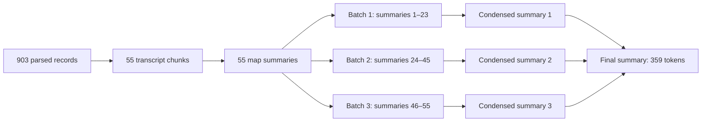

# Worked example: from a hearing transcript to its summary

**Hearing:** *Facebook, Social Media Privacy, and the Use and Abuse of Data*, April 10, 2018, a joint hearing of the Senate Committees on the Judiciary and on Commerce, Science, and Transportation, with testimony from Mark Zuckerberg. **GovInfo package:** `CHRG-115shrg37801`.

This example follows the saved production run for the Facebook–Cambridge Analytica hearing. It includes an intermediate collapse stage and a matched C-SPAN abstract, allowing readers to inspect both aggregation and external validation. Its 55 chunks exceed the corpus median of 11. The stored text contains 243,434 words, including extensive written material appended to the hearing record; that count does not measure oral testimony alone.

Use this README as the walkthrough. The supporting files are organized by purpose:

| Folder | Contents |
|---|---|
| [01 - Inputs](<01 - Inputs>) | Source text and parsed turns. The [Chunks](<01 - Inputs/Chunks/chunks.md>) subfolder contains the index and six pages of model inputs. |
| [02 - Outputs](<02 - Outputs>) | Recorded segment, collapse, and final summaries, plus the C-SPAN reference. |
| [03 - Logs and Verification](<03 - Logs and Verification>) | The original production call log used to verify the reconstructed inputs. |
| [04 - Scripts](<04 - Scripts>) | The script that verifies and exports this example into these folders. |

Continue with the same hearing in the [T2 topic and stance example](<../../T2 - Topic Extraction and Stance Analysis/T2.X - Worked Example/README.md>).

For a quick reading, start with the [final summary](<02 - Outputs/outputs.md#final-summary>), then trace a [chunk](<01 - Inputs/Chunks/chunks.md>) to its recorded segment summary. The source, parsed turns, chunks, and call log preserve different stages of the procedure; they are retained so the summary can be traced back to the original hearing.

| Step | What to inspect | What happened in this hearing |
|---|---|---|
| Source | [Original text extracted from the saved HTML](<01 - Inputs/source.txt>) | Front matter, testimony, exchanges, and inserted material in document order. |
| Parsing | [All parsed turn records](<01 - Inputs/parsed_turns.json>) | 8,192 paragraphs; 40 dot-leader paragraphs removed; 903 records, including introductory and appended material. |
| Packing | [All 55 model-input chunks](<01 - Inputs/Chunks/chunks.md>) | Consecutive turns packed within a 6,144-token budget; oversized records divided. |
| Map | [55 recorded segment summaries](<02 - Outputs/outputs.md#map-01>) | One model call per transcript chunk. |
| Collapse | [First](<02 - Outputs/outputs.md#collapse-01>), [second](<02 - Outputs/outputs.md#collapse-02>), and [third](<02 - Outputs/outputs.md#collapse-03>) condensed summaries | Three batches: segment summaries 1–23, 24–45, and 46–55. |
| Reduce | [Recorded final summary](<02 - Outputs/outputs.md#final-summary>) | The three condensed summaries became one 264-word, 359-token summary. |
| Reference | [Matched C-SPAN abstract](<02 - Outputs/outputs.md#c-span-reference>) | The independently written program abstract used in the evaluation. |

## 1. From source text to turn records

The goal is to identify which passages belong to each speaker while preserving the sequence of the exchange. The [transcript parser](<../../L - Lib/L2 - Document Parsing and Text Cleaning/transcript.py>) extracts fixed-width text from GovInfo's HTML rendition, reconstructs paragraphs, and looks for markers of written questions for the record. This hearing uses the indentation rule: a line indented by at least four spaces starts a paragraph. For documents in which fewer than 5 percent of nonblank lines follow this convention, the parser uses blank lines instead. It also removes page markers and standardizes whitespace within paragraphs.

Indentation identifies paragraph boundaries; the [speaker parser](<../../L - Lib/L2 - Document Parsing and Text Cleaning/speakers.py>) identifies speaking turns from opening labels such as `Chairman Grassley.` and attaches following paragraphs until another speaker opening appears. It matches detected surnames to the congressional-member roster extracted by the [MODS parser](<../../L - Lib/L2 - Document Parsing and Text Cleaning/mods.py>), assigning a Bioguide identifier where available. Named speakers without a match retain their transcript labels and a null identifier; the unnamed chair uses the separate identifier `0000000`. Dot-leader paragraphs, which generally represent contents or index entries, are excluded. These operations use text-processing rules, with no LLM calls.

The second saved record starts:

```text
Chairman Grassley. The committees on the Judiciary and Commerce, Science, and Transportation will come to order.
```

Its fields include `honorific: "Chairman"`, `surname: "Grassley"`, `bioGuideId: "G000386"`, `is_member: true`, `section: "spoken"`, and the full text of the turn. The next record is attributed to Chairman Thune. Zuckerberg's records retain `honorific: "Mr."` and `surname: "Zuckerberg"`, with `bioGuideId: null` and `is_member: false`. [Inspect these and the remaining records](<01 - Inputs/parsed_turns.json>).

These are rule-based records. The first contains introductory text without a recognized speaker. Prepared statements and inserted documents can remain attached to the preceding speaker; a `spoken` label is not proof that every word was delivered orally. In this hearing, the saved parser detected no QFR blocks despite the appendix containing headings such as `Response to Written Questions Submitted by Hon. John Thune`. Consequently, the QFR exclusion removed no records. The last record, numbered 903, retains 159,475 words under Grassley's name, including his adjournment remarks and the subsequent appendix. The example preserves this limitation of the original run; these appended responses must not be interpreted as Grassley's own testimony.

## 2. From turn records to model-input chunks

The [chunking function](<../T1.X - Background Helper Functions/chunking.py>) formats each record with its speaker label and packs consecutive records using the Qwen tokenizer. [Chunk 01](<01 - Inputs/Chunks/chunks_01-10.md#chunk-01>) contains the first nine records and 5,881 tokens. It includes introductory text and remarks by Grassley, Thune, Feinstein, and Nelson. [Chunk 02](<01 - Inputs/Chunks/chunks_01-10.md#chunk-02>) includes Zuckerberg's opening statement and Grassley's questions.

[Chunks 08](<01 - Inputs/Chunks/chunks_01-10.md#chunk-08>) through [14](<01 - Inputs/Chunks/chunks_11-20.md#chunk-14>) divide a 23,940-word record labeled Grassley that includes letters and statements submitted for the record. [Chunks 22](<01 - Inputs/Chunks/chunks_21-30.md#chunk-22>) through [55](<01 - Inputs/Chunks/chunks_51-55.md#chunk-55>) divide the final record containing the appendix. Paragraph boundaries are preferred when dividing long records; a paragraph that itself exceeds the budget is divided by tokens. Labels are present where the original formatted record begins; the code does not prepend a fresh label to every continuation fragment. The chunk table records which chunks came from split turns. Its speaker metadata is retained for inspection and is not separately supplied to the model. The inputs are presented in pages of up to ten chunks for easier reading.

The reproduced chunks match all 55 saved map user-prompt hashes. No model was called to reconstruct them.

## 3. From chunks to the final summary

The [summarization implementation](<../T1.X - Background Helper Functions/summarize.py>) calls the same model with separate prompts for three tasks. All outputs shown in [outputs.md](<02 - Outputs/outputs.md>) come from the production log. They have not been regenerated or editorially corrected, and include any trimming performed by the original pipeline.



The map outputs together exceed the 6,144-token aggregation budget. Python groups them in order, and the model condenses each group. The three resulting accounts fit within the budget and pass to the final reduce call. This hearing therefore required 59 model calls: 55 map, three collapse, and one reduce.

Word counts in the prompts are targets. The first map output has 174 words, and the final summary has 264 words. Generation caps are 320, 384, and 512 tokens for map, collapse, and reduce, respectively. The pipeline attempts to remove an incomplete final sentence when generation reaches its cap.

### Map prompt

System message:

```text
You are an expert in text summarization with a working knowledge of United States congressional hearings. You report only what the transcript states.
```

User template (`{text}` is one transcript chunk):

```text
Below is one consecutive segment of a congressional hearing transcript. Each speaking turn is labelled with the speaker.

Summarize this segment in about 150 words. Cover:
- the subjects raised, and what was said about them;
- the position each named speaker takes, attributed to that speaker;
- any numbers, dollar amounts, dates, and bill or act names, copied exactly as they appear.

If the segment is procedural or ceremonial and contains none of these, say so in one sentence.

--- SEGMENT ---
{text}
--- END OF SEGMENT ---

Write only the summary of the segment above.
```

### Collapse prompt

System message:

```text
You are an expert in text summarization with a working knowledge of United States congressional hearings. You condense summaries without adding to them.
```

User template (`{text}` is a batch of consecutive summaries joined with blank lines):

```text
Below are summaries of consecutive segments of one congressional hearing, in the order they occurred. They are already summaries, not transcript.

Condense them into one account of about 200 words that keeps the named speakers, their positions, and the numbers and legislation. This is a middle portion of the hearing, so do not write an overall conclusion about the hearing.

--- SEGMENT SUMMARIES ---
{text}
--- END ---

Write only the condensed account.
```

### Reduce prompt

System message:

```text
You are an expert in text summarization with a working knowledge of United States congressional hearings. You write from the summaries given and add nothing that is not in them.
```

User template (`{target_words}` is `200 to 250`; `{text}` is the ordered summaries):

```text
Below are summaries of every segment of one congressional hearing, in order. They are already summaries, not transcript.

Write a single summary of the hearing as a whole, in about {target_words} words. Cover:
- what the hearing was about;
- the main subjects, the most heavily discussed first;
- the position each named speaker took;
- any point where speakers took opposing positions, naming both sides;
- the key numbers and the legislation referred to, exactly as given.

Where the segment summaries do not establish one of these, leave it out rather than inferring it.

--- SEGMENT SUMMARIES ---
{text}
--- END ---

Write only the summary of the hearing, in about {target_words} words, as continuous prose.
```

## 4. Inspecting the external reference

The [final generated summary](<02 - Outputs/outputs.md#final-summary>) and [C-SPAN abstract](<02 - Outputs/outputs.md#c-span-reference>) describe the same hearing. The abstract identifies Zuckerberg's testimony on Facebook's use and protection of user data following the Cambridge Analytica revelations. The generated summary includes additional claims about data collection, political content, and regulation drawn from the retained record, including its appended material. This pair is one of 351 matched hearings in the evaluation. The full comparison uses the abstract pool of 3,812 matched programs.

The [original evaluation notebook](<../../B - Backup of Original File Structure/scripts/python/02_text_summarization/05_evaluate_quality.ipynb>) contains the matching procedure, embedding computation, and saved results. Semantic similarity to the reference evaluates whether the summary identifies the hearing's content. It does not verify each attribution, number, or omission in the generated text. Hash agreement establishes the provenance of this example, not its factual accuracy.

## Provenance and reproduction

The export reads the preserved data tree at `/project2/mmiric_1435/acroh/llm_method/data`. The following paths are relative to that tree:

| Saved input | Path |
|---|---|
| GovInfo rendition | `raw/govinfo/2018/html/CHRG-115shrg37801.htm` |
| Member roster for parsing verification | `interim/govinfo/hearing_members.parquet` |
| Parsed hearing | `interim/repo_data/raw/02_hearings/hearings_sst.parquet` |
| Production call log | `interim/summaries/sst_Qwen3.5-4B/status/CHRG-115shrg37801.jsonl` |
| Final summary | `interim/repo_data/cleaned/01_text_summarization/hearing_summaries.parquet` |
| C-SPAN match | `interim/repo_data/cleaned/01_text_summarization/cspan_matches.parquet` |

The model is `Qwen/Qwen3.5-4B`; the recorded prompt version is `hearing-mapreduce-1.0`. Reconstruction used the cached tokenizer snapshot `851bf6e806efd8d0a36b00ddf55e13ccb7b8cd0a`. The [original production notebook](<../../B - Backup of Original File Structure/scripts/python/02_text_summarization/03_summarize_sst.ipynb>) documents the generation settings and 6,144-token budget.

[export_example.py](<04 - Scripts/export_example.py>) verifies the 903 parsed texts and their recorded speaker labels against the saved turn records. It then replays the existing map–collapse–reduce orchestration with saved outputs substituted for generation. All 59 user-prompt hashes, stage identifiers, grouping counts, token counts, and the final summary must match before it writes the example files. The hashes cover the user prompt, not the system message or complete chat template. [call_log.jsonl](<03 - Logs and Verification/call_log.jsonl>) is a byte-for-byte copy of the original log.

With the project dependencies already installed, run:

```bash
python "T1 - Text Summarization/T1.X - Worked Example/04 - Scripts/export_example.py" \
  /project2/mmiric_1435/acroh/llm_method/data \
  /scratch2/acroh/projects/llm_method/hf_cache/hub/models--Qwen--Qwen3.5-4B/snapshots/851bf6e806efd8d0a36b00ddf55e13ccb7b8cd0a
```

The tokenizer must be available locally. The script does not load model weights or generate new summaries. `source.txt` preserves the text returned by the repository's HTML extraction function; `parsed_turns.json` exports the saved records; `chunks.md` indexes the six pages of verified reconstructed inputs; and `outputs.md` presents the saved model outputs and matched abstract for reading.
