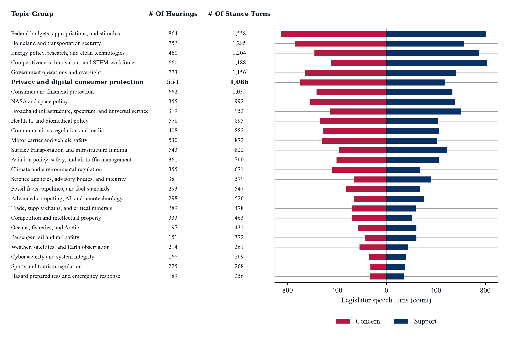
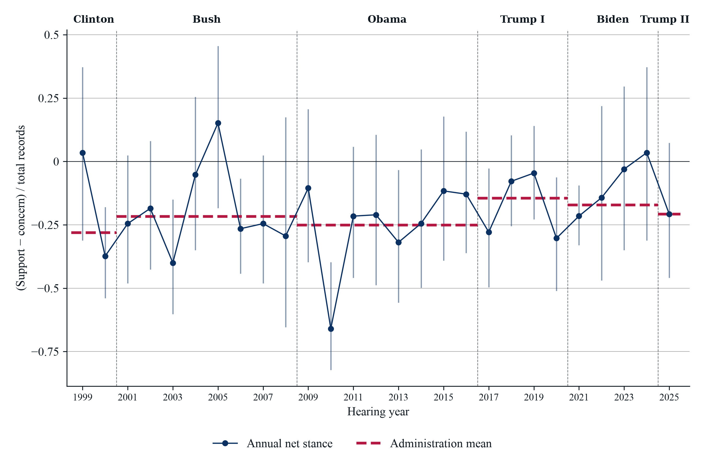
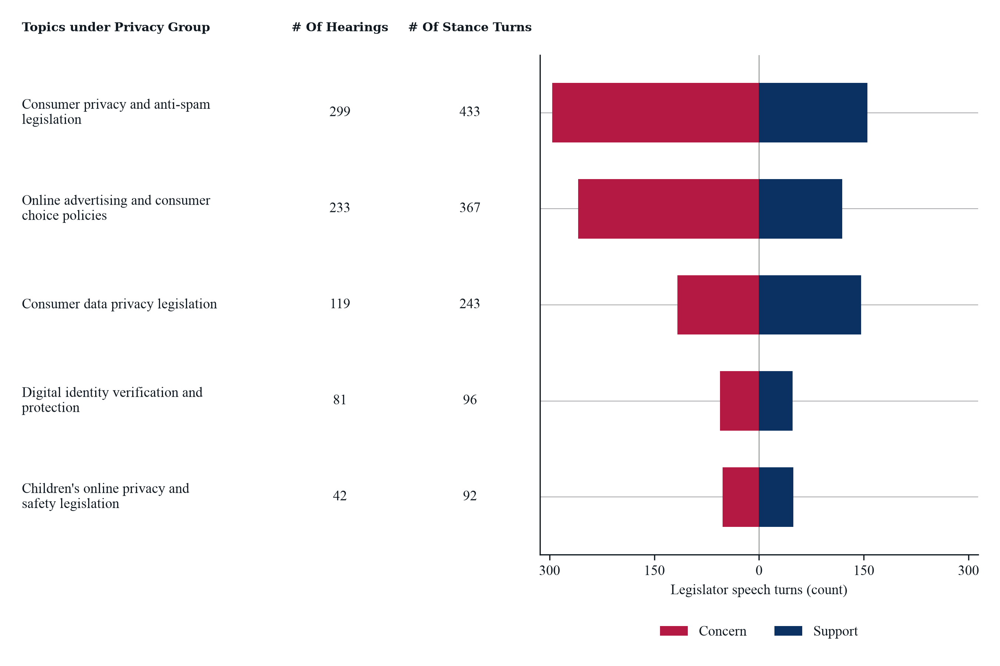
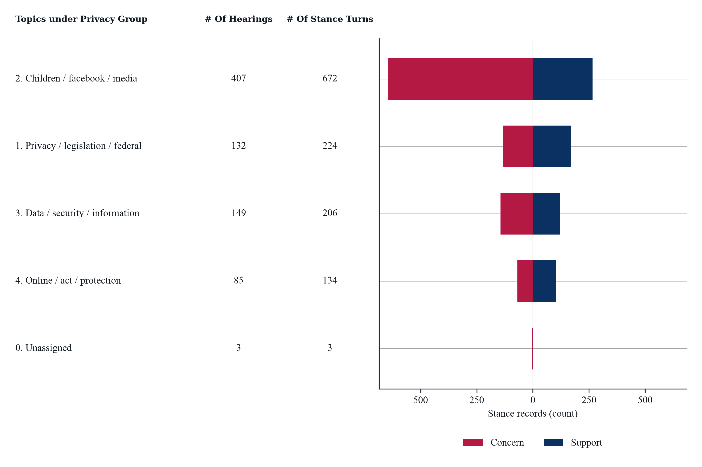

# Re-clustering of Topics from Topic Extraction Step

Input: Final output from the Topic Extraction stage [codebook_v1.csv](codebook_v1.csv)

Output: [topic_groups.csv](topic_groups.csv)

Method: Manually cluster the topic (label) into groups

# Figure 1. Grouped Cluster 

*Notes*: Sample: 2,206 House Science and Senate Commerce hearings, 1999–2025; 12,638 legislator speech turns with stance. Topic groups manually cluster extracted topics. Counts show distinct hearings and legislator speech turns expressing a stance on a group topic. Concern marks turns in which legislators express worry, criticism, or objection toward a topic, or urge its restriction, delay, or scrutiny. Support marks turns in which legislators endorse or advocate for a topic, or urge its adoption, funding, or expansion. Mixed-stance turns enter both bars but count once in totals.

See T2.4.1 .ipynb for details

# Figure 2. 

*Notes*: Sample: House Science and Senate Commerce, 1999–2025: 5 manually grouped privacy topics, 551 hearings, 1,086 legislator speech turns, and 1,654 stance records. Each record is a legislator's extracted position on a topic. Index = (support − concern) / total records; 0 indicates equal counts. Blue bars show 95 percent Wilson intervals, assuming independent records (no hearing-level clustering). Red dashed lines show pooled administration means; vertical dashed lines mark calendar-year boundaries between administrations.

See T2.4.2 .ipynb for details

# Table 1. 

`output/T2.4.3/privacy_and_digital_consumer_protection_stance_turns.csv`

Raw text for stance regarding privacy group selected based on the topics under the group ever mentioned. 

See T2.4.3 for details

# Figure 3. Topics under Privacy Group

A. Based on the original Topic from Topic Extraction Step 

*Notes*: Sample: 551 House Science and Senate Commerce hearings, 1999–2025; 1,086 legislator speech turns in the privacy group. Counts are distinct hearings and stance-bearing turns per original topic. Concern: worry, criticism, objection, or calls for restriction, delay, or scrutiny. Support: endorsement, advocacy, or calls for adoption, funding, or expansion. Mixed-stance turns enter both bars but count once in totals; multi-topic turns can enter several rows.

See T2.4.4 for details

B. (optional)TF-IDF from the Table 1. Raw Text Data As alternative specification.

***Only did this because during the meeting I was asked to try different way of exploring subgroup topics. If unnecessary, then we can remove this. Originally targetting to get more granular topics under the privacy group, but 4 was the highest coherence scored group classification.***

*Notes*: House Science and Senate Commerce, 1999–2025: 1,654 stance records from 1,086 turns and 551 hearings. NMF selects 4 topics by highest mean coherence among 4–12 candidates; exact ties favor fewer. Columns count distinct hearings and turns; bars count stance records. A turn can contribute multiple records or topics. Unassigned: 3 records with no model score. Labels are exploratory; potentially off-topic assignments remain for review. Concern about a harm and support for a remedy can be compatible.

See T2.4.5 for details

Each notebook saves its figures and data in the matching `output/T2.4.1/` through `output/T2.4.5/` folder. T2.4.4 and T2.4.5 read the raw stance-turn CSV from `output/T2.4.3/`.
