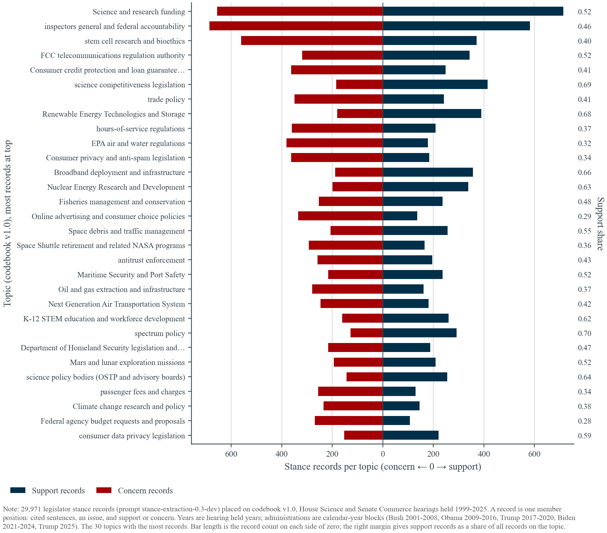
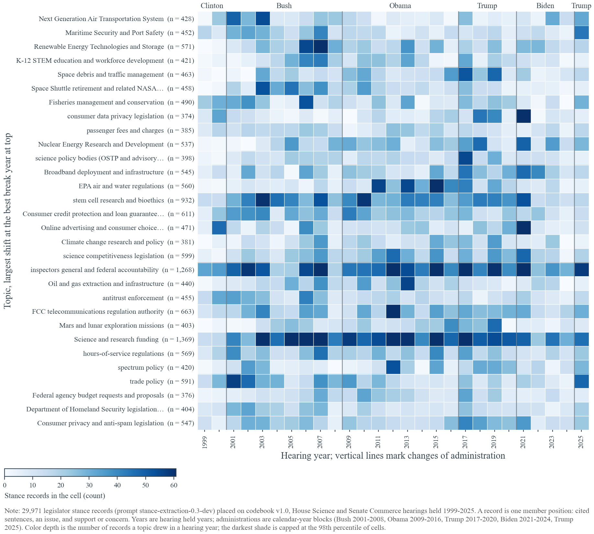
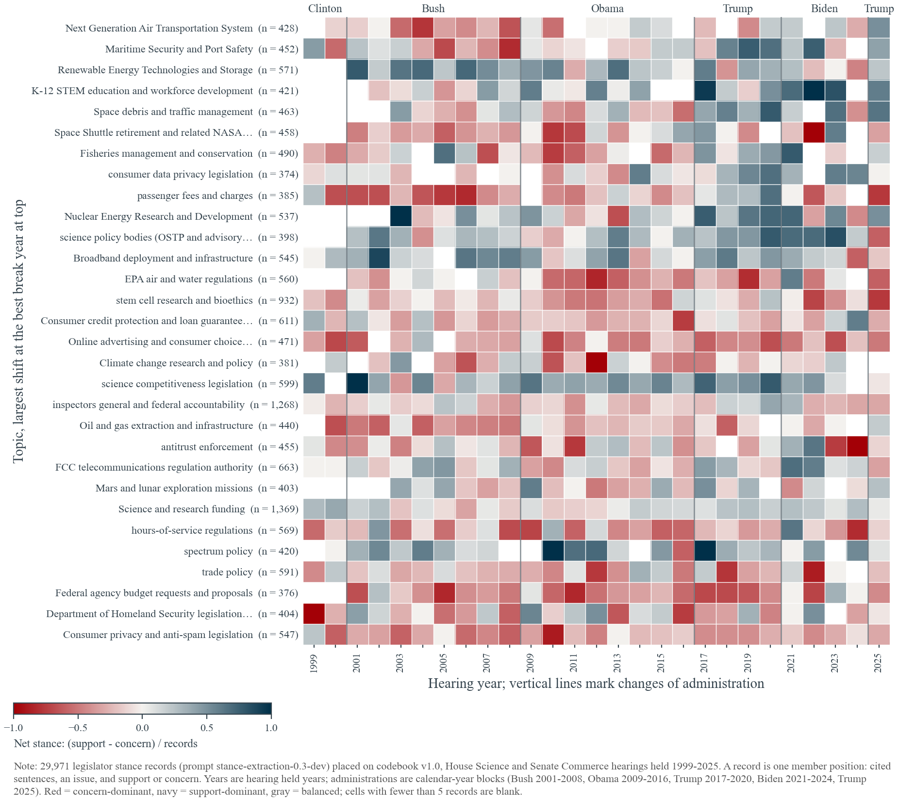
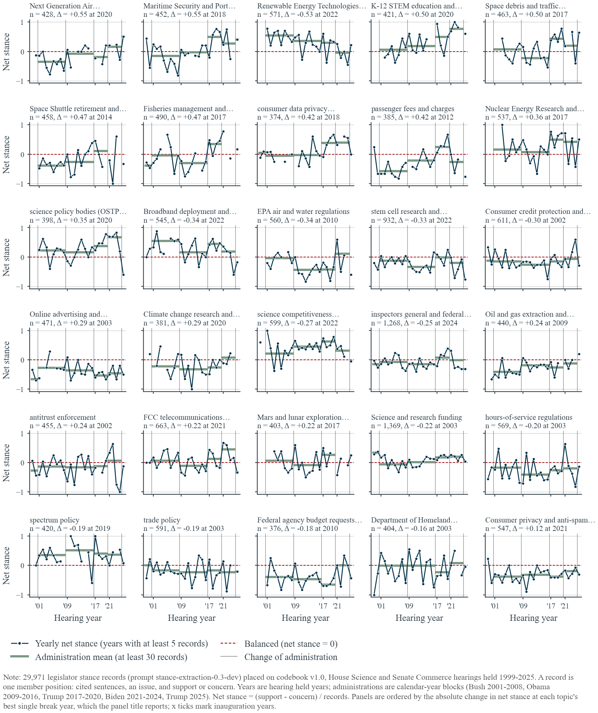
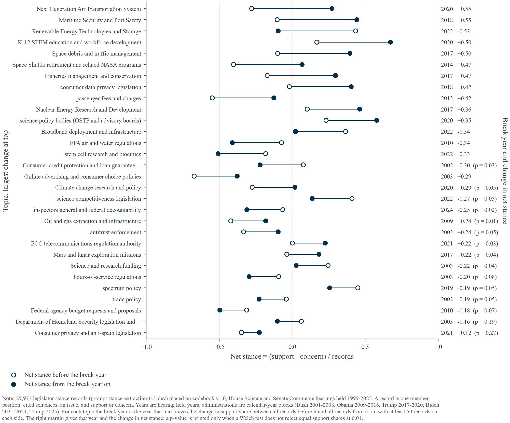
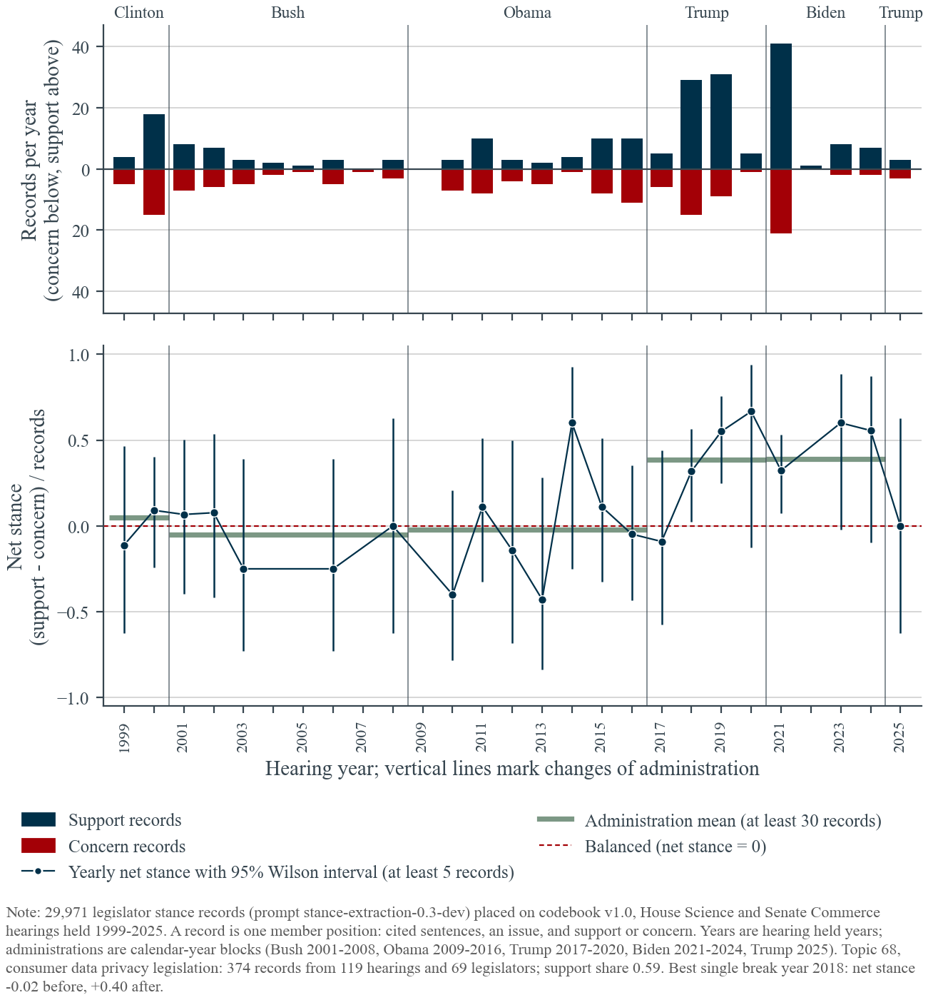
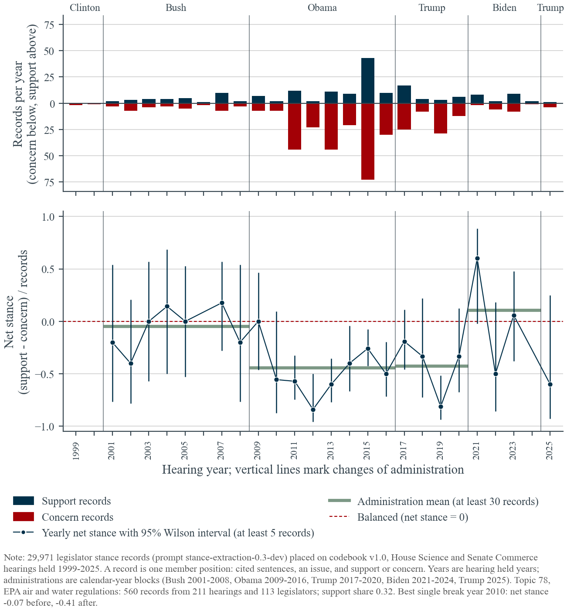

*Detailed notes for Step 1 of the running-example selection. The five-minute summary for both steps is [../../README.md](../../README.md).*

# Choosing the running-example topic for the Section 6 regression

**Decision needed.** Section 6 fixes one topic $k$ and uses legislators' direction on it in year $t$, $S_{kt}$, as the slope on firm exposure. This memo screens the 30 topics with the most stance records against three criteria and shortlists the ones that pass all three, so that the running-example topic can be chosen on evidence rather than by default.

1. **Volume.** Enough stance records to give a yearly series.
2. **Balance.** Enough support *and* concern, so that $S_{kt}$ is not a near-constant.
3. **A clean shift over time.** Net stance moves across administrations or around an identifiable event, so that $S_{kt}$ varies within the sample period.

A fourth consideration comes from Section 5: the topic must touch enough S&P 500 business descriptions for firm exposure $E_{fk}$ to vary. It is reported as a rough proxy, not used for ranking.

Everything here is computed from the saved Stage-3 records by [`T2.4.1 - Step 1 - Topic Screening.py`](<../../T2.4.1 - Step 1 - Topic Screening.py>). No model was run and no record was relabeled. The full metrics are in [`topic_selection_metrics.csv`](topic_selection_metrics.csv); sampled source sentences for every shortlisted topic are in the `stance_sentences_topic_<id>.md` files.

## 1. What was measured

| Item | Definition |
|---|---|
| Records | 29,971 Track 2 stance records placed on codebook v1.0 (the 2,406 "other" records are excluded), from hearings held 1999–2025. The single 1996 hearing (8 records) is dropped. |
| Year | Year the hearing was held (`heldDate_first`). It differs from the `dateIssued` year used in the Congress panel for 3 of 2,352 hearings. |
| Administration | Calendar-year blocks: Clinton to 2000, Bush 2001–2008, Obama 2009–2016, Trump 2017–2020, Biden 2021–2024, Trump 2025. A January transition hearing therefore counts with the incoming administration (the 2017 nomination hearings alone hold 462 records). |
| Net stance | (support − concern) / records. Yearly values are shown only for years with at least 5 records; administration means only with at least 30. |
| Administration test | Chi-square test of equal support shares across administrations with at least 30 records, and the range of their net stances. This is the pre-specified test. |
| Break year | The year that maximizes the change in support share between all records before it and all records from it on, with at least 50 records on each side. Because it is a maximum over candidate years, its Welch p-value is optimistic; use it to locate a shift, not to test it. The two-regime $R^2$ is the share of the between-year variation in net stance (weighted by records) that the before/after means explain. |
| Shortlist rule | Support share between 0.30 and 0.70; administration chi-square p < 0.01; administration net-stance range of at least 0.40; at least three administrations with 30 or more records. |
| Firm-exposure proxy | Number of S&P 500 firms with at least one filing whose raw top-5 cosine to the topic lies above the pooled 95th percentile. Raw cosines favor topics worded like filing language ("regulations", "fees", "enforcement"), so this column flags topics with almost no firm text (single digits) rather than ranking the rest. |

## 2. Figures

**Figure 1. Volume and balance (criteria 1 and 2).** Concern records extend left, support records right; the right margin gives the support share. Every top-30 topic has at least 374 records. Two topics sit below the 0.30–0.70 band, federal budget requests (0.29) and online advertising (0.29); EPA regulations (0.32), passenger fees (0.34) and consumer privacy and anti-spam (0.34) are near its lower edge, spectrum policy (0.70) and science competitiveness (0.69) at the upper edge.



**Figure 2. When the records occur.** Record counts by topic and hearing year. Cells are thin: a typical topic-year holds 10 to 25 records, which is why yearly net stances are noisy and the administration blocks matter.



**Figure 3. Net stance by year.** Same grid, colored by net stance; cells with fewer than 5 records are blank. Rows in Figures 3 to 5 are ordered by the size of the shift at the best break year, largest at top.



**Figure 4. Yearly net stance with administration means.** One panel per topic; the green steps are administration means, the navy line the yearly values. This is the figure to read for criterion 3: a clean shift shows as steps that differ and yearly points that stay near their step.



**Figure 5. Net stance before and after the best break year.** Hollow = before, filled = from the break year on. A p-value is printed only where the Welch test does not reject at 0.01.



**Figures 6a–6m. Detail for each shortlisted topic** (`fig_select_topic_<id>.png`): records per year with support above and concern below, and the yearly net stance with 95% Wilson intervals and administration means. The two leading candidates are shown here; the rest are in the folder.





## 3. Screening table

Columns: records; support share; years with at least 5 records; range of administration net stances and chi-square p across administrations; best break year with the change in net stance and the two-regime $R^2$; firm-exposure proxy; shortlist flag. Topics are in order of record count.

| ID | Topic | n | Support share | Years ≥5 | Admin range | Admin p | Break | Δ net | R² | Firms | Shortlist |
|---:|---|---:|---:|---:|---:|---:|---:|---:|---:|---:|:---:|
| 17 | Science and research funding | 1,369 | 0.52 | 27 | 0.40 | 0.006 | 2003 | −0.22 | 0.11 | 157 | no (range 0.398) |
| 74 | Inspectors general and federal accountability | 1,268 | 0.46 | 27 | 0.39 | 0.045 | 2024 | −0.25 | 0.09 | 522 | no |
| 108 | Stem cell research and bioethics | 932 | 0.40 | 27 | 0.31 | 0.006 | 2022 | −0.33 | 0.13 | 473 | no |
| 54 | FCC telecommunications regulation authority | 663 | 0.52 | 27 | 0.78 | <0.001 | 2021 | +0.22 | 0.08 | 352 | yes |
| 87 | Consumer credit protection and loan guarantees | 611 | 0.41 | 27 | 0.20 | 0.597 | 2002 | −0.30 | 0.17 | 642 | no |
| 116 | Science competitiveness legislation | 599 | 0.69 | 25 | 0.42 | 0.002 | 2022 | −0.27 | 0.06 | 501 | yes (edge of band) |
| 60 | Trade policy | 591 | 0.41 | 26 | 0.24 | 0.834 | 2003 | −0.19 | 0.09 | 380 | no |
| 26 | Renewable energy technologies and storage | 571 | 0.68 | 25 | 0.59 | <0.001 | 2022 | −0.53 | 0.32 | 291 | yes |
| 79 | Hours-of-service regulations | 569 | 0.37 | 27 | 0.23 | 0.125 | 2003 | −0.20 | 0.05 | 703 | no |
| 78 | EPA air and water regulations | 560 | 0.32 | 23 | 0.55 | <0.001 | 2010 | −0.34 | 0.21 | 498 | yes |
| 65 | Consumer privacy and anti-spam legislation | 547 | 0.34 | 27 | 0.19 | 0.524 | 2021 | +0.12 | 0.05 | 408 | no |
| 48 | Broadband deployment and infrastructure | 545 | 0.66 | 26 | 0.40 | 0.001 | 2022 | −0.34 | 0.18 | 68 | no (range 0.395) |
| 21 | Nuclear energy research and development | 537 | 0.63 | 23 | 0.43 | 0.001 | 2017 | +0.36 | 0.24 | 66 | yes |
| 44 | Fisheries management and conservation | 490 | 0.48 | 23 | 0.73 | <0.001 | 2017 | +0.47 | 0.33 | 43 | yes |
| 93 | Online advertising and consumer choice policies | 471 | 0.29 | 25 | 0.39 | 0.065 | 2003 | +0.29 | 0.18 | 358 | no |
| 14 | Space debris and traffic management | 463 | 0.55 | 22 | 0.65 | <0.001 | 2017 | +0.50 | 0.40 | 18 | yes |
| 13 | Space Shuttle retirement and related NASA programs | 458 | 0.36 | 23 | 0.49 | 0.002 | 2014 | +0.47 | 0.33 | 6 | yes |
| 90 | Antitrust enforcement | 455 | 0.43 | 26 | 0.34 | 0.568 | 2002 | +0.24 | 0.08 | 710 | no |
| 43 | Maritime security and port safety | 452 | 0.52 | 25 | 0.65 | <0.001 | 2018 | +0.55 | 0.41 | 26 | yes |
| 34 | Oil and gas extraction and infrastructure | 440 | 0.37 | 24 | 0.28 | 0.143 | 2009 | +0.24 | 0.33 | 258 | no |
| 147 | Next Generation Air Transportation System | 428 | 0.42 | 22 | 0.85 | <0.001 | 2020 | +0.55 | 0.42 | 65 | yes |
| 121 | K-12 STEM education and workforce development | 421 | 0.62 | 21 | 0.71 | <0.001 | 2020 | +0.50 | 0.22 | 8 | yes |
| 49 | Spectrum policy | 420 | 0.70 | 22 | 0.16 | 0.547 | 2019 | −0.19 | 0.11 | 81 | no |
| 62 | Department of Homeland Security legislation and operations | 404 | 0.47 | 26 | 0.32 | 0.357 | 2003 | −0.16 | 0.03 | 187 | no |
| 10 | Mars and lunar exploration missions | 403 | 0.52 | 21 | 0.36 | 0.020 | 2017 | +0.22 | 0.10 | 7 | no |
| 114 | Science policy bodies (OSTP and advisory boards) | 398 | 0.64 | 25 | 0.52 | 0.013 | 2020 | +0.35 | 0.17 | 49 | no |
| 86 | Passenger fees and charges | 385 | 0.34 | 25 | 0.83 | <0.001 | 2012 | +0.42 | 0.32 | 516 | yes |
| 36 | Climate change research and policy | 381 | 0.38 | 22 | 0.40 | 0.161 | 2020 | +0.29 | 0.14 | 197 | no |
| 18 | Federal agency budget requests and proposals | 376 | 0.29 | 25 | 0.65 | 0.005 | 2010 | −0.18 | 0.06 | 76 | no |
| 68 | Consumer data privacy legislation | 374 | 0.59 | 22 | 0.44 | 0.003 | 2018 | +0.42 | 0.60 | 285 | yes |

Thirteen topics pass the rule. The numbers alone do not separate them, so the sampled sentences were read for each one to check what "support" and "concern" mean in practice and whether the shift is a change of position or a change of subject.

## 4. What the source sentences show

Each verdict rests on 40 sampled records per topic (10 support and 10 concern on each side of the break year), linked in the file name. Two general findings first.

- **Placement noise.** Records are placed on a topic when the issue phrase's embedding is within the 0.68 cosine floor of the topic. Generic phrases such as "legislation", "regulation", "fees", or "the bill" clear the floor for several topics, and the two topics with the most generic phrases (FCC regulation, passenger fees) are the least coherent.
- **Polarity of "concern".** As the coauthor note in Section 4.2 anticipates, "concern" mixes concern *about a harm* (which favors rules) with concern *about a rule* (which opposes them). The mix differs by topic and period, and it decides what a change in $S_{kt}$ means. The verdicts below say which reading dominates.

### Tier 1: pass on the numbers and read coherently

**Topic 68, consumer data privacy legislation** ([sentences](stance_sentences_topic_68.md)). Support means support for privacy rules or bills throughout: Hollings's and Burns's privacy bills in 2000, Kerry's "we need to have a privacy law" in 2012, Markey, Cantwell, Blumenthal, Wicker, Blackburn and Hickenlooper on federal privacy legislation from 2018 on. Concern before 2018 is mostly concern about privacy harms ("an Exxon Valdez of privacy", Wyden 2000), with a minority against rules (McCain 2001, DeMint 2008). The break at 2018 is the Cambridge Analytica year and the hearing that anchors the worked example; net stance moves from −0.02 (1999–2017) to +0.40 (2018–2025), administration means Obama −0.02, Trump +0.39, Biden +0.39, and the two-regime $R^2$ of 0.60 is the highest of the thirty. It is the smallest topic in the top 30 (374 records, several early years under 5 records), and the surge is bipartisan rather than partisan, so the shift reads as an event, not an administration.

**Topic 78, EPA air and water regulations** ([sentences](stance_sentences_topic_78.md)). From 2010 on, concern is dominated by Republican House Science members criticizing EPA rules and process (Harris 2011 on the Clean Air Scientific Advisory Committee, Hultgren and Comstock 2015 on "EPA regulations", Smith 2016 "EPA's regulatory agenda is bad for the American economy", Cruz 2023 on the greenhouse gas rule), while support is Democrats defending the agency (Bonamici, Edwards, Johnson). Before 2010 both sides are smaller and mixed. Net stance falls from −0.07 to −0.41 at 2010, the administration means are Bush −0.05, Obama −0.44, Trump −0.42, Biden +0.11 (38 records), and the 2011 Republican House majority is the natural driver. It has the widest firm relevance of any shortlisted topic. Its weaknesses are the concern-heavy balance (0.32) and a thin pre-2010 period (82 records), and some Democratic concern is pro-regulation (Johnson 2017 on "altering EPA's mission"), which blurs the sign.

**Topic 21, nuclear energy research and development** ([sentences](stance_sentences_topic_21.md)). Support is coherent across the whole period: advanced fuel cycles, ITER, fusion, advanced reactors. Concern before 2017 is about waste, safety and cost (Yucca Mountain, Woolsey 2009 "I don't think it will ever be safe enough", Edwards 2011 on subsidies); concern from 2017 on is mostly *pro-nuclear* worry about cuts and competition (Lofgren 2025 on cutting the Advanced Reactor Demonstration Program, Babin 2025 on fusion commercialization), so the true shift toward support is larger than the net stance shows. Administration means rise from Bush +0.16 and Obama +0.07 to Trump +0.49 and Biden +0.42, and stay there under Trump II (+0.50, 28 records): a single monotone step at 2017 that persists across both parties. Firm relevance is moderate (utilities, fuel and reactor suppliers; 66 firms on the proxy).

### Tier 2: passes, with reservations

**Topic 26, renewable energy technologies and storage** ([sentences](stance_sentences_topic_26.md)). Support is coherent (hydrogen, solar, storage, offshore wind). The drop from +0.43 to −0.10 at 2022 comes from two sources that point in opposite policy directions: Republican House members after 2023 criticizing renewable subsidies and siting (Williams, Tenney, Garcia) and Democrats worried that the 2025 administration will "kill the offshore wind industry" (Markey). The post-break period is short (73 records over 2022–2025) and the overall balance is support-heavy (0.68). Firm relevance is good (energy, utilities, autos).

### Tier 3: clean shift, weak fit to the firm regression

- **Topic 14, space debris and traffic management** ([sentences](stance_sentences_topic_14.md)) is in practice a catch-all for the human spaceflight program. Concern before 2017 is Republican criticism of the Obama administration's space policy; support after 2017 is bipartisan enthusiasm for Artemis-era legislation. Clean, administration-driven, but it reaches only aerospace contractors.
- **Topic 43, maritime security and port safety** ([sentences](stance_sentences_topic_43.md)): concern before 2018 is about port vulnerabilities after 9/11 and Coast Guard readiness; support after 2018 is Coast Guard reauthorization and shipbuilding. The shift is partly a change of subject. Few S&P 500 firms.
- **Topic 44, fisheries management** ([sentences](stance_sentences_topic_44.md)): concern before 2017 opposes catch limits and catch shares; support after 2017 backs the Modern Fish Act and aquaculture. Interpretable, but no firm relevance.
- **Topic 121, K-12 STEM education** ([sentences](stance_sentences_topic_121.md)): only 9 concern records after 2020, so the later regime has no variation to use. No firm relevance.
- **Topic 13, Space Shuttle retirement and NASA programs** ([sentences](stance_sentences_topic_13.md)): concern about NASA budgets and the 2010 Constellation cancellation, then support. No firm relevance.
- **Topic 147, NextGen air transportation** ([sentences](stance_sentences_topic_147.md)): heterogeneous (runways, airline competition, ATC modernization, the 737 MAX, even livestock hauling). Concern about outdated air traffic control is pro-investment, so the sign is unclear.

### Excluded after reading

- **Topic 54, FCC telecommunications regulation authority** ([sentences](stance_sentences_topic_54.md)) has the largest administration range among balanced topics, but its support side is full of unrelated bills placed by the phrase "legislation" (ARPA-E, the Take It Down Act, the Undersea Cable Protection Act, autonomous-vehicle bills), and support for a bill is not support for regulation. The 2025 concern records (FCC independence, censorship) are a real new subject rather than a change of position.
- **Topic 86, passenger fees and charges** ([sentences](stance_sentences_topic_86.md)) collects E-rate, spectrum fees, fines, taxes, cable rates and gasoline pricing. Not a topic.
- **Topic 116, science competitiveness legislation** ([sentences](stance_sentences_topic_116.md)) is support-heavy (0.69) and its break rests on 58 post-2022 records.

### Large topics that do not shift

Science and research funding (1,369 records, support share 0.52) misses the shortlist by a hair (administration range 0.398) and its yearly net stance stays within about ±0.3 of zero for the whole period: plenty of volume, little time variation. Inspectors general (1,268) and stem cell research (932) behave the same way. Broadband (545) shows a 2022 drop much like renewable energy but just misses the range cut.

## 5. Recommendation

Three topics satisfy all three criteria and read coherently in the sources. Which one is right depends on what the running example is meant to show.

| | Topic 68 privacy | Topic 78 EPA regulations | Topic 21 nuclear R&D |
|---|---|---|---|
| Records | 374 (fewest) | 560 | 537 |
| Balance | 0.59 | 0.32 (concern-heavy) | 0.63 |
| Shape of the shift | One step at 2018, event-driven, bipartisan; highest $R^2$ (0.60) | Step at 2010, concern-heavy through 2020, back toward balance under Biden | One step at 2017, persists under both parties |
| What "concern" means | Mostly harm-concern before 2018, mixed after | Mostly anti-regulation from 2010 on | Waste and safety before 2017, cuts and competition after |
| Firm relevance | Data-handling firms across industries; T3 already built on it | Widest: any firm with emissions or discharge compliance | Utilities and nuclear suppliers |
| Main risk | Thin early years; the shift is one event, not administrations | Sign of $S_{kt}$ blurred by pro-EPA concern; thin pre-2010 | Post-2017 concern is pro-nuclear, so net understates the shift |

If continuity with the worked example matters, topic 68 is defensible on these numbers and has the cleanest two-regime fit. If the example should show an administration-driven shift with the broadest firm exposure, topic 78 is the stronger choice and would also make the Section 5 LLM-based measure worth rerunning on it. Topic 21 is the cleanest monotone shift but reaches fewer firms.

## 6. Caveats for whichever topic is chosen

- Yearly cells are small, so $S_{kt}$ at the year level is noisy; a Congress or administration block, or a minimum-record rule, should be considered for the regression.
- The break-year search is exploratory. The administration contrast is the pre-specified test and should be the one quoted.
- The polarity problem in "concern" is not solved by choosing a topic. If $S_{kt}$ enters as the share of concern, its sign must be interpreted per topic, and a relabeling toward "stricter rule" versus "less strict rule" (the fix proposed in Section 4.2) would make any of these topics cleaner.
- Placement at the 0.68 floor admits generic issue phrases; a per-topic review of the lowest-similarity records would tighten the series.
- The firm-exposure column is a textual-closeness proxy pooled across topics; it should not be read as the number of exposed firms.

## Reproduce

```bash
cd "T2 - Topic Extraction and Stance Analysis/T2.4 - Running Example Selection"
/project2/njia_1089/acroh/envs/llm_method/bin/python "T2.4.1 - Step 1 - Topic Screening.py" \
  --data-root /project2/mmiric_1435/acroh/llm_method/data
```

Outputs are written beside this file. The sentence samples use seed 1089 and are reproducible.
