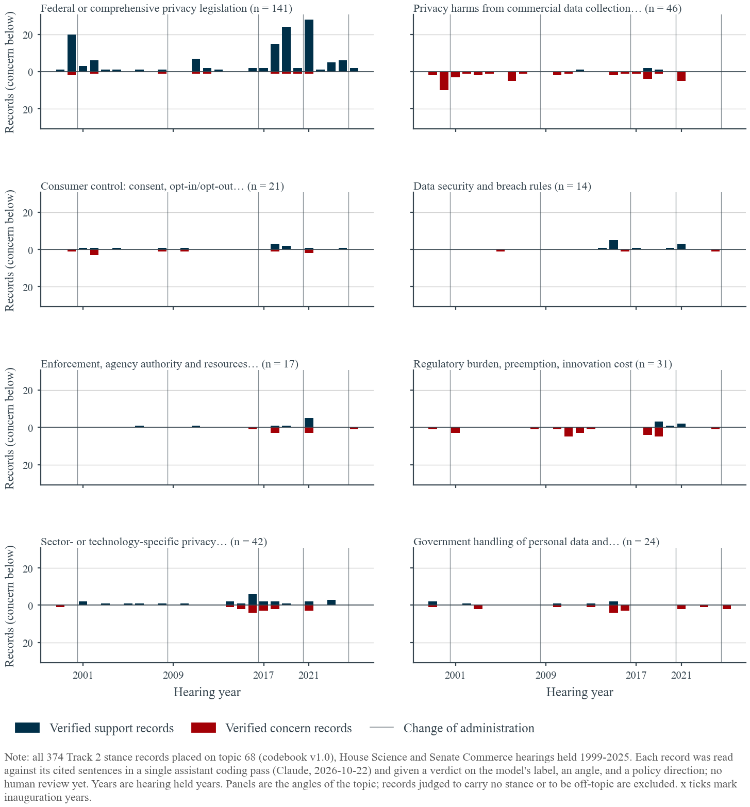
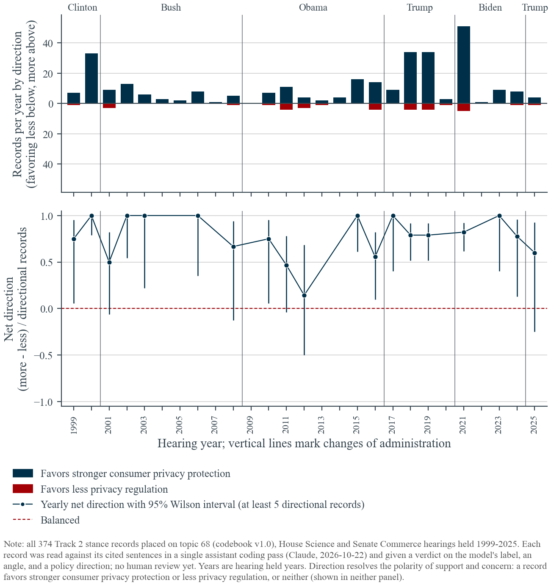
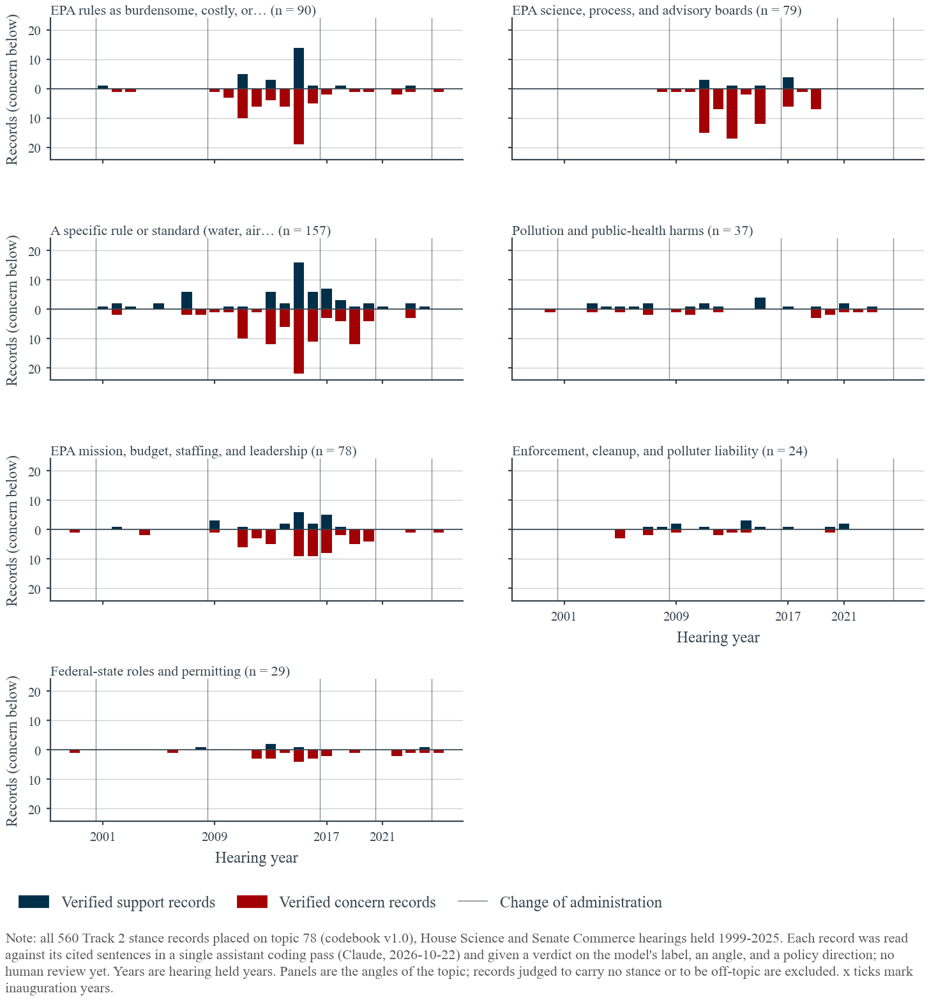
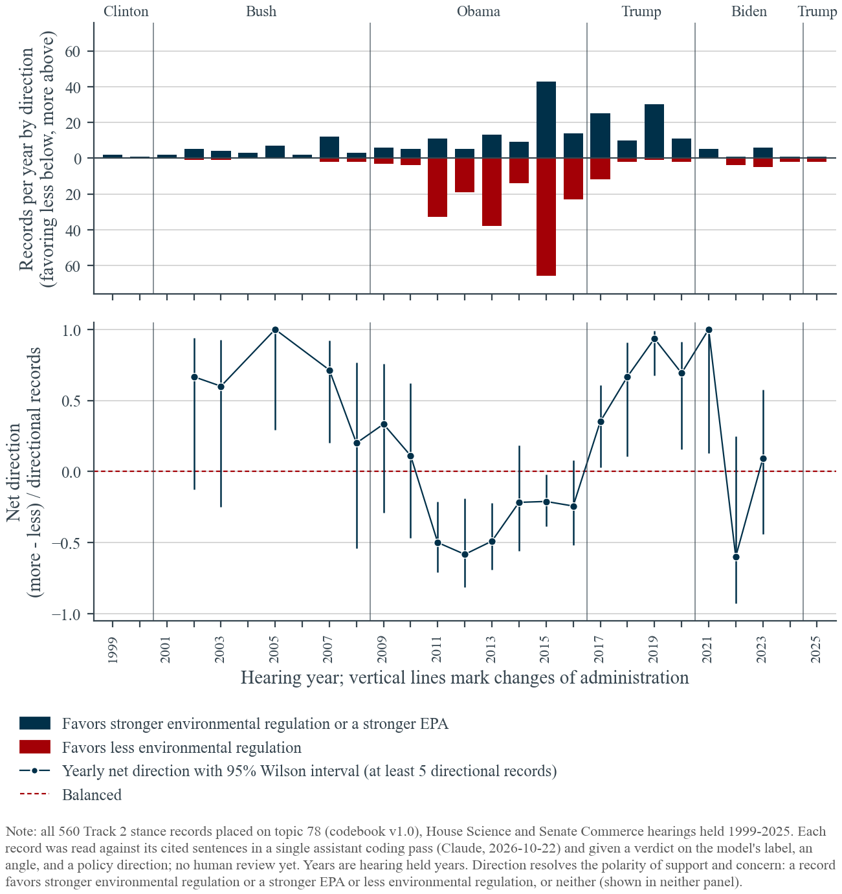
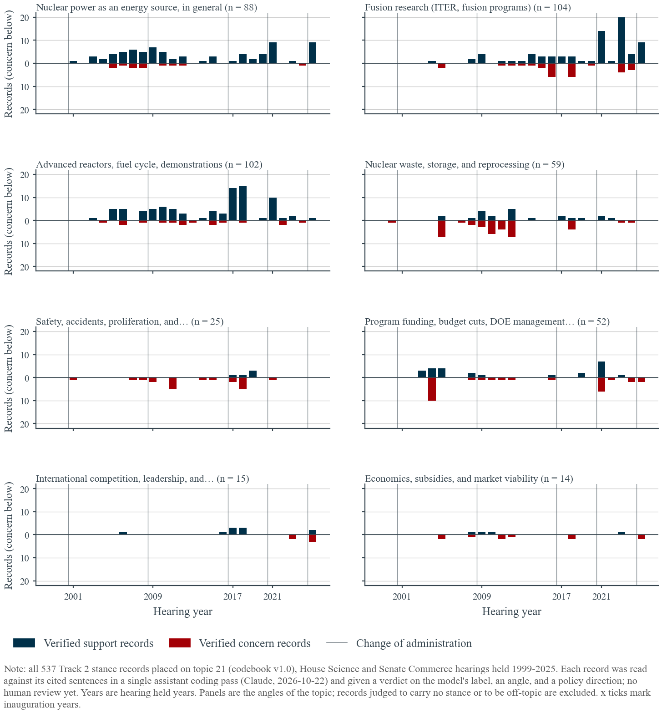
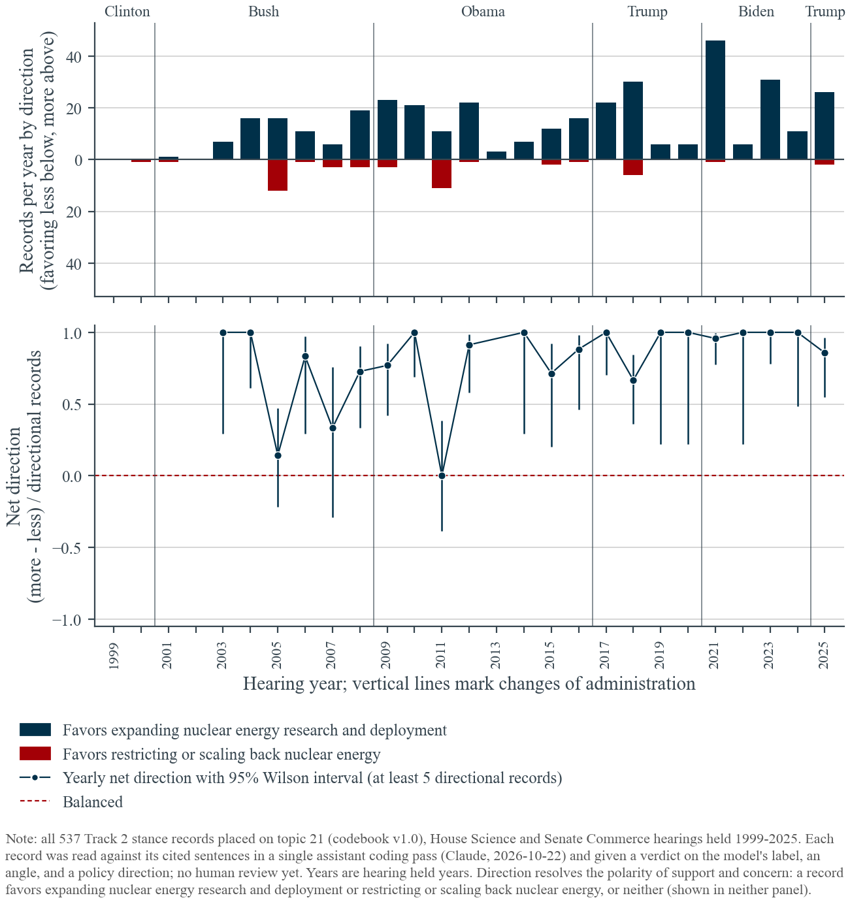
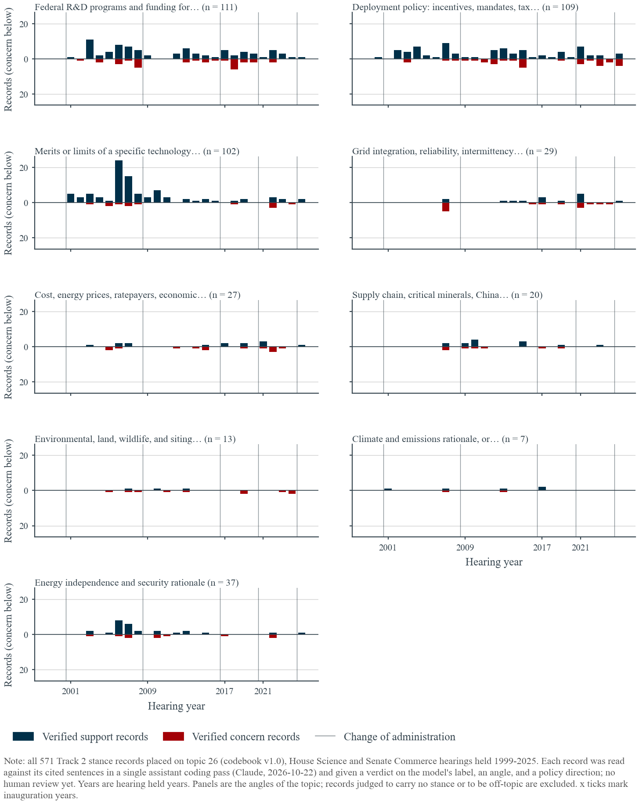
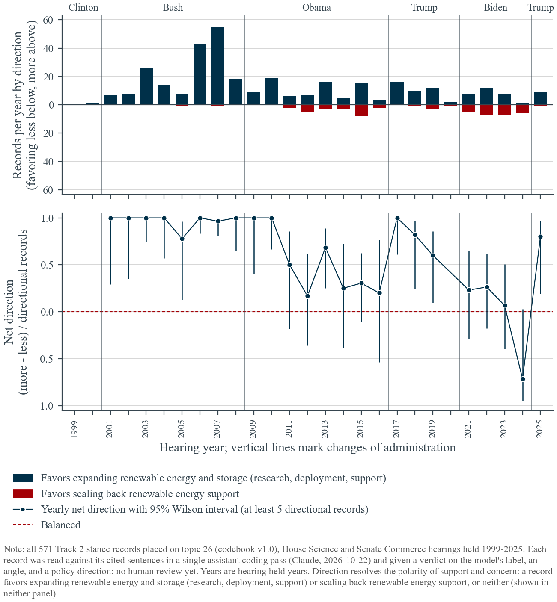
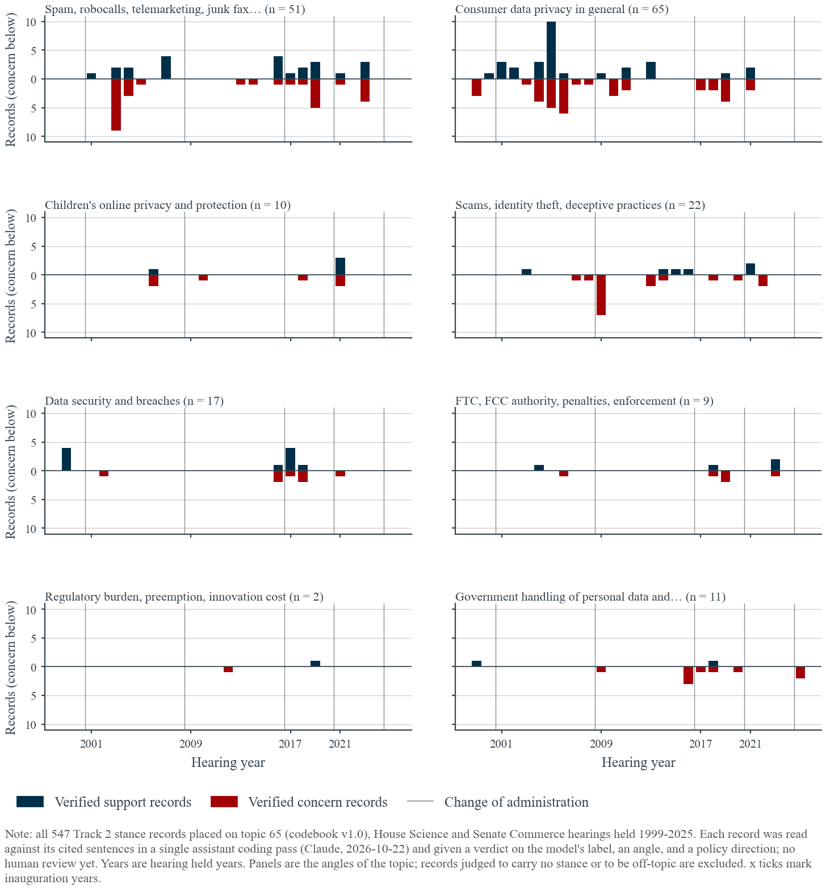
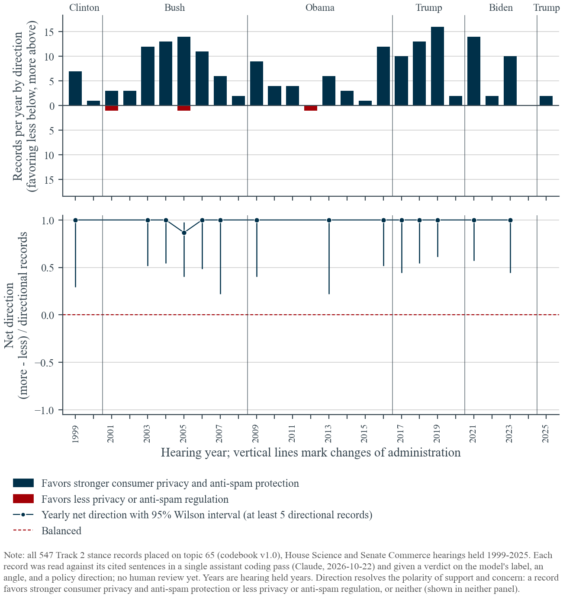

*Detailed notes for Step 2 of the running-example selection. The five-minute summary for both steps is [../../README.md](../../README.md).*

# Stance audit and angle coding for the candidate topics

This follows the topic screen in [T2.4.1](<../T2.4.1 - Step 1 - Topic Screening/README.md>). It answers two questions about the three leading candidates, consumer data privacy (topic 68), EPA air and water regulations (topic 78), and nuclear energy R&D (topic 21), and about two further topics added in a second pass: renewable energy technologies and storage (topic 26, the Tier 2 candidate) and consumer privacy and anti-spam legislation (topic 65, the privacy topic's sibling, audited to see whether it could be merged with topic 68):

1. **Are the model's support and concern labels right?** Every record was read against its cited sentences.
2. **What is each record about, and which way does it lean?** Every record received an *angle* (the aspect of the topic it addresses) and a *direction* (whether it favors more or less of the topic's policy object), so that the records can be aggregated by year into series that mean one thing.

**Scope and method.** All 2,589 records placed on the five topics in hearings held 1999–2025 were read one by one, in a single pass by the assistant (Claude, 2026-10-22). No human has reviewed the codes yet, so they are a first audit, not validation. The codes are plain data files (`audit/codes_topic_<id>.csv`), the script [T2.4.2](<../../T2.4.2 - Step 2 - Stance Audit and Angle Coding.py>) joins them back to the records, refuses to run on incomplete coverage, and writes every table and figure in this folder. Each record carries:

| Field | Values | Meaning |
|---|---|---|
| verdict | ok, inverted, nostance, offtopic | ok: the cited sentence expresses the labeled stance toward the model's issue phrase. inverted: it expresses the opposite. nostance: no position (a fact, a procedural remark, a question, a view attributed to someone else, a letter read into the record). offtopic: not about this codebook topic. |
| angle | per-topic list below | The aspect of the topic the sentence addresses. |
| direction | pro, anti, none | pro: favors stronger privacy protection (68), stronger environmental regulation or a stronger EPA (78), expanding nuclear energy research or deployment (21). anti: favors less. none: neither, or unclear. Direction is coded independently of the model's label and resolves the polarity problem noted in Section 4.2 of the proposal, where concern about a harm and concern about a rule both count as "concern". |

## 1. How accurate are the labels?

| Topic | Records | ok | inverted | no stance | off-topic | Agreement among stance records |
|---|---:|---:|---:|---:|---:|---:|
| 68 Consumer data privacy | 374 | 324 | 12 | 16 | 22 | 96.4% |
| 78 EPA air and water regulations | 560 | 485 | 9 | 17 | 49 | 98.2% |
| 21 Nuclear energy R&D | 537 | 456 | 3 | 12 | 66 | 99.3% |
| 26 Renewable energy and storage | 571 | 451 | 4 | 7 | 109 | 99.1% |
| 65 Consumer privacy and anti-spam | 547 | 186 | 1 | 4 | 356 | 99.5% |

Agreement is computed among records that carry a stance at all (ok plus inverted). Three findings.

- **Inverted labels are rare (1 to 3 percent) and follow a pattern.** Nearly all are a speaker *reporting an opponent's position* or *rebutting a claim*, which the model reads as the speaker's own concern: Blumenthal's "you spent vast sums fighting California's privacy rules" (coded concern about California's privacy rules), Johnson's "EPA regulations do not, do not, do not kill jobs" (concern about EPA regulations), Burns quoting Bill Gates that the privacy bill "goes too far". The full list is in `audit/audit_topic_<id>.csv` under `verdict = inverted`.
- **Off-topic placement is the larger problem (6 to 12 percent).** Records reach a topic through the 0.68 cosine floor between the issue phrase and the topic's Track 1 subjects, and generic phrases slip through: the NEON ecology project, hypersonics, the NOAA Organic Act and particle-physics facilities on the nuclear topic; e-cigarette rules, a face-mask mandate, the NOAA Organic Act again and a privacy bill on the EPA topic; net-neutrality, DRM and content-moderation bills on the privacy topic. These are not stance errors; they are placement errors and they dilute every yearly cell.
- **No-stance records (3 to 4 percent)** are mostly letters and witness statements read into the record by the chair, questions, and factual descriptions of a rule.

The two topics added in the second pass sharpen the placement finding. On topic 26, 19 percent of records are off-topic, almost all statements about energy efficiency or conservation, oil and gas production, or electricity markets that reached the topic through phrases like "energy efficiency" or "energy prices". On topic 65 the share is 65 percent: the topic's label combines two subjects ("consumer privacy" and "anti-spam"), and the placement floor admitted anything about illegality, security or fraud, from maritime piracy, port security and Enron to Kaspersky Lab, counterfeit goods, content moderation and TSA screening. Only 187 of its 547 records are about consumer privacy, spam, scams or data security.

A side finding for the attribution step: several records carry a member's name but witness text (a DOE official and an Argonne scientist on topic 21, a Utah air-quality official and a GE scientist on topic 78), and five 2015–2016 records attributed to "Chairman Smith" are the ranking member's defense of EPA. These are errors in `speakers.py` turn attribution, not in the stance model, and they are worth a look before the legislator-level table is used.

## 2. The angles

Angles were defined from the first sample of sentences and refined while coding; "OFF" is reserved for off-topic records. Counts are verified support and concern records (ok and inverted, after correcting the inverted ones), and the pro/anti columns are the direction codes.

**Topic 68, consumer data privacy legislation** (332 stance records)

| Angle | Support | Concern | Pro | Anti | What it covers |
|---|---:|---:|---:|---:|---|
| LAW | 131 | 10 | 140 | 0 | Federal or comprehensive privacy legislation, privacy law in general |
| HARM | 4 | 42 | 46 | 0 | Privacy harms from commercial collection, tracking, breaches, data brokers |
| SECTOR | 26 | 16 | 37 | 4 | Sector- or technology-specific privacy: ISPs (the 2016–2017 FCC broadband rules), cars, drones, children, health, AI |
| BURDEN | 6 | 25 | 4 | 26 | Regulatory burden, preemption, innovation cost, cost-benefit demands |
| GOVT | 7 | 17 | 23 | 0 | Government handling of personal data: HealthCare.gov, IRS, surveillance, encryption rights |
| CONTROL | 12 | 9 | 21 | 0 | Consent, opt-in/opt-out, notice, transparency, access |
| ENFORCE | 9 | 8 | 13 | 4 | FTC and FCC authority, resources, a privacy bureau |
| SECURITY | 11 | 3 | 14 | 0 | Data security and breach-notification rules |

**Topic 78, EPA air and water regulations** (494 stance records)

| Angle | Support | Concern | Pro | Anti | What it covers |
|---|---:|---:|---:|---:|---|
| RULE | 61 | 96 | 87 | 68 | A specific rule or statute: Clean Air Act, Clean Water Rule, ozone NAAQS, Cross-State rule, Clean Power Plan, methane, PFAS, asbestos |
| OVERREACH | 26 | 64 | 27 | 63 | EPA rules as burdensome, costly, job-killing, and the rebuttals |
| SCIENCE | 9 | 70 | 16 | 53 | EPA science, IRIS assessments, advisory boards, "secret science", cost-benefit methods |
| AGENCY | 21 | 57 | 45 | 28 | EPA mission, budget, staffing, leadership, cooperation with Congress |
| HEALTH | 20 | 17 | 34 | 0 | Pollution and public-health harms |
| STATE | 5 | 24 | 6 | 22 | Federal–state roles, permitting, NEPA, the California waiver |
| LIABILITY | 13 | 11 | 22 | 2 | Enforcement, cleanup, polluter liability, oil-spill law |

**Topic 21, nuclear energy research and development** (459 stance records)

| Angle | Support | Concern | Pro | Anti | What it covers |
|---|---:|---:|---:|---:|---|
| FUSION | 76 | 28 | 91 | 10 | ITER, NIF, fusion programs and budgets |
| ADVANCED | 86 | 16 | 100 | 1 | Advanced reactors, SMRs, fuel cycle, test reactors, demonstration programs |
| GENERAL | 77 | 11 | 83 | 3 | Nuclear power as an energy source, in general |
| WASTE | 22 | 37 | 38 | 14 | Yucca Mountain, storage, reprocessing |
| FUNDING | 25 | 27 | 45 | 1 | Program budgets, cuts, DOE management, workforce |
| SAFETY | 5 | 20 | 0 | 10 | Safety, accidents, proliferation, oversight (15 coded "none": complaints about light-water reactors by advocates of advanced designs) |
| COMPETE | 10 | 5 | 15 | 0 | International competition, leadership, uranium supply |
| ECON | 4 | 10 | 2 | 9 | Cost overruns, subsidies, market viability |

**Topic 26, renewable energy technologies and storage** (455 stance records)

| Angle | Support | Concern | Pro | Anti | What it covers |
|---|---:|---:|---:|---:|---|
| RDFUND | 80 | 31 | 94 | 6 | Federal R&D programs and budgets: hydrogen and fuel cells, EERE, ARPA-E, batteries, cuts |
| DEPLOY | 76 | 33 | 74 | 22 | Deployment policy: incentives, tax credits, portfolio standards, mandates, loan guarantees, "all of the above" |
| TECH | 90 | 12 | 89 | 2 | Merits or limits of a technology: hydrogen, fuel cells, plug-ins, solar, wind, batteries, geothermal, biofuels |
| INDEP | 27 | 10 | 29 | 2 | Energy independence and security as the rationale |
| GRID | 15 | 14 | 13 | 7 | Grid integration, reliability, intermittency, storage need |
| COST | 14 | 13 | 10 | 10 | Cost, prices, ratepayers, the economic case for or against |
| SUPPLY | 13 | 7 | 20 | 0 | Supply chain, China, domestic manufacturing, global competition |
| SITING | 3 | 10 | 3 | 6 | Land, water, wildlife and siting impacts of wind, solar and storage |
| CLIMATE | 5 | 2 | 6 | 1 | Climate rationale, or skepticism of it |

**Topic 65, consumer privacy and anti-spam legislation** (187 stance records; 356 off-topic)

| Angle | Support | Concern | Pro | Anti | What it covers |
|---|---:|---:|---:|---:|---|
| PRIVACY | 29 | 36 | 62 | 2 | Spyware, cookies, tracking, do-not-track, data brokers, consent |
| SPAM | 23 | 28 | 50 | 0 | Spam, robocalls, spoofing, junk fax, do-not-call |
| FRAUD | 6 | 16 | 22 | 0 | Online scams, cramming, ticket bots, scams against the elderly |
| SECURITY | 10 | 7 | 16 | 0 | Encryption, breaches (Equifax, FDIC), device security |
| GOVT | 2 | 9 | 10 | 0 | Government handling of personal data, TSA searches, backdoors |
| CHILD | 4 | 6 | 10 | 0 | Children's online privacy and protection |
| ENFORCE | 4 | 5 | 9 | 0 | FTC and FCC enforcement, penalties |
| BURDEN | 1 | 1 | 1 | 1 | Regulatory burden |

The pro/anti columns show why the raw labels mislead. Concern on HARM, GOVT and HEALTH is always pro-protection; concern on BURDEN, OVERREACH, SCIENCE and STATE is always anti-regulation; and on WASTE or FUNDING a concern can be either (a cut to a program the speaker likes, versus doubt that the waste problem is solvable).

## 3. Yearly development of each topic

The figures `fig_audit_angles_topic_<id>` show verified support (up) and concern (down) by year within each angle; `fig_audit_direction_topic_<id>` show records favoring more (up) and less (down) and the yearly net direction with Wilson intervals. The administration blocks below sum the same records.

### Topic 68: one direction, a changing angle





| Administration | Pro | Anti | Net direction | Model net stance | Leading angles |
|---|---:|---:|---:|---:|---|
| Clinton (1999–2000) | 40 | 1 | +0.95 | +0.12 | LAW 23, HARM 12 |
| Bush | 47 | 4 | +0.84 | −0.02 | LAW 15, HARM 13, CONTROL 8 |
| Obama | 58 | 13 | +0.63 | −0.03 | SECTOR 17, LAW 14, GOVT 13, BURDEN 10 |
| Trump (2017–2020) | 80 | 9 | +0.80 | +0.41 | LAW 46, BURDEN 13, SECTOR 10 |
| Biden | 69 | 6 | +0.84 | +0.50 | LAW 41, ENFORCE 8, SECTOR 8 |

Legislators favor stronger privacy protection in every period; the anti side is a minority of 34 records in 27 years, concentrated in 2011–2012 (Toomey, McCaskill on cost-benefit and HIPAA) and 2018–2019 (Moran, Lee, Young on the California law, GDPR and start-up burden). What changes is the *angle*. Before 2018 the concern records describe harms ("an Exxon Valdez of privacy", tracking, breaches) and the support records are scattered across bills; from 2018 on, after Cambridge Analytica, the records are overwhelmingly support for a federal privacy law, from both parties (Wicker, Thune, Blackburn, Moran alongside Cantwell, Markey, Blumenthal). The 2018 break that the screen found in the model's net stance is therefore mostly a change from *harm-talk* to *legislation-talk*, not a change in which way legislators lean. A yearly $S_{kt}$ built from the raw labels would measure the share of discussion that takes the form of a bill rather than the direction of policy preference.

### Topic 78: a real reversal of direction, tied to who controls the House





| Administration | Pro | Anti | Net direction | Model net stance | Leading angles |
|---|---:|---:|---:|---:|---|
| Bush | 38 | 6 | +0.73 | +0.07 | RULE 18, HEALTH 11, LIABILITY 7 |
| Obama | 106 | 200 | −0.31 | −0.43 | RULE 96, OVERREACH 77, SCIENCE 60, AGENCY 47 |
| Trump (2017–2020) | 76 | 17 | +0.63 | −0.42 | RULE 36, AGENCY 25, SCIENCE 18 |
| Biden | 13 | 11 | +0.08 | −0.12 | RULE 7, HEALTH 6, STATE 5 |

This is the one topic where direction itself moves. From 2011 to 2016 the Republican House Science Committee held repeated EPA oversight hearings, and the anti records on OVERREACH, SCIENCE and STATE dominate (yearly net direction −0.2 to −0.6). From 2017 to 2021 the same committee's Democrats defended the agency against rollbacks, and the direction turns pro (+0.35 to +1.0) even though the model's net stance stays negative, because those defenses are phrased as *concern* about cuts, dismissals and repeals. After 2021 the volume collapses (under 20 records a year) and the direction is mixed. The raw-label series and the direction series disagree most in 2017–2020; any regression on this topic should use the direction, or the angle-level counts, not the raw net stance.

### Topic 21: consensus, with attention moving from waste to fusion





| Administration | Pro | Anti | Net direction | Model net stance | Leading angles |
|---|---:|---:|---:|---:|---|
| Bush | 76 | 20 | +0.58 | +0.22 | GENERAL 33, FUNDING 24, ADVANCED 19, WASTE 13 |
| Obama | 115 | 18 | +0.73 | +0.15 | ADVANCED 35, WASTE 32, FUSION 29, GENERAL 24 |
| Trump (2017–2020) | 64 | 6 | +0.83 | +0.52 | ADVANCED 31, FUSION 15, SAFETY 12 |
| Biden | 94 | 1 | +0.98 | +0.49 | FUSION 46, FUNDING 17, ADVANCED 16 |
| Trump (2025) | 26 | 2 | +0.86 | +0.50 | FUSION 9, GENERAL 9, COMPETE 5 |

Nuclear energy is close to a consensus topic in these two committees: 375 records favor expansion, 48 favor restraint, and the anti records cluster in three episodes (Honda on waste and reprocessing cost in 2005, Edwards after Fukushima in 2011, Tonko, Rosen and later Ross and Salinas on cost overruns and Yucca). The step up in the model's net stance at 2017 reflects a change in *what is discussed*: the Bush and Obama years carry the Yucca Mountain fight, budget cuts and the 2005 reprocessing debate (concern-heavy angles), while 2017–2018 brings the bipartisan advanced-reactor bills (NEICA, the Versatile Test Reactor, the Nuclear Energy Research Infrastructure Act) and 2021–2025 a surge of fusion support after the NIF ignition result. The direction series barely varies, so this topic offers attention and angle variation, not direction variation.

### Topic 26: unanimous under Bush, contested from 2011, near balance under Biden





| Administration | Pro | Anti | Net direction | Model net stance | Leading angles |
|---|---:|---:|---:|---:|---|
| Bush | 179 | 2 | +0.98 | +0.59 | TECH 68, RDFUND 50, DEPLOY 35, INDEP 23 |
| Obama | 80 | 23 | +0.55 | +0.40 | DEPLOY 36, RDFUND 23, TECH 19, SUPPLY 12 |
| Trump (2017–2020) | 40 | 5 | +0.78 | +0.26 | RDFUND 25, DEPLOY 9, GRID 6 |
| Biden | 29 | 25 | +0.07 | +0.06 | DEPLOY 21, RDFUND 12, GRID 11, COST 8 |
| Trump (2025) | 9 | 1 | +0.80 | +0.38 | DEPLOY 7, TECH 2 |

This is the second topic, after EPA regulations, where direction itself moves. The Bush years are the hydrogen and fuel-cell era: the 2003–2008 hearings on the administration's hydrogen initiative, plug-in hybrids and energy independence produce 179 records favoring expansion and 2 against, from both parties (Boehlert, Biggert, Inglis, Brownback alongside Kerry, Dorgan, Honda). The first anti records appear in 2011 with Solyndra and the "picking winners and losers" critique (Harris, Rohrabacher, Hall), and the Obama years split 80 to 23. Under Trump the pro records are mostly Democrats defending EERE against 70 to 85 percent budget cuts, coded as concern by the model, which is why the model's net stance keeps falling while the direction rebounds. Under Biden the anti side grows to parity: grid reliability after the 2021 Texas blackout, EV mandates and charging, subsidies and siting (Weber, Tenney, Garcia, Franklin, Lucas), and the yearly direction reaches −0.7 in 2024. In 2025 the few records are Markey's concern about the administration "killing" offshore wind and battery storage, which count as pro. The break at 2022 that the screen found is therefore a real change of direction, but the direction series begins to turn in 2011, and after 2016 the topic is thin (under 60 usable records per administration).

### Topic 65: a catch-all with a coherent core





| Administration | Pro | Anti | Off-topic share | Model net stance | Leading angles |
|---|---:|---:|---:|---:|---|
| Bush | 64 | 2 | 59% | −0.09 | PRIVACY 37, SPAM 22 |
| Obama | 39 | 1 | 70% | −0.30 | FRAUD 13, PRIVACY 11, SPAM 7 |
| Trump (2017–2020) | 41 | 0 | 67% | −0.29 | SPAM 13, PRIVACY 9, SECURITY 8 |
| Biden | 26 | 0 | 63% | 0.00 | SPAM 9, CHILD 5 |

Two thirds of this topic is noise, and the third that remains is two subjects. The privacy half (spyware in 2004–2005, pretexting in 2006, do-not-track in 2010–2013, data brokers and location data after 2017) is the same construct as topic 68 and leans the same way: 180 of 183 directional records favor stronger protection. The anti-spam half (the 2003 CAN-SPAM hearing, do-not-call in 2007, robocalls and spoofing from 2016) is a separate and entirely bipartisan policy object. The model's negative net stance reflects that nearly every record is concern about a harm (spam, spyware, scams), not opposition to rules.

## 4. What this means for the Section 6 choice and for building $S_{kt}$

- **Use direction, not the raw labels, when the regressor is meant to be a policy lean.** On topic 78 the two series point opposite ways for four years; on topics 68 and 21 the raw net stance tracks the angle mix rather than any change of lean.
- **Two topics have within-topic variation in direction: EPA regulations and renewable energy.** Both track partisan control of the House Science Committee more than any single event, and both are thin after 2016. Privacy, nuclear and the privacy-and-spam topic are consensus-pro in these committees, so $S_{kt}$ for them is better defined as attention to a particular angle (the share of records calling for a federal privacy law; the share about advanced reactors or fusion) than as a direction.
- **Topic 65 cannot stand alone, but its privacy core can be merged into topic 68.** After dropping the 356 off-topic records, its PRIVACY, SECURITY, GOVT and CHILD records (103) would add roughly 30 percent to topic 68's 332 stance records, with the same direction. Its 60 spam and robocall records are a separate, coherent policy object that could serve as a small bipartisan comparison topic.
- **Angle-level series are the "coherent perspectives" the yearly aggregation can carry.** The per-year tables `audit/angle_year_topic_<id>.csv` give verified support and concern counts by angle and year, and `audit/direction_year_topic_<id>.csv` gives pro, anti and net direction by year. Yearly cells are thin for most angles (typically under 10 records), so Congress or administration blocks are the realistic unit for anything but the largest angles.
- **Placement, not labeling, is the error to fix first.** Removing the off-topic records (6 to 12 percent) and reviewing the lowest-similarity placements would do more for the series than relabeling stances.

## 5. Caveats

- One coder, one pass, no adjudication. Angle boundaries involve judgment (LAW versus SECTOR for a sector-specific bill; RULE versus OVERREACH when a specific rule is attacked as costly; TECH versus RDFUND when a technology is praised in a budget hearing), and direction for balanced statements was set to "none". On topic 26, "all of the above" statements were coded as no direction, and pure energy-efficiency statements as off-topic; both choices move a few dozen records. A human spot-check of a stratified sample, and of the 29 inverted records, would turn this audit into validation.
- Direction is defined per topic as favoring the policy object. For nuclear it means favoring expansion, which is the opposite polarity from "favoring regulation" on the other two topics; the regression sign must be interpreted per topic.
- Administration blocks are calendar years, as in T2.4.1. The 2017 nomination hearings therefore count with the Trump years.
- Records whose speaker is misattributed are coded on their content; the attribution problem is flagged above but not fixed here.

## Files

| File | Contents |
|---|---|
| `audit/records_topic_<id>.txt`, `.csv` | The records as read: year, speaker, model label, issue phrase, cited sentences, plus keys back to the stance table |
| `audit/codes_topic_<id>.csv` | The hand codes: rid, verdict, angle, direction (header lines document the scheme) |
| `audit/audit_topic_<id>.csv` | Records joined to codes, with the verified stance |
| `audit/angle_year_topic_<id>.csv` | Verified support and concern by angle and hearing year |
| `audit/direction_year_topic_<id>.csv` | Pro, anti and net direction by hearing year |
| `audit/audit_summary.json` | Verdict counts, confusion matrices, angle-by-stance and angle-by-direction tables |
| `fig_audit_angles_topic_<id>.*`, `fig_audit_direction_topic_<id>.*` | The figures above (pdf, svg, png) |

Reproduce from the repository root:

```bash
cd "T2 - Topic Extraction and Stance Analysis/T2.4 - Running Example Selection"
/project2/njia_1089/acroh/envs/llm_method/bin/python "T2.4.2 - Step 2 - Stance Audit and Angle Coding.py" export --topics 68 78 21 26 65
/project2/njia_1089/acroh/envs/llm_method/bin/python "T2.4.2 - Step 2 - Stance Audit and Angle Coding.py" aggregate --topics 68 78 21 26 65
```
