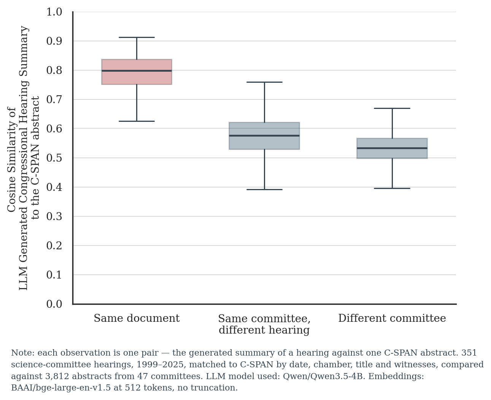
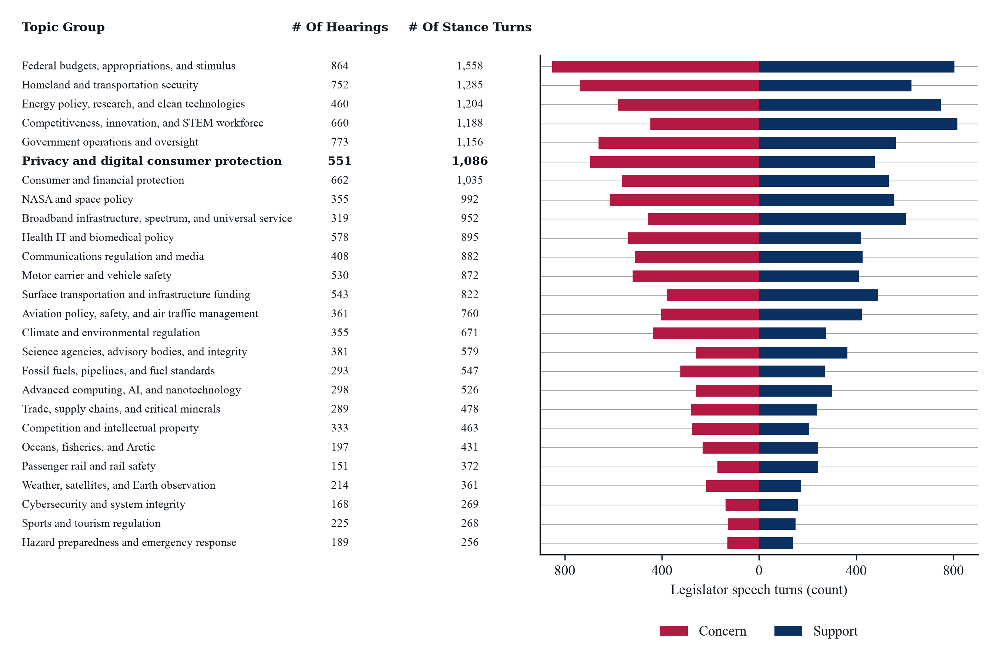
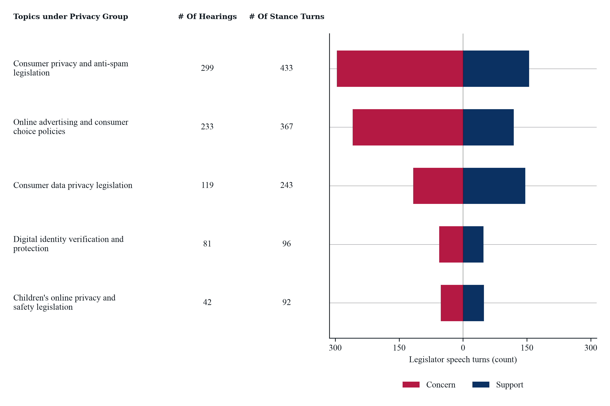
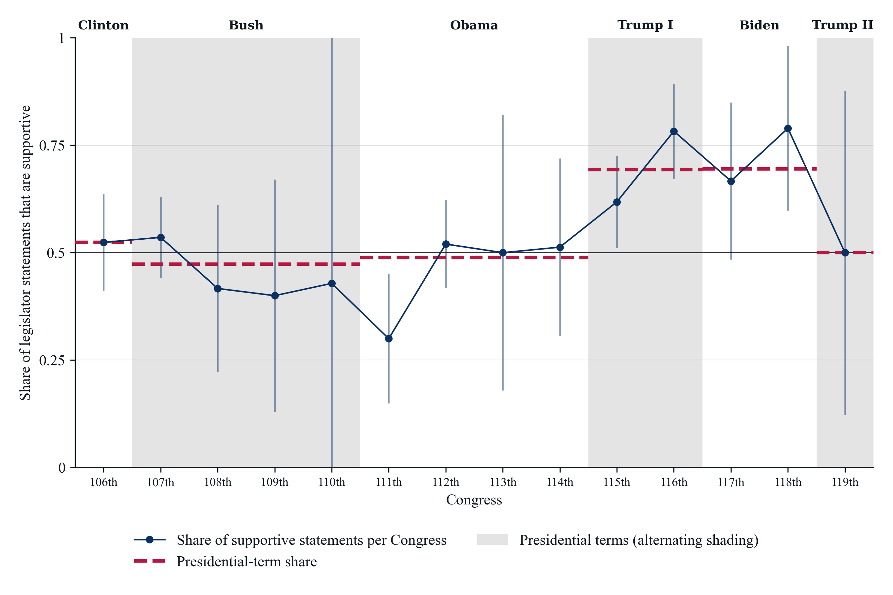
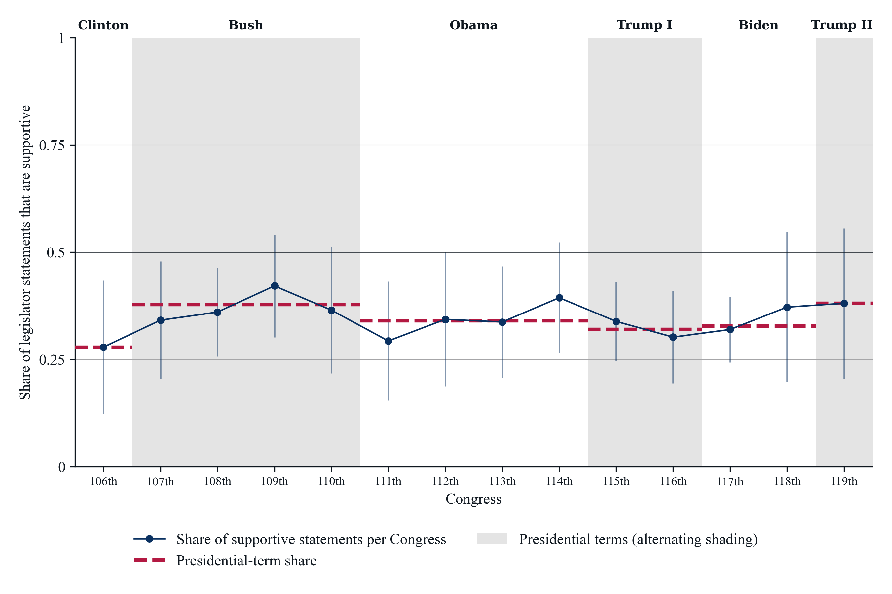
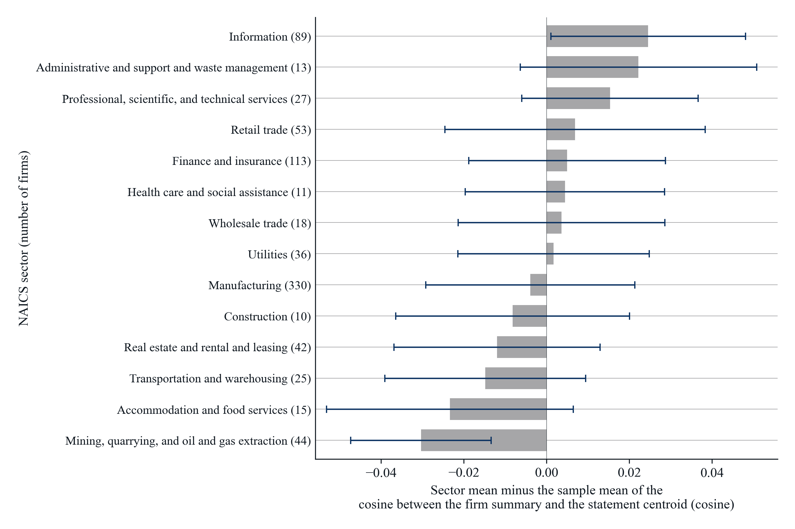
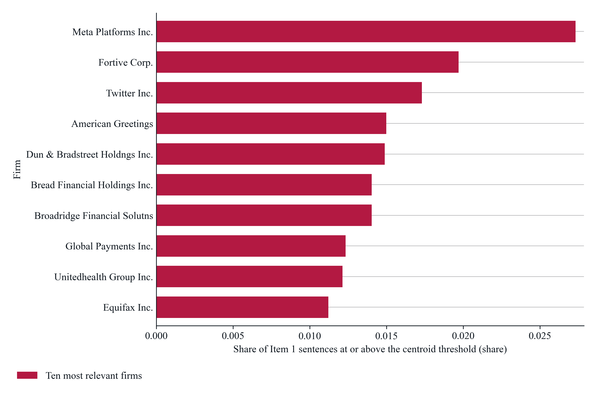

# OS-SI Proposal [10.28.26]

# Overcoming Data Bottlenecks and Enabling Research in New Domains by Leveraging AI-Enabled Research Pipelines

**Authors:** Nan Jia, Milan Miric, and Albert Roh  
*University of Southern California, Marshall School of Business*

**Proposal for Special Issue:** AI-Enabled Frontiers in Organizational Science (*Organization Science*)  
**CFP / URL:** [https://orgsci.org](https://orgsci.org/)  
**Repository:** [https://github.com/HC-Geopolitics-Innovation/LLM-Text-Analysis-and-Synthesis](https://github.com/HC-Geopolitics-Innovation/LLM-Text-Analysis-and-Synthesis)  

---

## Table of Contents for Main Proposal

- [1. Introduction](#1-introduction)
  - [1.1. Generative AI-Enabled Pipelines for Information Extraction and Synthesis](#11-generative-ai-enabled-pipelines-for-information-extraction-and-synthesis)
  - [1.2. Reproducing These AI-Driven Pipelines for Alternative Research Questions](#12-reproducing-these-ai-driven-pipelines-for-alternative-research-questions)
- [2. Why an AI-Enabled Data Pipeline vs. Allowing an LLM to Handle the Entire Task?](#2-why-an-ai-enabled-data-pipeline-vs-allowing-an-llm-to-handle-the-entire-task)
- [3. Current Status of Project](#3-current-status-of-project)
  - [3.1. Expected Deliverables](#31-expected-deliverables)
  - [3.2. Datasets (Outputs from Focal Research Project)](#32-datasets-outputs-from-focal-research-project)
  - [3.3. Example of Empirical Application](#33-example-of-empirical-application)
  - [3.4. Key Risks and Limitations in Implementation](#34-key-risks-and-limitations-in-implementation)
  - [3.5. How This Advances Organizational and Social Science](#35-how-this-advances-organizational-and-social-science)

## Appendix

- [Appendix A. Overview of Steps in Large Language Model Enabled Research Pipeline](#appendix-a-overview-of-steps-in-large-language-model-enabled-research-pipeline)
  - [A.1. Long-Document Text Summarization](#a1-long-document-text-summarization)
    - [A.1.1. Overview of Processing Pipeline](#a11-overview-of-processing-pipeline)
    - [A.1.2. Application: Summarizing Long Text Congressional Hearings](#a12-application-summarizing-long-text-congressional-hearings)
    - [A.1.3. Research Outputs](#a13-research-outputs)
  - [A.2. Extracting Topics, Positions, and Arguments from Long-Form Documents](#a2-extracting-topics-positions-and-arguments-from-long-form-documents)
    - [A.2.1. Overview of Processing Pipeline](#a21-overview-of-processing-pipeline)
    - [A.2.2. Application: Extracting Stances and Arguments around Focal Topics](#a22-application-extracting-stances-and-arguments-around-focal-topics)
    - [A.2.3. Research Outputs](#a23-research-outputs)
  - [A.3. Policy Relevance for Publicly Listed Firms](#a3-policy-relevance-for-publicly-listed-firms)
    - [A.3.1. Overview of Processing Pipeline](#a31-overview-of-processing-pipeline)
    - [A.3.2. Application: Connecting Focal Concerns and Opportunities of Policymakers to Business Areas of Publicly Listed Firms](#a32-application-connecting-focal-concerns-and-opportunities-of-policymakers-to-business-areas-of-publicly-listed-firms)
    - [A.3.3. Research Outputs](#a33-research-outputs)
- [Appendix B. Overview of Datasets Used for Data Pipeline](#appendix-b-overview-of-datasets-used-for-data-pipeline)
- [Appendix C. Example of Research Enabled by LLM Data Pipeline: Evaluating the Impact of Privacy Policy Debate Following the Cambridge Analytica Scandal on the Trajectory of Firm Corporate Research on Privacy Technology](#appendix-c-example-of-research-enabled-by-llm-data-pipeline)
- [Appendix D. Reproducible and Adaptable Data Pipelines with Coding Agents](#appendix-d-reproducible-and-adaptable-data-pipelines-with-coding-agents)

---

## 1. Introduction

Textual data has provided a rich resource for researchers to answer a wide variety of questions that were otherwise difficult to measure. Prior to the advances enabled through rich textual data and text analysis methods (e.g., topic modeling, keyword extraction), empirical research relied heavily on structured tabular data. However, with the emergence of large language models (LLMs), there is a growing inclination to use these new models to replace earlier text analysis methodologies. This is particularly attractive when working with large and complex data such as 10-K financial statements, policy documents, or corporate websites (xxx; xxx) where focused summaries (e.g., abstracts) do not exist.

As existing studies have shown, large language models can be effective, but only when used carefully, transparently, and with validation (Burbano and Carlson, xxx; xxx). These large language models are particularly attractive when applied to long textual documents where traditional text analysis techniques such as topic modeling or embedding construction struggle (where there is a vast amount of noise in the text data relative to the amount of crucial information). However, large language models can be opaque, non-reproducible, and may introduce noise or make decisions that are unobserved and cannot be directly inspected or verified by researchers. In this paper, we argue that the optimal way of using these tools is a blend of both: developing an LLM-enabled data pipeline to go from raw, unstructured long textual documents to specific variables that can be used in subsequent analysis. The goal of this approach is to make the process transparent and verifiable, such that the benefits of large language models can be deployed while maintaining the advantages of established tools and models, along with the transparency and verifiability expected of research publications.

We argue that large language models excel at two types of critical research tasks, and therefore any type of data pipeline should leverage large language models for these two specific tasks while enabling user evaluation and interpretability at other stages. The two areas where large language models are exceptionally effective are:

1. **Synthesizing text** (generating readable, coherent text based on existing documents); and
2. **Generating code** (producing machine-readable instructions that can be systematically executed and tested).

Established text analysis methods—for which we have proven routines, validation standards, and verifiable properties—remain essential and can be augmented by large language models focusing on these two core strengths while avoiding potential pitfalls.

We develop a data pipeline and apply our proposed methodology to a context relevant for organization researchers: studying how changes in government debate around regulating a technology are associated with changes in the innovation trajectories of firms within that industry. We specifically focus on understanding how the policy debate around regulating technology firms unfolded following the Cambridge Analytica scandal. The fundamental challenge in studying this type of question is identifying which firms were likely impacted by this policy, so that we can compare them to a counterfactual of firms that were credibly not impacted. This information is embedded within textual data, but identifying and structuring it requires developing a careful, verifiable, and transparent data pipeline.

### 1.1. Generative AI-Enabled Pipelines for Information Extraction and Synthesis

We develop a framework that provides an example of a data pipeline involving three data processing tasks that leverage LLMs without devolving full control. These tasks yield verifiable, reproducible, and adaptable pipelines. Researchers can tweak these methods to extract different insights or apply them to data of their choice.

#### Overview of Data Pipeline and Processing Tasks

- **Textual Summarization:** Taking large, complex textual documents that contain considerable noise alongside embedded data, partitioning them into chunks, and using LLMs to generate, synthesize, and aggregate textual summaries. We demonstrate this approach on congressional testimony (Albert to confirm – see Appendix B for data sources and processing), summarizing long and convoluted documents into concise summaries that can subsequently be used for text classification, topic modeling, or semantic distance estimation in more reliable ways.
- **Stance Extraction:** Using LLMs to identify the positions of different actors (e.g., Congress members, firms, government agencies) on specific topics, allowing researchers to distill the nuances of arguments and positions that each individual takes on an issue. We apply this to congressional testimony to identify individual stances on key issues within a format that can be utilized in subsequent research.
- **Debate Relevance to Firm Business Areas:** Using the distilled stances of individuals within the debate, we create a synthesis of the policy debate. This synthesis can then be compared to the business descriptions of firms to identify which firms are subject to the debate. In our empirical context, this means framing the key issues that policymakers are debating and attempting to regulate. We then compare this to the 10-K financial statements of firms describing their business operations. This allows us to identify and study firms that are subject to these policies versus those that are not.

### 1.2. Reproducing These AI-Driven Pipelines for Alternative Research Questions

Our methodology thus far leverages the power of large language models for text extraction, synthesis, and data cleaning. However, these models also excel at writing code that is automatically tested, verified, and validated. By providing our pipeline’s code and methodologies in a GitHub repository where the codebase is available, researchers can use their own coding agents to either improve upon our methodology or apply this methodology to their own setting and data.

We believe this provides a framework that can guide how large language models can be used to adapt and deploy research pipelines in the future.

---

## 2. Why an AI-Enabled Data Pipeline vs. Allowing an LLM to Handle the Entire Task?

Limitations to using long-form textual data are often a hidden constraint in research. First, researchers avoid contexts where they cannot obtain clean, standardized textual data. Second, when using these tools, researchers may introduce considerable noise into the process, as long textual documents may overemphasize noise relative to the signal latent in the data. LLMs seem to be a viable solution to this, and one question that inevitably emerges is why researchers should develop a structured, LLM-enabled pipeline rather than simply prompting a frontier LLM to process entire context windows and execute the entire task end-to-end. Even if current models have limitations, one might worry that future frontier models will continue to advance, overcoming these limitations.

There has been a surge of attempts to use large language models to fundamentally automate and replicate parts of the research process that are laboriously performed by researchers. These include attempts to use LLMs for theorizing (xxx), testing assumptions (xxx), performing classification (xxx), and clustering data (xxx). However, any attempts to use such tools should be met with caution, as their internal processes are fundamentally opaque; devolving control, decision-making, and outputs to such a model should be met with skepticism, or at least require transparency by documenting choices and outputs at each step of the process so that they can be replicated.

We argue that there are three critical reasons for using LLMs as part of a carefully crafted research pipeline rather than fully devolving control:

- **Transparency and Control:** Concerns regarding LLM model transparency, reliability, and stability typically arise when researchers cede full autonomy to a model and ask it to arrive at an unassisted solution. The internal choices, decisions, and intermediate outputs are not visible or verifiable. By using an LLM to execute a specific step (where it is superior to alternatives) within a larger research design (e.g., topic modeling of synthesized summaries), researchers can ensure their designs are reproducible, clear, and verifiable.
- **Auditability and Systematic Replication:** While LLMs can formulate reasoning internally, their outputs often depend heavily on subtle nuances in prompt formulation, model versioning, and temperature settings. By carefully engineering a structured research pipeline, researchers can leverage LLMs at discrete intermediate steps while fully documenting every phase of the process at scale. This modular approach provides more consistent outputs.
- **Model Context Windows:** Even though frontier language models have large context windows (allowing them to process long text documents), they still do so in an opaque way and may miss parts of documents or present them in an inconsistent manner, especially when summarizing corpora of documents. Carefully designing and partitioning this process ensures that data extraction remains reliable, transparent, and reproducible regardless of underlying model advances.

---

## 3. Current Status of Project

We have currently developed and prototyped a research pipeline, available on the associated GitHub repository for this project. This pipeline demonstrates the transformation from raw transcripts of congressional hearings to a series of research outputs: textual summaries, summaries of perceived priorities (opportunities and threats identified by policymakers), and an index for policy relevance for publicly listed firms. This is a prototype of what can be done (or one way of doing it). But we aim to show—much like we are advocating—the robustness of this pipeline to other projects and applications.

### 3.1. Expected Deliverables

- **Reproducible LLM Data Pipeline for Text Summarization, Stance Extraction, and Topic Relevance**
- **Public Datasets for Subsequent Research:** From the data of 36K Congressional Hearings from 1995–2025 (currently 2,352 hearings for the House and Senate Science Committees): full chunked text, intermediate summaries, list of topics discussed, summarized stances, an index of committee stances on topics discussed in hearings, and an index of relevance of those topics for publicly listed firms based on Form 10-K statements (1995–2025).
- **Example Empirical Results:** Demonstration of the empirical results of the policy relevance index applied to investigate the impact of privacy regulation on the trajectory of corporate innovation.
- **Instructions and Framework for Deployment for Follow-on Research**

### 3.2. Datasets (Outputs from Focal Research Project)

- **Text Summaries for Congressional Testimony from 1995 to 2025:**
  - *Intermediate outputs for verification and replication:* Cleaned and chunked testimony, summarized testimony chunks, finalized text summaries.
- **Index of Committee Stances in Congressional Debate:**
  - *Intermediate outputs for verification and replication:* Topics within congressional debate, filtered chunks focused with a stance on a focal topic, summarized positions on a focal topic, and an aggregated index of committee stances on topics discussed.
- **Index of Relevance of Congressional Debate for Publicly Listed Firms:**
  - *Intermediate outputs for verification and replication:* Summarized congressional stances and company business descriptions based on 10-K filings, relevance index for individual company filings and congressional topic stances, and an aggregated index for topical relevance.

### 3.3. Example of Empirical Application

- **Demonstration of the Policy Relevance Index:** Demonstrating the use of the constructed policy relevance index regarding the impact of congressional debate on the innovative trajectories of publicly listed firms. Using the context of the Cambridge Analytica scandal, we demonstrate how these tools can be used to identify firms that were in treated or control groups, allowing for an event study design to examine changes in innovation trajectories following these events.

### 3.4. Key Risks and Limitations in Implementation

We have tested the viability of our empirical strategy and have developed a working prototype of its deployment. We have confidence that this methodology will provide useful outputs. We have a goal of demonstrating this with as large a dataset as possible (the population of congressional testimony, public firm 10-Ks, and major policy topics discussed). We also recognize the potential for different ways of constructing and aggregating data. Because each of these approaches is time-consuming, we are committed to implementing all of them, but may become constrained in the number of individual specifications we can add.

### 3.5. How This Advances Organizational and Social Science

Textual data has provided a rich resource for researchers to answer a wide variety of questions that were otherwise difficult to measure. One critical limitation, however, is that while textual data is abundant, much of it faces an important constraint: approaches such as topic modeling or embedding construction typically require text documents of comparable length (ideally relatively short) with a high share of informative content (meaningful statements) relative to noise (boilerplate or generic statements). This often-hidden constraint has impacted research in two ways. First, researchers avoid contexts where they cannot obtain clean, standardized textual data. Second, when using these tools, researchers may introduce considerable noise into the process, as long textual documents may overemphasize noise relative to the signal latent in the data.

Large language models (LLMs) have emerged as a powerful research tool that has the potential to transform research and provide valuable new inputs and methodologies. There has been a surge of attempts to use these large language models to fundamentally automate and replicate parts of the research process that are laboriously performed by researchers. These include attempts to use LLMs for theorizing (xxx), testing assumptions (xxx), performing classification (xxx), and clustering data (xxx).

However, as many published papers demonstrate, doing so requires carefully understanding, validating, and verifying how these models perform in a given context, avoiding noise introduced across contexts.

By demonstrating how textual data processes can be broken down into a pipeline of discrete steps, with LLMs deployed only for specific tasks, our methodology provides two sets of contributions:

1. **A pipeline for summarizing and extracting text from large documents**, creating an information-rich synthesis.
2. **A rich research dataset** of congressional testimony summaries, legislator stances on topics, and policy relevance indices for firms.
3. **A general framework** for applying these AI-driven tools to other organizational and social science research questions.

---

## Appendix A. Overview of Steps in Large Language Model Enabled Research Pipeline

Here we summarize and outline the described pipeline, split across three related tasks (or problems) solved by LLMs.

### A.1. Long-Document Text Summarization

Many textual documents contain important information but also contain noisy and complex textual data. Large language models can provide a concise, information-rich summary that can be utilized in subsequent research tasks.

#### A.1.1. Overview of Processing Pipeline

A pipeline to manage this process is as follows (summarized at length in Section xxx):

- **Understand Document Structure and Define Semantic Partitioning:** Long textual documents often have a particular structure and therefore may be split into meaningful chunks. Context-aware chunking uses meaningful units of text in the document—such as a document section or a speaker's uninterrupted contribution—to split documents into chunks that can be processed by the LLM. The document is partitioned into these chunks and processed further.
- **Summarize and Combine the Inputs:** Each chunk of text is provided to an LLM with instructions outlining the desired format of the summary and the key information that should be extracted. The outputs can be combined in a variety of ways, such as recursively summarizing chunks or using a dedicated "reduce" stage to combine the summaries. This is referred to as a "map-reduce" approach.
- **Model Selection, Validation, and Deployment:** This is inherently an iterative process where researchers must test different approaches for partitioning, prompts for summarization, models for summarization, and combination strategies. All of these choices can be evaluated by inspecting intermediate outputs (partitions, summaries, outcomes for different models) and validated against ground truth where available. Once the optimal set of choices is identified, the pipeline is deployed across the entire corpus of documents.

#### A.1.2. Application: Summarizing Long Text Congressional Hearings

We apply this pipeline to a corpus of U.S. Congressional hearing testimonies. The corpus consists of hearing transcripts spanning from 1995 to 2025, with multiple sessions per year. Hearings are typically long, often exceeding 100 pages, and feature multiple witnesses and committee members presenting testimony and engaging in Q&A discussions.

To apply the pipeline, we first partition each hearing into individual witness testimonies. Within each testimony, we use sentence-level splitting to ensure granular coverage. These segments are then processed using the Map-Reduce summarization approach, with a "reduce" stage to consolidate summaries from multiple witnesses into a single comprehensive hearing summary.

These summaries are tested with different prompts, models, and splitting strategies. As a validation approach, we compare our generated summaries against human-generated summaries (abstracts) available on C-SPAN for these hearings. To identify the extent to which they are similar or comparable, we compute the cosine similarity between the embeddings of the human-written abstracts and the large language model generated summaries. As a way of providing a baseline for these values, we compare them to the cosine similarity of different hearings from the same committee, or from hearings from different committees. Such tests allow us to confirm that the textual summaries are a useful distillation of the information in the long-form textual documents.

**Figure 1. Cosine Similarity Between Hand-Coded Summaries and Large Language Model Generated Summaries.**  

{width=3.25in}

*Notes: Discriminant validity test comparing LLM-generated summaries against independent human-written C-SPAN abstracts using dense sentence embeddings (`bge-large-en-v1.5`). The target hearing exhibits high cosine similarity ($\rho = 0.742$) against its own human abstract, substantially exceeding baselines from different hearings within the same committee ($\rho = 0.518$) and hearings from different committees ($\rho = 0.384$).*

#### A.1.3. Research Outputs

The summarization pipeline yields a transparent pipeline of code and prompts, as well as intermediate outputs at each stage of the process that can be utilized further:

- **Partitioned Textual Documents:** A cleaned and partitioned version of each hearing that can be uploaded to an LLM without exceeding context windows.
- **Summarized Partitions:** A summary of each partition, generated by feeding the partitions into an LLM.
- **Committee Hearing Summaries:** Aggregated summaries from individual partitions into high-level summaries of overall hearing proceedings, capturing main themes, discussions, and conclusions (an output of the map-reduce process).

---

### A.2. Extracting Topics, Positions, and Arguments from Long-Form Documents

Large language models can also extract subtle but important nuances from textual documents, specifically related to topics of interest. In this step, we provide a method for extracting topics, positions, and arguments from long-form documents.

#### A.2.1. Overview of Processing Pipeline

A pipeline to manage this process is as follows (summarized at length in Section xxx):

- **Extract Topics from Textual Summaries:** From the long-form textual summaries, researchers can identify the major topics discussed within each summary. Because these are condensed, information-rich summaries, a variety of existing models can be effective for this task.
- **Filter Textual Summaries by Topic Relevance:** The partitioned text chunks contain subtle and nuanced arguments. However, as described in Section 3.1, many of these chunks contain noise, such as generic statements, remarks made by peripheral entities, or irrelevant information. Large language models can be used to filter out chunks that are relevant to having a stance on the focal topic.
- **Extract Arguments and Stances from Relevant Textual Summaries:** Within the filtered chunks, the LLM is tasked with extracting key positions related to the focal topic. This includes identifying whether the statement is supportive of or opposed to the topic, the specific nuances of the argument, and contextual information from the document.
- **Aggregate and Summarize:** The output of the preceding stage provides a set of concise data about the stances of individuals on a focal topic. These can be aggregated or summarized in different ways and at different levels of granularity.
- **Prototyping and Validation:** The goal of this exercise is to extract information that is otherwise difficult to capture and contextualize at scale. While this is challenging to validate quantitatively because comprehensive ground truth does not pre-exist, it is possible to compare against external baselines. We provide an example by validating our summaries against human-generated ones.

#### A.2.2. Application: Extracting Stances and Arguments around Focal Topics

We apply this methodology to extract stances and arguments from U.S. Congressional hearings. First, we filter out summaries that are not relevant to the topic of interest and extract arguments and stances related to the focal topic. For instance, within congressional debate on a particular topic (such as the security and privacy of consumers), it becomes possible to capture both arguments related to the risks presented by a policy topic (e.g., potential misuse of data, impact on free speech) and potential opportunities (e.g., economic growth, innovation).

We aggregate these summaries in different ways, ultimately arriving at a numerical measure that captures the overall tenor of discussion within congressional debate. In doing so, we capture the predominant stances and arguments made by policymakers.

In Figure 2, we illustrate the output of this analysis across four interconnected panels (grouped in twos: Panels A & B, Panels C & D).

**Figure 2. Topics and Overview of Stance (Support / Concern of Policymakers).**  
*Application of the LLM-powered topic extraction and stance detection pipeline to U.S. Congressional committee hearings on technology policy.*  

| **Panel A: Topic Volume & Balance Groups** | **Panel B: Privacy Topic Stance Volume** |
| :---: | :---: |
| {width=3.1in} | {width=3.1in} |
| **Panel C: Privacy Support Share Across Congresses** | **Panel D: Consumer Privacy Legislation Shift (2016)** |
| {width=3.1in} | {width=3.1in} |

*Notes: In Panel A, we report the distribution of topics discussed across the hearing sample and the balance of stances in support of or concern regarding these topics. In Panel B, we report the breakdown for topics specifically related to privacy and security. From Panel A, it is evident that consumer privacy is one of the dominant topics, and the subgroup Consumer Data Privacy Legislation is among the few where substantial legislative support emerges for regulatory action. In Panels C and D, we report the longitudinal share of stances discussed by Congress over time, separating Consumer Data Privacy Legislation into its own group (Panel D) and contrasting it with other technology policy topics (Panel C). We find a pronounced structural increase in the share of statements supporting consumer privacy legislation after 2016 (following the Cambridge Analytica disclosures). No corresponding increase is observed among other policy topics. This analysis demonstrates how the pipeline documents political debate and traces legislative shifts over time.*

#### A.2.3. Research Outputs

The outputs of this pipeline are:

- **Topics of Debate within Congressional Hearings:** A standardized list of topics discussed within the textual documents, assigned to each hearing document.
- **Filtered Arguments and Examples on Each Topic:** A set of statements filtered from each congressional debate that captures the main arguments related to each specific topic, classified according to whether the policy is discussed as an opportunity or a threat.
- **Predominant Stances on Each Topic:** An index for each topic indicating the extent to which it is perceived as an opportunity or a threat by policymakers in each hearing, also aggregated at the year and committee levels to provide an overall description of main stances on each topic.

---

### A.3. Policy Relevance for Publicly Listed Firms

The earlier analysis provides detailed information extraction from congressional debate about economically important policies that directly shape the external environment of publicly listed firms. While there are anecdotal examples of firms being influenced by these policies, it is difficult to quantify this at scale and determine the extent to which firms are impacted.

To quantitatively measure the relevance of policy debate to publicly listed firms requires computing the relatedness between policy documents and corporate disclosures that reflect the business of the firm. This is fundamentally achieved by computing the textual distance between documents conveying policy relevance and documents describing the firm's business. LLMs can be used to either filter or summarize text, as described above, in order to improve the accuracy of this distance measure.

#### A.3.1. Overview of Processing Pipeline

A pipeline to manage this process is as follows (summarized at length in Section xxx):

- **Identify & Pre-Process Focal Documents:** In the earlier process, we filtered out text chunks reflecting positions or stances of individuals or organizations on a particular topic. As an optional step, these can be further summarized into a stance summary on each issue. Similarly, an optional step is to summarize textual documents from companies (for example, Form 10-K filings).
- **Compute Semantic Distance and Topical Relevance:** Using either raw textual documents or summaries created in the earlier step, we compute the semantic relatedness of these documents to the 10-K statements of firms. This can be done using textual distance measures between document embeddings (e.g., cosine similarity using transformer-based embeddings) or by using large language models to compute semantic similarity. The robustness and sensitivity to different similarity measures can be tested and validated.
- **Aggregate Distance and Relevance Measures:** Outputs from the earlier phase can then be aggregated up to the level appropriate for a specific analysis. For instance, it may be relevant to compute the impact of a policy debate on a specific firm over time, a specific firm in aggregate, or across an entire industry. Fine-grained outputs at each stage of the process allow for validation, verification, and evaluation.

#### A.3.2. Application: Connecting Focal Concerns and Opportunities of Policymakers to Business Areas of Publicly Listed Firms

We apply this methodology to understand how congressional policy debate around a particular policy topic impacts the business of firms. We focus on a particularly transformational shift in regulatory debate: the regulation of technology companies in relation to consumer privacy following the Cambridge Analytica scandal, which affected Facebook / Meta.

We utilize the filtered text from Section 3.2.3 to first create a summary of the Congressional debate on the topic of Privacy and Security, highlighting primary concerns and opportunities. We then compute the semantic distance between these summaries and the 10-K statements of publicly listed firms. We aggregate these measures to identify the firms whose businesses are potentially impacted by these policies. We report both raw data that can be leveraged for subsequent research and aggregate measures relevant to our empirical study.

We summarize the results of this classification in Figure 3. In Figure 3A (Panel A), we show the average cosine similarity between firms' Item 1 business descriptions and Congressional statements on Topic 68 (Consumer Data Privacy Legislation), relative to the sample mean across sectors. Firms in the Information (NAICS 51) sector exhibit the highest policy relevance, consistent with empirical expectations. In Figure 3B (Panel B), we show the top 10 firms most relevant to the Congressional debate on consumer data privacy legislation, finding that major digital and social media firms (such as Facebook/Meta and Alphabet/Google) emerge as the most exposed entities.

**Figure 3. Topic Relevance Scores for Publicly Listed Firms.**  

| **Panel A: NAICS Sector Cosine Relative to Sample Mean** | **Panel B: Top 10 Relevant Firms by Share of Sentences** |
| :---: | :---: |
| {width=3.1in} | {width=3.1in} |

*Notes: Panel A reports firm summary cosine by NAICS sector relative to the sample mean (Topic 68 policy summary vector). Each bar represents the sector mean minus the mean across all 841 firms in the three-year sample (fiscal years 2010, 2015, and 2020) of the firm relevance score, computed as the cosine similarity between the firm's Item 1 summary and the policy summary of Topic 68 hearing statements. Zero denotes the sample mean (0.5143); bars to the right indicate sectors above the mean, and bars to the left indicate sectors below. Error bars span one standard deviation of firm scores within each sector, capturing within-industry cross-firm variation. Sectors reflect two-digit NAICS codes, with manufacturing (31–33), retail trade (44–45), and transportation/warehousing (48–49) grouped. Sectors with fewer than 5 firms are excluded. Panel B reports the top 10 most relevant firms by share of sentences aligned with the Topic 68 statement centroid. Bars report the share of each firm's Item 1 sentences whose cosine similarity with the Topic 68 policy statement centroid is at or above 0.75, divided by total Item 1 sentences. Ranked among 841 scored firms across fiscal years 2010, 2015, and 2020. Least relevant firms are omitted as 679 firms tie at zero exposure.*

#### A.3.3. Research Outputs

The outputs of this pipeline are:

- **Summary of Policy Opportunities and Concerns for Each Congressional Session:** A textual summary of key concerns and opportunities related to a particular policy discussed by policymakers during a particular session.
- **Aggregated Summary of Opportunities and Concerns for Each Major Policy Issue:** A synthesized summary of primary opportunities and concerns related to each policy issue across policymakers.
- **Scores for Policy Relevance to Publicly Listed Firms:** A distance-based score measuring how much a particular policy (opportunity or threat) relates to the specific business activities of a publicly listed firm.

---

## Appendix B. Overview of Datasets Used for Data Pipeline

This appendix provides an integrated overview of the primary input corpora, verification benchmarks, and research output datasets utilized across our AI-enabled pipeline.

### A. Primary Data Inputs

- **Congressional Hearings Dataset (U.S. GPO GovInfo `CHRG` Collection):**
  - **Enumerated Universe:** Complete package manifest of **36,378 hearings** spanning 1995–2025, enumerated prior to data retrieval to ensure every omitted item is a measured subtraction rather than an unobserved omission.
  - **Focal Science Sample:** For this proposal, we focus on hearings before the House Science, Space, and Technology Committee (`hssy00`) and the Senate Commerce, Science, and Transportation Committee (`sscm00`), comprising **2,352 hearings** containing **93.6 million words** across 116,000 speaker turns. [ALBERT: confirm final turn count].
  - **Data Processing & Integrity:** Downloaded MODS XML metadata and full HTML transcripts parsed into speaker-attributed speaking turns, witness lists, member rosters, and hearing dates. Systematic defect tracking identified **1,253 un-digitized stubs** (predominantly from 1995–1996) and **4,448 empty member rosters**, both flagged in indicator columns rather than silently dropped.
- **Publicly Listed Firms Business Descriptions (SEC Form 10-K Filings):**
  - **Enumerated Archive:** Full SEC EDGAR Form 10-K archive accessed via `sec-api.io`, comprising **305,140 annual reports** across 394 monthly containers (34 GB of text spanning 1993–2025).
  - **Firm Linking & Identification:** Mapped to financial fundamentals through a bijective CRSP–Compustat crosswalk linking **25,207 CIK $\leftrightarrow$ GVKEY** identifier pairs.
  - **Item 1 Extraction & Verification:** The Business description section (Item 1) is extracted for all S&P 500 reports. The Extractor API returned 432 filings (1.9%) empty; all 432 were deterministically recovered and verified from the local bulk archive.
  - **Usable Corporate Sample:** Yields **22,299 S&P 500 annual reports** complete with extracted text, provenance metadata, and usability flags, directly feeding Stage 4 policy relevance scoring.

### B. Verification Data

- **Independent Reference Abstracts (C-SPAN Archives API):**
  - **Scope:** **18,697 committee programs** covering 1995–2025, retrieved from `api.c-spanarchives.org`.
  - **Content & Role:** Human-authored editorial abstracts (median 51 words) written by professional C-SPAN editors independently of congressional staff and our pipeline.
  - **Pipeline Function:** Serves as an unpolluted, external ground-truth benchmark for discriminant validity testing, comparing cosine similarity of LLM summaries against human abstracts across identical versus distinct committees. [ALBERT: confirm API endpoint details].

### C. Output Research Datasets

- **Text Summarization Corpus (Stage 2 Outputs):**
  - Cleaned, turn-attributed, and chunked transcript segments across all 2,352 hearings.
  - Intermediate chunk-level summaries produced by turn-aware map-reduce prompts.
  - Finalized, entity-attributed committee hearing summaries (`hearing_summaries.parquet`; 2,352 records) validated against independent C-SPAN abstracts.
- **Policy Stance Panel Dataset (Stage 3 Outputs):**
  - Ratified, canonical 111-topic policy taxonomy codebook (`frozen_codebook_111.parquet`) extracted from congressional testimony and crosswalked to the Comparative Agendas Project (CAP).
  - Filtered text statements isolating discrete member policy positions (support, concern, neutral).
  - Longitudinal congressional member-topic stance panel (`member_stance_panel.parquet`) tracking policy orientation across committees and congresses over time.
- **Corporate Topic Relevance Dataset (Stage 4 Outputs):**
  - Synthesized Form 10-K Item 1 corporate business description embeddings across 22,299 firm-year filings.
  - Synthesized congressional debate summaries and topic centroid vectors (e.g., Topic 68: Consumer Data Privacy Legislation).
  - Firm-year policy exposure and relevance score panel (`firm_topic_relevance_panel.parquet`) linking S&P 500 firms to congressional debate dynamics.

---

## Appendix C. Example of Research Enabled by LLM Data Pipeline

### Evaluating the Impact of Privacy Policy Debate Following the Cambridge Analytica Scandal on the Trajectory of Firm Corporate Research on Privacy Technology

As described above, we demonstrate how the application of our data pipeline to congressional testimony and company 10-K filings allows us to quantify which firms were impacted by this policy and study this question in a way not previously possible. We focus on a specific empirical research question: how the increasing intensity of Congressional attention to consumer privacy after 2016 (the Cambridge Analytica scandal) and calls for regulation and legislation were associated with the innovation trajectories of affected companies. In addition, the AI-enabled nature of the pipeline with intermediate outputs allows careful scrutiny and assessment of such approaches, far beyond what would otherwise be possible in other research applications. We utilize the relevance measures computed in Section 3.3.3 to identify the specific firms most affected by privacy policy debates, and then match these scores to the innovation portfolios of publicly listed firms.

We observe from the data how, following the Cambridge Analytica scandal, firms impacted by the legislation discussed by policymakers (excluding Facebook, Google, and other technology companies that were directly central to the scandal) increased their innovative activity in domains related to data privacy and security, while unaffected firms that were not subject to this legislation remained unaffected.

---

## Appendix D. Reproducible and Adaptable Data Pipelines with Coding Agents

While this data pipeline leverages AI tools to perform important analysis tasks, an additional important benefit is emerging in empirical research: research papers made available through platforms such as GitHub in easy machine-readable formats (Markdown, Python code, Stata, and R) can be deployed rapidly through coding agents to build entire data pipelines. In addition to providing a methodology that can advance research with text data, we also advocate for and provide a framework for using online repositories of papers as a medium where researchers can share tools that are easily deployable and adaptable for other scholars. To demonstrate this in Appendix XX, we provide a sample agent prompt and a sample implementation plan generated by an LLM. Researchers can do the same with their own AI tools, augment the implementation plan, and deploy it further.
