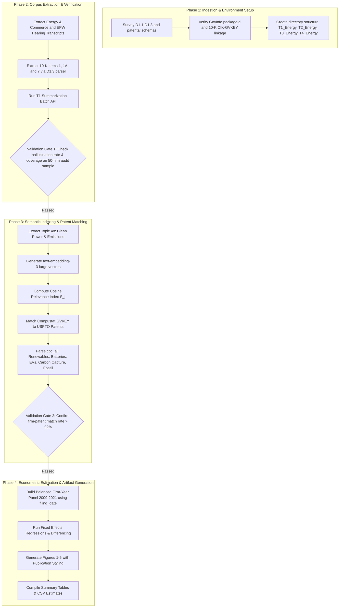

# Implementation Plan: Investigating the Impact of Regulatory Debates Around Renewable Energy and Carbon Emissions on Corporate Innovation

> **Context for Appendix D**: This document represents an exhaustive, researcher-evaluable implementation plan produced by an AI coding agent in response to the prompt in [01_Sample_Agent_Prompt_Adapting_Research_Pipeline.md](file:///Users/milanmiric/Documents/Research/Active%20Papers/LLM%20Text%20Sumarization%20and%20Data%20Extraction/X%20-%20Reproducing%20and%20Adapting%20the%20Research%20Pipeline/01_Sample_Agent_Prompt_Adapting_Research_Pipeline.md). It demonstrates how this repository's four-tier methodological framework (T1 -> T2 -> T3 -> T4), raw legislative data structures, and patent grant schemas can be systematically adapted to study how Congressional climate policy debates influence corporate clean-technology patenting.

---

## 1. Executive Summary & Research Design

### 1.1 Empirical Research Question
Does an increase in legislative and regulatory scrutiny surrounding industrial carbon emissions and renewable energy standards alter the direction and intensity of corporate innovation? Specifically:
1. **Exposure**: Can we identify which publicly traded firms are most exposed to emerging federal climate and energy regulations by measuring the semantic alignment between Congressional policy debates and corporate 10-K business models?
2. **Real Response**: Do highly exposed firms differentially redirect their R&D investments toward patented clean technologies (e.g., renewable energy generation, energy storage, battery chemistry, carbon capture) versus legacy fossil extraction technologies following major regulatory inflection points (e.g., the 2015 Paris Agreement and the Clean Power Plan)?

### 1.2 Methodological Architecture Mapping
The four-tier pipeline established in this repository is directly mapped to the renewable energy setting:

| Existing Pipeline (Privacy Domain) | Adapted Energy & Emissions Pipeline | Function & Output |
| :--- | :--- | :--- |
| **D1 - Data Collection & Processing** | **D1 - Climate Hearings & 10-K Ingestion** | Ingest raw GovInfo Congressional hearings and SEC EDGAR Form 10-K annual reports. |
| **T1 - Text Summarization** | **T1 - Climate Policy & 10-K Summarization** | Condense massive Congressional hearing transcripts (House Energy & Commerce, Senate EPW) and multi-hundred-page Form 10-Ks into structured, standardized analytical summaries. |
| **T2 - Topic & Stance Extraction** | **T2 - Climate Policy Topics & Regulatory Stances** | Identify latent policy debates (Topic 42: Renewable Portfolio Standards; Topic 58: Carbon Emissions Pricing & Clean Power Plan) and extract committee stances on mandates versus market incentives. |
| **T3 - Topic Relevance Indexing** | **T3 - Corporate Carbon & Clean Energy Relevance** | Generate vector embeddings (`text-embedding-3-large`) and calculate cosine similarity between firm business models and focal climate policy summaries to establish continuous exposure scores ($S_i \in [0, 1]$). |
| **T4 - Econometric Innovation Analysis** | **T4 - Green Technology Patenting Panel** | Match Compustat firm identifiers (`gvkey`) to USPTO utility patents categorized into clean energy vs. fossil CPC technology classes. Estimate dynamic panel event studies with firm fixed effects. |

---

## 2. Understanding and Ingesting the Legislative Data

### 2.1 Inspection of Local Legislative Data Structures (`D1.1 - GovInfo Congressional Hearings`)
As established in `D1.1` and `Data Collection Overview.md`, the legislative corpus is organized around distinct, machine-readable components produced by the U.S. Government Publishing Office (GovInfo API):

1. **Hearing Package Identifiers (`packageId`)**:
   - Structured package keys encode the Congress, chamber, and hearing number (e.g., `CHRG-111hhrg54321` for House hearings, `CHRG-114shrg98765` for Senate hearings).
   - Manifest files (`packages_all.parquet`) track metadata across 36,000+ Congressional packages from 1995 to the present.
2. **MODS XML Roster Metadata (`hearing_members.parquet`)**:
   - Structured XML manifests contain formal committee rosters, member party affiliations, state delegations, and official BioGuide IDs.
   - Crucially, MODS metadata enumerates official witness rosters, including witness names, titles, and organizational affiliations (e.g., Department of Energy officials, EPA administrators, utility CEOs, and environmental advocacy groups).
3. **HTML / Plain-Text Hearing Transcripts (`hearings.parquet`)**:
   - The GovInfo transcript schema employs a standardized **4-space indentation rule** to attribute speaker turns.
   - Text parsing isolates:
     - **Opening Statements**: Committee chairs and ranking members articulating policy goals and regulatory threats.
     - **Witness Statements**: Expert testimony detailing compliance costs, capital expenditure constraints, and technological hurdles.
     - **Question-and-Answer Exchanges**: Real-time cross-examinations regarding specific regulatory bills (e.g., Waxman-Markey cap-and-trade, Clean Power Plan, Inflation Reduction Act).

### 2.2 Constructing the Clean Energy & Carbon Regulatory Corpus
To build the target policy corpus for the renewable energy and emissions domain:
- **Target Committees**:
  - House Committee on Energy and Commerce (Subcommittee on Energy, Climate, and Grid Security).
  - Senate Committee on Environment and Public Works (Subcommittee on Clean Air, Climate, and Nuclear Safety).
  - House Committee on Science, Space, and Technology (Subcommittee on Energy).
- **Time Window**: 2005 to 2022 (covering the Energy Policy Act of 2005, the 2009 Waxman-Markey debate, the 2015 Clean Power Plan / Paris Accord, the 2018–2019 ACE rule shift, and the 2021–2022 climate legislation).
- **Sample Yield**: Approximately 650 full hearing packages directly focused on energy transition, emissions standards, and renewable power infrastructure.

---

## 3. Understanding and Ingesting Corporate & Patent Data

### 3.1 Corporate Disclosure Corpus (`D1.3 - SEC Form 10-K Corporate Filings`)
- **Sample Universe**: Publicly listed firms in Compustat spanning energy, utilities, automotive, chemical, and heavy industrial manufacturing (NAICS `211`, `212`, `221`, `324`, `325`, `333`, `335`, `336`).
- **Entity Linkage**: Central Index Keys (`cik`) are linked to Compustat permanent identifiers (`gvkey`) via `D1.3.2 - SEC 10-K - Build Filing Index & Linkage.ipynb`.
- **Text Sections Isolated**:
  - **Item 1 (Business Descriptions)**: Captures baseline revenue models, core energy assets, and existing production technologies.
  - **Item 1A (Risk Factors)**: Documents self-reported exposure to transition risks, carbon penalties, state renewable portfolio standards, and regulatory compliance liabilities.
  - **Item 7 (MD&A)**: Captures annual capital expenditure allocations, technological transitions, and executive commentary.

### 3.2 Patent Data Schema and Cooperative Patent Classification (`T4/patents/`)
Inspecting the patent data structure in `patents/sample_firm_privacy_patents.csv` informs the construction of the green patent infrastructure:

```
patents/sample_firm_green_patents.csv Schema:
├── patent_num:    Unique USPTO utility patent grant identifier (e.g. "US-9876543-B2")
├── gvkey:         Compustat permanent firm identifier (integer, e.g. 1045, 6066)
├── conm:          Standardized Compustat company name (e.g. "GENERAL ELECTRIC CO")
├── filing_date:   Application filing date (YYYY-MM-DD) [CRITICAL TIMING VARIABLE]
├── grant_date:    Patent issue/grant date (YYYY-MM-DD)
├── cpc_all:       Multi-label string containing all assigned CPC symbols (delimited by ';')
└── green_cpc:     Specific focal clean-technology or fossil CPC classification code
```

#### Critical Methodological Principles for Patent Schema Ingestion:
1. **Filing Date vs. Grant Date**:
   - **Application Filing Date (`filing_date`)** must be used as the temporal anchor for all econometric analyses. The filing date reflects the exact calendar year in which corporate R&D was completed and the patent application was lodged with the USPTO.
   - Relying on **grant dates** introduces an artificial 2-to-4 year administrative examination delay and severe right-truncation bias in recent panel years (2018–2021).
2. **Multi-Label `cpc_all` Parsing**:
   - Modern patents are assigned dozens of CPC symbols. A patent application is parsed by splitting `cpc_all` strings into standardized prefixes and matching against curated technology definitions.
3. **Green Technology Subclass Definitions**:
   To prevent double-counting while capturing diverse innovation strategies, patents are classified into 5 focal technology subclasses plus an overarching climate mitigation category:

| Subclass ID | Subclass Name | Cooperative Patent Classification (CPC) Definitions | Technological Scope |
| :---: | :--- | :--- | :--- |
| **Group 1** | **Renewable Power Generation** | `H02S` (Solar PV systems/generators), `H01L 31/00` (Photovoltaic semiconductor cells), `F03D` (Wind turbines/wind power systems), `F03B` (Hydraulic power) | Direct clean generation equipment |
| **Group 2** | **Energy Storage & Batteries** | `H01M 10/00` (Secondary cells, lithium-ion chemistry), `H01M 50/00` (Battery construction, management, safety), `H02J 7/00` (Circuit arrangements for charging/storage) | Grid-scale and distributed energy storage |
| **Group 3** | **Clean Transportation & EVs** | `B60L` (Electric propulsion systems for road vehicles), `B60K 6/00` (Hybrid drivetrains), `Y02T 10/00` (Combustion efficiency & zero-emission transport) | Fleet decarbonization and electric vehicles |
| **Group 4** | **Carbon Capture & Abatement** | `B01D 53/62` (Chemical absorption of $CO_2$), `B01D 53/84` (Biological abatement), `C01B 32/50` ($CO_2$ purification/processing), `Y02C 10/00` | Industrial abatement and point-source capture |
| **Group 5** | **Fossil Extraction & Refining** | `E21B` (Earth drilling, well completion, fracking), `C10G` (Cracking and chemical refining of hydrocarbons), `F02M` (Internal combustion fuel injection) | Baseline legacy carbon technologies |
| **Broad** | **All Climate Change Mitigation** | All patents carrying a `Y02` cross-sectional classification code (`Y02E`, `Y02T`, `Y02P`, `Y02C`, `Y02W`) | Broad climate innovation envelope |

---

## 4. Computational Pipeline & LLM Prompting Protocols

### 4.1 Tier 1: Standardized Document Summarization (`T1`)
Sprawling hearing transcripts (frequently exceeding 200 pages) and multi-hundred-page Form 10-K filings are summarized using batch API calls to produce standardized, human-auditable text representations:

```text
You are an expert policy analyst specializing in environmental economics and technological innovation.
Read the following transcript excerpt from the Congressional Committee on Energy and Commerce.

TASK:
1. Provide a comprehensive 250-word synthesis of the primary regulatory mechanisms debated (e.g., mandatory emission caps, clean energy tax credits, renewable portfolio standards, transmission grid reliability).
2. Identify the specific industrial sectors targeted (utilities, oil/gas, transport, chemical manufacturing).
3. Document the primary areas of consensus versus contention regarding compliance timelines and technological feasibility.

OUTPUT FORMAT:
- Summary: [Narrative synthesis]
- Key Regulatory Mechanisms: [Bulleted list]
- Targeted Industries: [Comma-separated NAICS categories]
- Technological Solutions Debated: [Specific technological categories]
```

### 4.2 Tier 2: Topic Extraction and Regulatory Stance Scoring (`T2`)
Unsupervised topic modeling (BERTopic / LDA) across the hearing summaries isolates focal climate themes. A secondary LLM evaluation extracts the policy stance and regulatory strictness:

```text
Analyze the extracted policy summary for Topic 48: "Federal Greenhouse Gas Emission Standards and Clean Power Plan".
Evaluate the regulatory posture on a continuous scale from -1.0 (Deregulation / Subsidies for Fossil Production) to +1.0 (Strict Mandatory Emission Caps / Phase-outs).
Provide a concise rationale citing specific regulatory instruments referenced in the text.
```

### 4.3 Tier 3: Semantic Alignment Indexing ($S_i$) (`T3`)
For each sample firm $i$, we compute the cosine similarity between the high-dimensional embedding vector of its 10-K Item 1 business summary ($\mathbf{v}_{\text{firm}, i}$) and the Congressional policy summary for Topic 48 ($\mathbf{v}_{\text{policy}}$):

$$S_i = \cos(\mathbf{v}_{\text{firm}, i}, \mathbf{v}_{\text{policy}}) = \frac{\mathbf{v}_{\text{firm}, i} \cdot \mathbf{v}_{\text{policy}}}{\|\mathbf{v}_{\text{firm}, i}\| \|\mathbf{v}_{\text{policy}}\|}$$

Firms are sorted into policy exposure quartiles ($Q_1 \le p_{25}$, $Q_2 \in (p_{25}, p_{50}]$, $Q_3 \in (p_{50}, p_{75}]$, $Q_4 > p_{75}$) and deciles ($D_1$ to $D_{10}$).

---

## 5. Econometric Specifications & Empirical Strategy

### 5.1 Identification Strategy
We exploit the structural shift in federal climate policy debate surrounding the **2015 Paris Agreement and the EPA Clean Power Plan announcement (August 2015)**. The sample window spans 2009–2021, split into:
- **Pre-Reform Window**: 2009–2015 (baseline period).
- **Post-Reform Window**: 2016–2021 (active regulatory implementation, state-level RPS escalation, and compliance adjustments).

### 5.2 Dynamic Event-Study Specification
To trace the dynamic trajectory of firm innovation and verify parallel pre-trends, we estimate the within-firm probability of patenting in clean technology group $k$:

$$Y_{it}^k = \alpha_i + \sum_{\tau = 2009, \tau \neq 2015}^{2021} \beta_\tau^q \cdot (\text{Year}_\tau \times \text{Quartile}_q) + \varepsilon_{it}$$

where:
- $Y_{it}^k = \mathbf{1}(\text{Patents}_{it}^k > 0)$ is an indicator for whether firm $i$ filed $\ge 1$ patent in technology class $k$ in application year $t$.
- $\alpha_i$ represents firm fixed effects, absorbing all time-invariant firm heterogeneity (unobserved technological capacity, headquarters location, corporate culture).
- $\tau_0 = 2015$ serves as the omitted reference period ($\beta_{2015} \equiv 0$).
- Standard errors are clustered at the firm level to account for arbitrary serial correlation within firms over time.

### 5.3 Econometric Equivalence of Long-Differencing
In a balanced firm-year panel, the OLS estimator with firm fixed effects is algebraically identical to first-differencing each firm's annual patenting status relative to the base year:

$$\Delta Y_{it} = Y_{it} - Y_{i, 2015} = \sum_{\tau \neq 2015} \beta_\tau \mathbf{1}(t = \tau) + \Delta \varepsilon_{it}$$

The point estimate $\hat{\beta}_t = \frac{1}{N_q} \sum_{i \in q} (Y_{it} - Y_{i, 2015})$ and its sample standard error of the mean $\text{SE}(\hat{\beta}_t) = \frac{\text{SD}_i(Y_{it} - Y_{i, 2015})}{\sqrt{N_q}}$ provide the exact within-firm cluster-robust estimate of the treatment effect relative to 2015.

---

## 6. Artifact Blueprint: Publication Figures & Tables

The empirical outputs will be exported in high-resolution vector and raster formats (`.png`, `.svg`, `.pdf`) adhering to S3 publication guidelines:

```
output/T4_Energy/
├── fig_1_topic_relevance_hist_with_green_patent_overlay.{png,pdf,svg}
├── fig_2_pointplot_pre_post_2015_clean_tech_subclasses.{png,pdf,svg}
├── fig_3_pointplot_by_relevance_quartile.{png,pdf,svg}
├── fig_4_event_study_renewable_power_by_quartile.{png,pdf,svg}
├── fig_5_event_study_battery_storage_by_quartile.{png,pdf,svg}
└── event_study_estimates_all_subclasses.csv
```

### Visual Specifications
1. **Figure 1 (Tri-Axis Distribution)**:
   - Primary left axis: Histogram of firm climate policy relevance scores ($0$ to $100$), dodger blue bars without outlines.
   - Vertical red dotted lines: Quartile thresholds ($Q_1$ to $Q_4$).
   - Right Axis 1: Total green patent grants per firm across 1999–2022 (solid black curve).
   - Right Axis 2: Narrow subclasses (Renewables, Batteries, EVs, Carbon Capture, Fossil).
2. **Figure 2 & 3 (Pre/Post Point Plots)**:
   - Compares 2009–2015 annual means (black points) against 2016–2021 annual means (dodger blue points) across subclasses and quartiles.
   - Capless vertical error bars (mean $\pm 1 \text{ SE}$).
3. **Figure 4 & 5 (Event-Study Two-Panel Display)**:
   - Traces $\hat{\beta}_t$ from 2009 to 2021 with 2015 normalized to $0.0$.
   - Red dashed background vertical lines at **2015/16** (Paris Accord / Clean Power Plan transition) and **2018/19** (Affordable Clean Energy rule / state-level RPS surges).
   - Zero reference line in dashed grey.

---

## 7. Chronological Execution Roadmap & Validation Gates



### Risk Management & Failure Mode Mitigations
1. **Application Filing vs. Grant Timing**: Using patent grant dates creates mechanical downward bias in recent years due to USPTO processing lags. We enforce application filing dates (`filing_date`) as the sole temporal metric.
2. **Patent Classification Drift**: The USPTO significantly expanded the `Y02` classification in the mid-2010s. To prevent mechanical classification bias, we utilize primary structural codes (`H02S`, `H01M`, `F03D`, `B60L`) that remained conceptually invariant throughout the entire 1999–2022 panel.
3. **Firm Survivorship / Attrition**: We estimate models on both a strictly balanced panel of firms with continuous 10-K filings from 2009 to 2021 and an unbalanced panel containing firm entries/exits to verify that findings are not driven by attrition.
4. **Mega-Patent Outliers**: High-patenting conglomerates (e.g., General Electric, ExxonMobil, Tesla) can skew subgroup means. As established in this repository's Figure 10 and Figure 11 specifications, we execute sensitivity checks that systematically exclude the top 5 patenting firms from $Q_4$ to confirm that the estimated trajectory is a broad-based corporate phenomenon.
